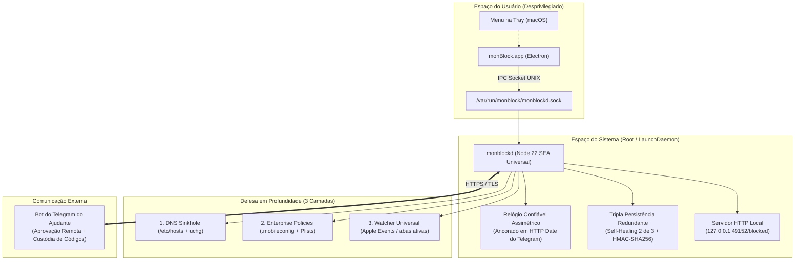

<div align="center">

# 🛡️ monBlock

**Bloqueador Web de Alta Resiliência, Defesa em Profundidade e Prestação de Contas para macOS**

[](https://github.com/mat-dgruber/monBlock/actions/workflows/ci.yml)
[-000000.svg?logo=apple&logoColor=white>)](#requisitos-do-sistema)
[-blue.svg>)](#requisitos-do-sistema)
[](package.json)
[](scripts/build-daemon-sea.sh)
[](src/main/main.ts)
[](docs/design/tokens.css)

<p align="center">
  Projetado para interromper impulsos compulsivos e dependência digital (pornografia, apostas, redes sociais).<br>
  <b>Catraca Unidirecional</b> · <b>Defesa em 3 Camadas</b> · <b>Guardião Remoto via Telegram</b> · <b>Daemon Root Resiliente</b>
</p>

</div>

---

## 📑 Sumário

- [Visão Geral & Filosofia](#-visão-geral--filosofia)
- [Arquivos de Build & Downloads](#-arquivos-de-build--downloads)
- [Guia de Instalação Passo a Passo](#-guia-de-instalação-passo-a-passo)
- [Arquitetura Split Privilegiada](#-arquitetura-split-privilegiada)
- [Defesa em Profundidade (3 Camadas)](#-defesa-em-profundidade-3-camadas)
- [Catraca Unidirecional & Ajudante (Telegram)](#-catraca-unidirecional--ajudante-telegram)
- [Catálogo de 11 Categorias](#-catálogo-de-11-categorias)
- [Design System & Interface](#-design-system--interface)
- [Guia do Desenvolvedor (Compilação & Testes)](#-guia-do-desenvolvedor-compilação--testes)
- [Desinstalação Autorizada](#-desinstalação-autorizada)
- [Resolução de Problemas (FAQ)](#-resolução-de-problemas-faq)
- [Governança & ADRs](#-governança--adrs)

---

## 🎯 Visão Geral & Filosofia

A maioria dos bloqueadores de conteúdo falha exatamente no momento em que você mais precisa deles: em instantes de impulso, o próprio usuário desmarca extensões no navegador, desinstala o aplicativo ou ajusta o relógio do sistema para contornar o limite de tempo.

O **monBlock** foi construído sob uma premissa diferente:

1. **Ativação Instantânea, Desativação Deliberada (Catraca Append-Only):** Qualquer nova restrição ou categoria bloqueada entra em vigor imediatamente sem fricção. No entanto, enfraquecer ou desativar regras exige autorização externa.
2. **Custódia Exclusiva do Ajudante:** Códigos de desbloqueio de emergência e tokens definitivos ficam sob controle exclusivo de um parceiro de confiança cadastrado via Telegram.
3. **Resistência a Adulteração Local:** A imposição técnica não depende do aplicativo visual; ela roda em um **daemon privilegiado de nível root** (`monblockd`), ancorado no `launchd` do macOS, imune a encerramentos forçados (`Cmd+Q` ou `kill`), manipulações do relógio do sistema ou deleção de pastas de configuração de usuário.

---

## 📦 Arquivos de Build & Downloads

Os pacotes oficiais de distribuição são compilados e assinados automaticamente no fluxo de integração contínua (CI) e estão disponíveis para download na aba [**Releases**](https://github.com/mat-dgruber/monBlock/releases) ou como artefatos recentes na aba [**Actions**](https://github.com/mat-dgruber/monBlock/actions).

| Artefato de Build               | Arquivo                                         | Descrição                                                                                                                                                                     | Instalação                                                    |
| :------------------------------ | :---------------------------------------------- | :---------------------------------------------------------------------------------------------------------------------------------------------------------------------------- | :------------------------------------------------------------ |
| **Aplicativo Desktop (UI)**     | `monBlock-app.zip`<br>_(contém `monBlock.app`)_ | Interface visual do usuário, assistente de onboarding, dashboard de categorias, menu na bandeja (tray) do macOS e ferramenta de reparo/reinstalação.                          | Descompactar e mover para `/Applications`                     |
| **Instalador do Daemon (Root)** | `monblockd.pkg`                                 | Pacote `.pkg` com o daemon privilegiado `monblockd` (binário nativo universal), configuração do LaunchDaemon, perfil corporativo para navegadores e página de bloqueio local. | Executar instalador do macOS com privilégios de Administrador |

> [!NOTE]
> O pacote `monBlock.app` já traz embutido o instalador `monblockd.pkg` em seus recursos internos. No entanto, para a primeira configuração, o instalador `.pkg` instala e inicializa o serviço de sistema de forma assistida.

### Requisitos do Sistema

- **Sistema Operacional:** macOS 13.0 (Ventura), macOS 14.0 (Sonoma) ou macOS 15.0 (Sequoia).
- **Processador:** Binário Universal nativo para **Apple Silicon** (`arm64` - M1/M2/M3/M4) e **Intel** (`x86_64`).
- **Navegadores Suportados:** Safari, Google Chrome (incluindo Beta e Canary), Brave, Arc, Dia, Microsoft Edge, Vivaldi, Opera, Chromium e Mozilla Firefox. O perfil de políticas cobre os navegadores Chromium (Chrome, Brave, Edge, Vivaldi, Opera, Chromium, Chrome Beta/Canary) e o Firefox; o vigia de abas (palavras-chave e redirecionamento) cobre os que têm AppleScript (Safari, Chromium e derivados, Arc, Dia), com leitura limitada no Firefox.

---

## 🚀 Guia de Instalação Passo a Passo

Para garantir que a proteção seja completa e ininterrupta, siga os 5 passos abaixo:

### Passo 1: Instalar o Serviço de Sistema (`monblockd.pkg`)

1. Baixe o instalador `monblockd.pkg` da [Release](https://github.com/mat-dgruber/monBlock/releases).
2. Dê um duplo-clique no arquivo `.pkg` e siga as instruções do instalador do macOS.
3. Insira sua senha de Administrador quando solicitado. Isso registrará o serviço em `/Library/LaunchDaemons/com.ccat.monblockd.plist`.

### Passo 2: Aprovar o Perfil de Navegadores no macOS

Ao final da instalação do `.pkg`, o instalador descarrega o perfil de gerenciamento de políticas corporativas (`monblock-browsers.mobileconfig`).

1. O instalador abrirá automaticamente os **Ajustes do Sistema** na seção **Geral > Gerenciamento de Dispositivos**.
2. Clique no perfil baixado **monBlock Browser Policies** e clique em **Instalar...** / **Aprovar**.
3. Confirme com sua senha de administrador.
   _(Isso tranca os navegadores Chromium contra modo anônimo e DNS-over-HTTPS burlável)._

### Passo 3: Instalar o Aplicativo Desktop (`monBlock.app`)

1. Baixe e extraia o arquivo `monBlock-app.zip`.
2. Arraste `monBlock.app` para a sua pasta `/Applications`.
3. Abra o **monBlock**.

### Passo 4: Conceder Permissão de Automação (Apple Events)

Na primeira execução, o macOS exibirá uma caixa de diálogo solicitando permissão para o monBlock controlar seus navegadores.

- Clique em **Permitir** (ou acesse _Ajustes do Sistema > Privacidade e Segurança > Automação_ e garanta que o monBlock tenha permissão para Safari, Chrome, Brave, etc.).
- Essa permissão permite ao Watcher ler os títulos das abas ativas e redirecionar imediatamente palavras-chave indesejadas.

### Passo 5: Assistente de Pareamento com o Ajudante

No primeiro início, o assistente (Wizard) guiará o pareamento:

1. Conecte-se com seu parceiro de prestação de contas através do bot do Telegram.
2. Seu ajudante receberá a custódia exclusiva dos códigos de emergência.
3. Uma vez concluído, o sistema entra em modo de proteção permanente.

---

## 🏛️ Arquitetura Split Privilegiada

O monBlock adota a arquitetura **Split Privilegiada (ADR-0001 & ADR-0007)**: o aplicativo visual não possui privilégios de superusuário e atua exclusivamente como cliente de apresentação. Toda a lógica crítica de segurança, integridade de regras e bloqueio reside no daemon root.



### Componentes Chave da Arquitetura

- **IPC Seguro:** Comunicação local via UNIX Domain Socket (`/var/run/monblock/monblockd.sock`) com permissões estritas `root:monblock 0750` e protocolo NDJSON até 64 KiB estruturado conforme _RFC 9457 Problem Details_.
- **Relógio Confiável Assimétrico (RN-DAEMON-08):** O daemon rejeita retrocessos ou avanços artificiais do relógio do sistema macOS. A hora de referência é sincronizada com o cabeçalho criptográfico `Date` das requisições ao Telegram.
- **Tombstone de Pareamento (RN-DAEMON-07):** Impede que o usuário reinicie o app como "não pareado" simplesmente apagando os arquivos de banco em sua pasta pessoal.
- **Fail-Closed:** Se o daemon for encerrado ou corrompido, as regras de `/etc/hosts` e as políticas de navegadores continuam ativas no sistema operacional.

---

## 🛡️ Defesa em Profundidade (3 Camadas)

Para garantir que nenhum site nocivo seja acessado via navegadores alternativos, conexões HTTPS ou abas anônimas, o monBlock aplica três camadas independentes de contenção:

```
┌─────────────────────────────────────────────────────────────────┐
│ Camada 1: DNS Sinkhole Local (/etc/hosts)                      │
│ ➜ Resolve domínios para 127.0.0.1:49152                         │
│ ➜ Permissão 0644 (legível pelo mDNSResponder) + trava uchg      │
└────────────────┬────────────────────────────────────────────────┘
                 ▼
┌─────────────────────────────────────────────────────────────────┐
│ Camada 2: Políticas Corporativas de Navegadores                 │
│ ➜ URLBlocklist / URLAllowlist forçadas no Chromium e Firefox   │
│ ➜ IncognitoModeAvailability: 1 (Janela Anônima desativada)     │
│ ➜ Bloqueio de DNS-over-HTTPS (DoH)                              │
└────────────────┬────────────────────────────────────────────────┘
                 ▼
┌─────────────────────────────────────────────────────────────────┐
│ Camada 3: Watcher Universal em Tempo Real                      │
│ ➜ Monitora título e URL da aba ativa a cada intervalo          │
│ ➜ Varredura de palavras-chave Unicode com proteção Scunthorpe   │
│ ➜ Redirecionamento instantâneo para a página de conscientização │
└─────────────────────────────────────────────────────────────────┘
```

### 1. Camada de Rede: DNS Sinkhole Local (`/etc/hosts`)

- Os domínios das categorias ativas são direcionados para `127.0.0.1`, onde o servidor embutido do daemon exibe a página educativa `docs/design/blocked-page.html`.
- O arquivo `/etc/hosts` é mantido com permissões `0644` e protegido pelo watchdog contra alterações externas.

### 2. Camada Corporativa: Perfis e Políticas de Navegador

- Instalação via perfil `.mobileconfig` gerenciado em `/Library/Managed Preferences/`.
- Configura `URLBlocklist` e `URLAllowlist` no Google Chrome, Brave, Microsoft Edge, Opera e Firefox.
- **Desativação Total de Janelas Privadas:** Garante que o usuário não escape da filtragem utilizando abas anônimas.

### 3. Camada Comportamental: Watcher Universal em Tempo Real

- Monitora a aba em foco via integração segura de Apple Events (AppleScript).
- **Prevenção Geral de Falsos Positivos (RN-WEB-07):** Algoritmo inteligente baseado no Scunthorpe problem. Utiliza regex com fronteiras de palavra Unicode `(?<![\p{L}\p{N}])termo(?![\p{L}\p{N}])`, decodificação segura de URLs acentuadas e listas de exceção cotidianas (evitando bloqueios indevidos em buscas como _"seg a sex"_, _"titulares"_, etc.).

---

## 🤝 Catraca Unidirecional & Ajudante (Telegram)

O pilar de prestação de contas do monBlock transforma a autodisciplina individual em um compromisso assistido:

- **Modo Catraca (Append-Only):**
  - Adicionar novas palavras-chave ou categorias: **Permitido a qualquer momento**.
  - Remover bloqueios ou diminuir restrições: **Requer token do Ajudante ou Cooldown anti-impulso de 72 horas**.
- **Aprovação Delegada via Telegram:**
  - O aplicativo se comunica de forma autenticada com o bot do Telegram configurado.
  - Ao solicitar um desbloqueio temporário (ex: para estudo ou pesquisa), uma notificação com o motivo e recurso de **Raio-X com Blur** (`has_spoiler: true`) é enviada ao ajudante.
  - O ajudante pode autorizar remotamente com um clique ou emitir um token HMAC descartável.
- **Códigos de Emergência Criptográficos:**
  - Gerados com chave forte e armazenados sob hash `Argon2id`.
  - A lista física dos códigos de emergência é exibida **uma única vez** diretamente na tela do ajudante durante o pareamento.

---

## 📂 Catálogo de 11 Categorias

O monBlock inclui um catálogo estruturado em 11 categorias de navegação. As listas ficam em `src/domain/lists/*.txt` (a ordem é a prioridade; atribuição das fontes em [`NOTICE`](NOTICE)). Perfil dos navegadores: 900 primeiros do `adult`; `/etc/hosts`: até 25 mil domínios; vigia: lista completa.

|       ID        | Categoria                               |       Padrão        | Descrição & Alvo | Domínios | Palavras-chave |
| :-------------: | :-------------------------------------- | :-----------------: | :--- | ---: | ---: |
|     `adult`     | **Conteúdo Adulto & Pornografia**       | 🔒 **Sempre Ativa** | Trancada pela catraca na primeira inicialização. Impossível desmarcar sem autorização. | 6.397 | 258 |
|   `gambling`    | **Apostas & Cassinos (Bets)**           |      Opcional       | Plataformas de apostas esportivas, roletas, slots e cassinos online.                   | 408 | 113 |
|     `games`     | **Jogos Online**                        |      Opcional       | Portais de jogos casuais e streams recreativas contínuas.                              | 184 | 27 |
|     `proxy`     | **Proxies, VPNs & Bypass**              |      Opcional       | Serviços de web proxy e túneis projetados para contornar bloqueadores.                 | 116 | 26 |
|    `dating`     | **Sites de Relacionamento**             |      Opcional       | Aplicativos e páginas de encontros casuais.                                            | 82 | 27 |
|    `social`     | **Redes Sociais**                       |      Opcional       | Feeds infinitos e algoritmos de retenção compulsiva (Instagram, TikTok, X, etc.).      | 105 | 0 |
|     `video`     | **Streaming & Vídeos**                  |      Opcional       | Plataformas de streaming de consumo passivo prolongado.                                | 103 | 0 |
|    `forums`     | **Fóruns & Comunidades Mistas**         |      Opcional       | Fóruns anônimos e plataformas de agregação de conteúdo não moderado.                   | 60 | 0 |
|   `shopping`    | **Compras por Impulso**                 |      Opcional       | Marketplaces com gatilhos de compra por dopamina.                                      | 238 | 6 |
|     `news`      | **Notícias & Portais Sensacionalistas** |      Opcional       | Tabloides e sites focados em clickbait / doomscrolling.                                | 224 | 4 |
| `search_unsafe` | **Buscadores sem SafeSearch**           |      Opcional       | Motores de busca que desativam filtragem familiar por padrão.                          | 25 | 0 |
---

## 🎨 Design System & Interface

O monBlock implementa o **Design System Oficial CCAT**, com interface desktop e tela de bloqueio com rigor visual anti-distração:

- **Tokens e Cores:** Paleta sem ruído visual, contraste validado pelas diretrizes **WCAG 2.2 AAA** e escala APCA.
- **5 Temas:**
  1. `Capycro (Marfim)` — padrão, verde-azulado e terracota sobre marfim.
  2. `Capycro escuro` — a marca à noite: carvão quente, verde-azulado mineral, terracota e detalhes marrons (contraste AA/AAA).
  3. `Escuro` — slate de alta ergonomia noturna.
  4. `Claro` — visual limpo e diurno.
  5. `Alto Contraste` — máxima legibilidade (AAA). Zero roxo em todos.
- **Página de bloqueio:** logo da CCAT, respiração guiada automática (com pausa e `prefers-reduced-motion`), dados reais do bloqueio e pedido de liberação ao Ajudante (15 min, 1 hora ou permanente, via Telegram) que só confirma o que o servidor confirma. Segue o tema do sistema.
- **Micro-UX Calma:** Animações discretas, indicador de status na barra de menus (tray) e respeito estrito a `prefers-reduced-motion` e `prefers-reduced-transparency`.

---

## 🛠️ Guia do Desenvolvedor (Compilação & Testes)

Se você deseja contribuir ou compilar o monBlock diretamente do código-fonte:

### Pré-requisitos

- macOS 13+ com Xcode Command Line Tools (`xcode-select --install`)
- Node.js 22 LTS instalado (preferencialmente universal via instalador oficial do nodejs.org)
- npm 10+

### Instalação de Dependências

```bash
git clone https://github.com/mat-dgruber/monBlock.git
cd monBlock
npm ci
```

### Comandos de Desenvolvimento

```bash
# Executa checagem de tipos TypeScript
npm run typecheck

# Executa suíte de testes unitários e de integração (Vitest)
npm test

# Executa testes rápidos de domínio e enforcers
npm run test:unit

# Inicia a interface Electron em modo de desenvolvimento
npm run electron
```

### Compilação dos Binários e Pacotes de Produção

O projeto possui scripts determinísticos para empacotar todos os componentes:

```bash
# 1. Compila o daemon root como Single Executable Application (Node SEA Universal)
#    Gera: build/daemon/monblockd (fatias arm64 + x86_64)
npm run build:daemon

# 2. Compila e empacota o instalador de sistema do daemon (.pkg)
#    Gera: build/monblockd.pkg
npm run build:pkg

# 3. Compila o aplicativo Electron completo com o .pkg embutido em Resources
#    Gera: build/monBlock.app
npm run build:app
```

> [!TIP]
> **Assinatura de Código:** Para compilar com assinatura de desenvolvedor da Apple (Developer ID), defina as variáveis de ambiente antes de rodar os scripts:
>
> ```bash
> export MONBLOCK_CODESIGN_ID="Developer ID Application: Seu Nome (TEAMID)"
> export MONBLOCK_INSTALLER_ID="Developer ID Installer: Seu Nome (TEAMID)"
> ```
>
> Sem essas variáveis, os scripts aplicam automaticamente assinatura ad-hoc local (`-`).

---

## 🔓 Desinstalação Autorizada

Por design, o monBlock não pode ser desinstalado simplesmente arrastando o ícone para o Lixo. Isso é uma salvaguarda intencional para evitar desinstalações em momentos de fraqueza.

### Fluxo Recomendado (Via Aplicativo)

1. Abra o **monBlock** e acesse as **Configurações > Desinstalação**.
2. Solicite o token de desinstalação permanente ao seu **Ajudante no Telegram** (ou aguarde a expiração do Cooldown de 72 horas).
3. Insira o token recebido e confirme. O aplicativo emitirá o comando `UNINSTALL_AUTHORIZED` para o daemon root.
4. O daemon restaurará o `/etc/hosts`, removerá os perfis de navegadores e executará `/Library/PrivilegedHelperTools/com.ccat.monblockd/uninstall.sh`, limpando completamente todos os arquivos do sistema.

### Desinstalação Administrativa de Emergência (Manual via Terminal)

Se o usuário tiver acesso de administrador do macOS (`sudo`), o script de desinstalação pode ser invocado diretamente pelo Terminal:

```bash
sudo sh /Library/PrivilegedHelperTools/com.ccat.monblockd/uninstall.sh
```

---

## ❓ Resolução de Problemas (FAQ)

### 1. O site bloqueado continua abrindo no Chrome / Brave.

- Certifique-se de que o **Perfil de Navegadores** foi devidamente aprovado:
  Abra **Ajustes do Sistema > Geral > Gerenciamento de Dispositivos** e confirme se o perfil `monBlock Browser Policies` está listado como instalado.
- Se o navegador já estava aberto durante a instalação, feche-o completamente (`Cmd+Q`) e abra-o novamente para que ele recarregue as políticas gerenciadas.

### 2. Palavras-chave indesejadas não fecham a aba imediatamente.

- Verifique a permissão de **Automação (Apple Events)**:
  Acesse **Ajustes do Sistema > Privacidade e Segurança > Automação** e confirme se o `monBlock` tem permissão para emitir eventos para os navegadores em uso.

### 3. O aplicativo exibe "Proteção não verificada" ou o ícone da Tray mostra `?`.

- Isso indica que o app Electron não conseguiu se conectar ao socket do daemon root (`/var/run/monblock/monblockd.sock`).
- Abra o app e clique no botão **"Reinstalar serviço"** para reconfigurar o LaunchDaemon, ou execute no terminal:
  ```bash
  sudo launchctl kickstart -k system/com.ccat.monblockd
  ```

---

## 📜 Governança & ADRs

O desenvolvimento deste repositório é governado por Registros de Decisões de Arquitetura (**ADRs**) canônicos mantidos no diretório [`docs/adrs/`](docs/adrs/README.md):

- [ADR-0001](docs/adrs/0001-arquitetura-split-privilegiada-daemon-monblockd.md): Arquitetura Split Privilegiada (UI Electron Desprivilegiada e Daemon Root).
- [ADR-0002](docs/adrs/0002-bloqueio-web-em-3-camadas-hosts-policies-watcher.md): Defesa em Profundidade para Bloqueio Web em 3 Camadas.
- [ADR-0003](docs/adrs/0003-catraca-unidirecional-append-only-e-aprovacao-ajudante.md): Catraca Unidirecional Append-Only e Aprovação pelo Ajudante.
- [ADR-0004](docs/adrs/0004-pareamento-duravel-tripla-persistencia-e-recuperacao-3-niveis.md): Pareamento Durável em Tripla Persistência e Recuperação em 3 Níveis.
- [ADR-0005](docs/adrs/0005-pareamento-telegram-custodia-exclusiva-codigos-emergencia.md): Pareamento Delegado via Telegram com Custódia Exclusiva de Códigos.
- [ADR-0006](docs/adrs/0006-chave-por-instalacao-e-cofres-cifrados-aes-gcm.md): Chave Aleatória por Instalação e Cofres Cifrados com AES-256-GCM.
- [ADR-0007](docs/adrs/0007-daemon-root-pkg-ipc-relogio-confiavel.md): Daemon Root Distribuído por `.pkg` (Node SEA), IPC por Socket, Relógio Confiável e Tombstone.

---

<div align="center">
  <sub>Construído com foco inegociável em integridade, privacidade e resiliência técnica.</sub>
</div>
