# Topologia de Deployment e Runtime no macOS — Cisdem AppCrypt v7.11.0

> Gerado pelo agente **Architect** (`doc_level = detalhado`, 🟢 CONFIRMADO).

---

## 1. Diagrama de Implantação no Sistema de Arquivos e Subsistemas do macOS

```mermaid
flowchart TB
    subgraph DiskRoot["Volume do Sistema (/Applications)"]
        AppBundle["/Applications/Cisdem AppCrypt.app\n(Universal Binary: x86_64 + arm64)"]
        HelperBin[".../Frameworks/ASBaseService.framework/Versions/A/ASBaseServiceHelper"]
        AssetsCar[".../Contents/Resources/Assets.car\n(NSDataAsset: popularURLs)"]
    end

    subgraph UserHome["Diretório do Usuário (~/Library)"]
        LaunchAgent["~/Library/LaunchAgents/com.cisdem.appencrypt.plist\n(RunAtLoad=true, -runMode autoLaunched)"]
        UserPrefs["~/Library/Preferences/com.cisdem.appencrypt.plist\n(AC_BrowserAuthCache, ACUserLanguageKey)"]
        OfficialSupport["~/Library/Application Support/Cisdem AppCrypt/\n├── configure.ascfg (JSON)\n├── appcrypt.aclog (Intruder Photos)\n└── log/MM_dd_yyyy HH-mm-ss.log"]
        HiddenPrimary["~/Library/Application Support/com.apple.sdev/csdv.dsc\n(Configuração Primária NSKeyedArchiver)"]
        HiddenBackup["~/Library/Application Support/com.app.cadlvq/dgh.xvc\n(Configuração Espelho NSKeyedArchiver)"]
        KeychainDB["~/Library/Keychains/login.keychain-db\n(svce = 'com.cisdem.keychain')"]
    end

    subgraph MacOSDaemons["Daemons de Sessão do macOS"]
        Launchd["launchd (User Session)"]
        WindowServer["WindowServer (CoreGraphics)"]
        AppleEventsD["appleeventsd & tccd (TCC Automation)"]
        FSEventsD["fseventsd (File System Events)"]
        IOKitHID["IOKit (IOHIDSystem)"]
    end

    Launchd -->|Lê plist no login| LaunchAgent
    Launchd -->|Executa| AppBundle
    AppBundle -->|Carrega categorias| AssetsCar
    AppBundle <-->|Lê/Grava config| HiddenPrimary
    AppBundle <-->|Espelha/Restaura| HiddenBackup
    AppBundle -->|Grava logs e fotos| OfficialSupport
    AppBundle <-->|Hash MD5 da senha| KeychainDB
    AppBundle <-->|Preferências leves| UserPrefs
    AppBundle <-->|CGWindowListCopyWindowInfo| WindowServer
    AppBundle <-->|NSAppleScript / AEDeterminePermission| AppleEventsD
    AppBundle <-->|Watchdog anti-remoção| FSEventsD
    AppBundle <-->|Consulta HIDIdleTime| IOKitHID
```

---

## 2. Requisitos Operacionais de Execução

1. **Caminho Fixo Obrigatório:** O executável verifica no boot via `+[ACLoginItemSharedFileList installedApplicationsPath]` (`0x100047fe4`) se está rodando a partir de `/Applications/Cisdem AppCrypt.app`. Caso seja aberto de `~/Downloads` ou de um volume `.dmg`, exibe o alerta `AC_O_InstallError` e encerra imediatamente.
2. **Sessão Gráfica (GUI Security Session):** O app valida a existência de conexão com o `WindowServer` (se não houver sessão gráfica ativa, registra `"Waring: Window Server not running or No GUI security session."`).
3. **Argumentos de Linha de Comando Suportados:**
   - `-runMode autoLaunched`: Injetado pelo `com.cisdem.appencrypt.plist` no login para iniciar silenciosamente sem exibir a janela principal nem solicitar senha na largada.
