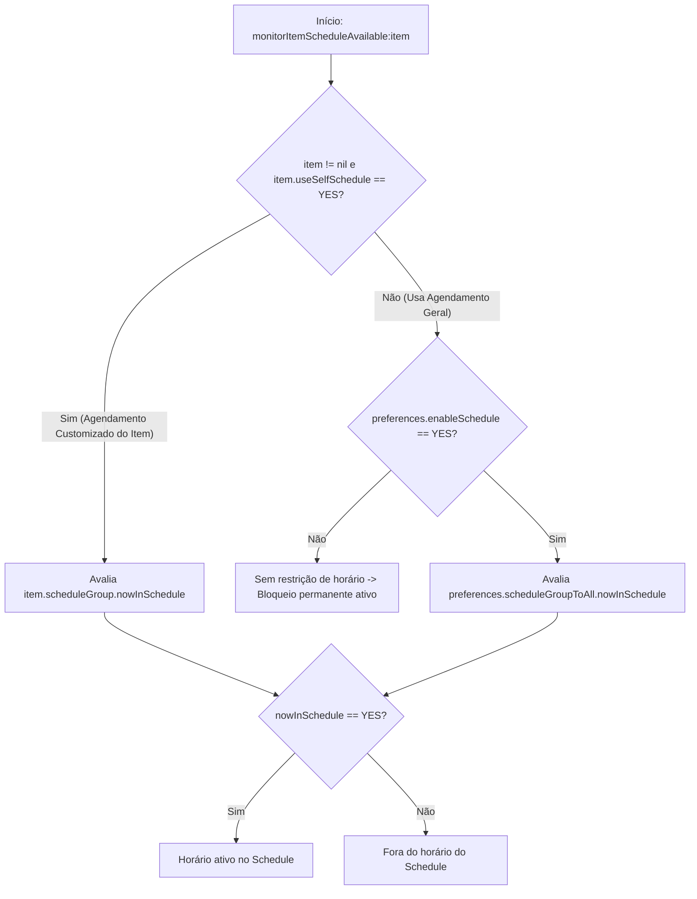

# Fluxogramas — Módulo `schedule-engine`

> Gerado pelo agente **Archaeologist** (`doc_level = detalhado`). Leitura estática, sem teste dinâmico (🟡).
>
> **Aviso de conflito:** este fluxo descreve o modelo `ACScheduleGroup`/`ACScheduleUnit` com `monitorItemScheduleAvailable:` atribuído a `0x100009730`; `schedule-engine/{requirements,design,tasks}.md` descrevem `ACSchedule`/`ACScheduleHelper` com `0x100009b70`. Os modelos e endereços não foram reconciliados (ver [`../gaps.md`](../gaps.md), [`../traceability/code-spec-matrix.md`](../traceability/code-spec-matrix.md), TT-SCH-03).

---

## 1. Resolução de Agendamento Global vs. Individual (`-[ACMonitorTask monitorItemScheduleAvailable:]` em `0x100009730`)



---

## 2. Avaliação de `-[ACScheduleGroup nowInSchedule]` (`0x10001241c`) e `-[ACScheduleUnit nowInSchedule]` (`0x10001bf10`)

```mermaid
flowchart TD
    A[-[ACScheduleGroup nowInSchedule]] --> B{countOfScheduleUnits == 0?}
    B -- Sim --> C[Retorna NO]
    B -- Não --> D[Itera sobre cada ACScheduleUnit em _scheduleUnits]
    D --> E[-[ACScheduleUnit nowInSchedule]]
    E --> F[Obtém dia da semana atual via NSCalendar]
    F --> G{Bit do dia atual está ativo em _repeatMask?}
    G -- Não --> H[Próxima ACScheduleUnit]
    G -- Sim --> I[Normaliza hora/minuto atual, _startTimer e _endTimer]
    I --> J{startTimer <= agora <= endTimer?}
    J -- Sim --> K[Retorna YES imediatamente]
    J -- Não --> H
    H -->|Fim da lista sem match| C
```
