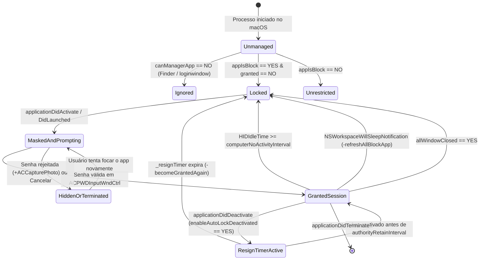
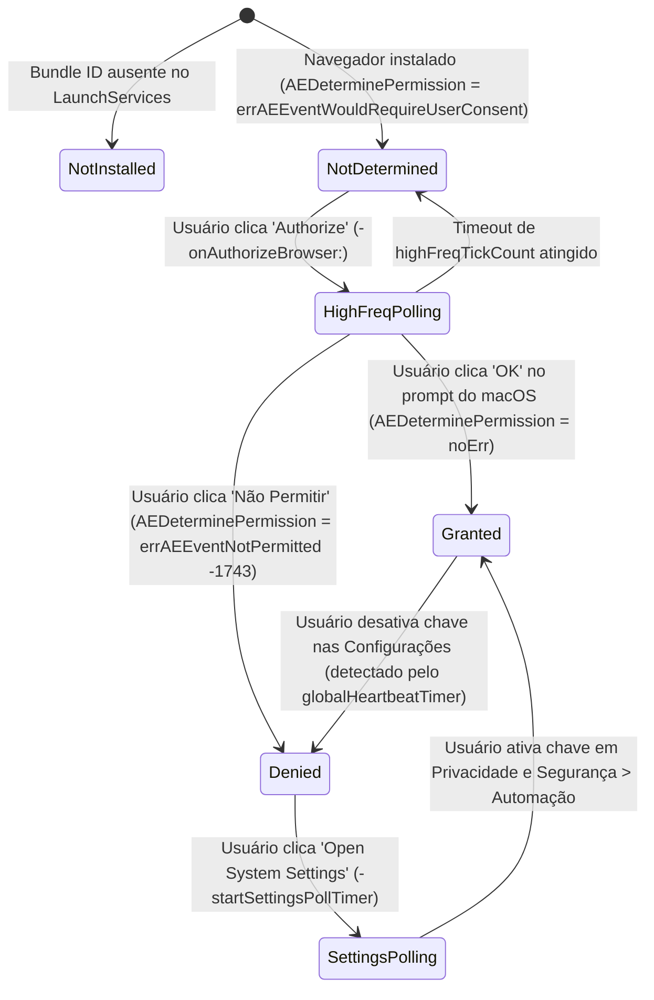
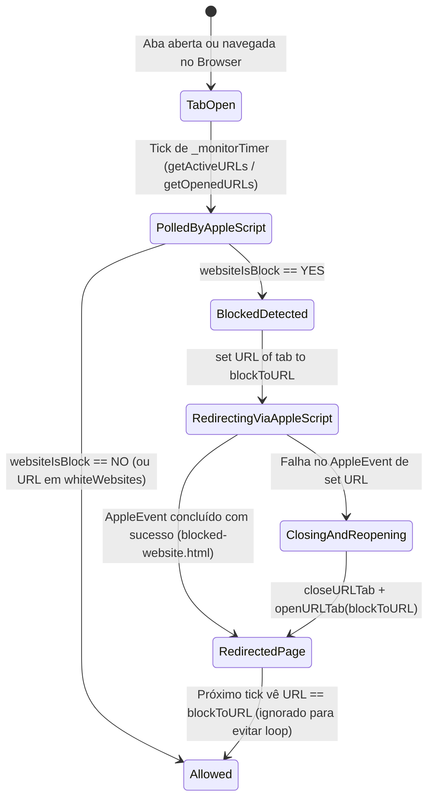

# Máquinas de Estado — Cisdem AppCrypt v7.11.0

> Extraídas pelo agente **Detective** (`doc_level = detalhado`, 🟢 CONFIRMADO).

---

## 1. Máquina de Estados de um Aplicativo Monitorado (`ACRunningApp`)

Controlada pelas propriedades `granted`, `_notRespondActiveNotification`, `_resignTimer`, `_hiddenTimer` e `_terminateTimer`.

---

## 2. Máquina de Estados de Permissão TCC Automation por Navegador (`ACBrowserAuthInfo.state`)

Gerenciada por `ACBrowserAuthManager` (`-queryAuthStatusForBundleID:`, `-requestAuthForBundleID:`, `-highFreqTick`) e refletida visualmente em `ACBrowserAuthPanel`.

---

## 3. Máquina de Estados de Uma Aba de Navegador Sob Web Block (`ACMonitorBrowser`)

