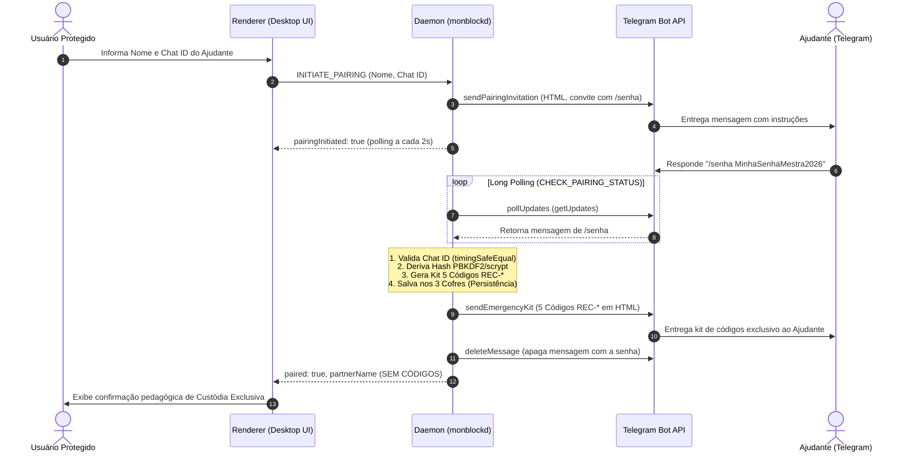

<!--
================================================================================
LOG DE MANUTENÇÃO DE DOCUMENTAÇÃO
--------------------------------------------------------------------------------
Data       | Autor          | Descrição
--------------------------------------------------------------------------------
2026-11-05 | adr-governor   | Criação da ADR 0005 detalhando o pareamento delegado via Telegram, senha mestra remota e custódia exclusiva de códigos de emergência.
================================================================================
-->

# ADR 0005: Pareamento Delegado via Telegram com Senha Remota e Custódia Exclusiva dos Códigos de Emergência

| Metadado | Detalhe |
| :--- | :--- |
| **Status** | **Aprovada** (2026-11-05) |
| **Decisores** | Arquitetura monBlock, SecOps, Produto, Tech Lead |
| **Tags** | `[security]`, `[telegram]`, `[ccat]`, `[zero-trust]`, `[recovery]`, `[anti-autossabotagem]` |
| **Impacto Sistêmico** | Alto (`monblockd`, `telegram-client`, `desktop-ui`, `preload-bridge`, `partner-guard`) |
| **ADRs Relacionadas** | Complementa ADR-0001, ADR-0003 e ADR-0004 |

## Contexto
No fluxo inicial do monBlock, a configuração do Ajudante de Responsabilidade (*Accountability Partner*) previa que a Senha Mestra fosse digitada em um campo de formulário local no próprio aplicativo desktop, e que os 5 Códigos de Recuperação de Emergência (`REC-XXXXXX-XXXXXX`) fossem exibidos em tela para download e cópia na máquina protegida.

Essa abordagem violava os princípios fundamentais do CCAT (*Compromisso Compartilhado Anti-Tentação*):
1. **Risco de Autossabotagem e Curiosidade**: Ao digitar a senha no computador compartilhado ou observar a digitação, o usuário pode memorizar ou registrar a credencial mestre.
2. **Vazamento do Kit de Emergência no Dispositivo Protegido**: Se os 5 códigos forem baixados em `.txt` ou copiados para a área de transferência no computador do usuário, ele passa a ter as 5 chaves de liberação instantânea ao seu alcance durante momentos de fissura ou impulso.
3. **Complexidade Presencial Desnecessária**: Exigia a presença física do Ajudante no computador no momento exato do pareamento inicial.

### Riscos Identificados e Problemas a Resolver:
1. **Captura da Senha no Ambiente Protegido**: Keyloggers locais, extensões de navegador maliciosas ou inspeção de memória poderiam expor a senha mestra se digitada no Electron.
2. **Acesso Não Autorizado ao Kit Offline**: Se o arquivo de recuperação residir na pasta `Downloads/` do usuário, anula-se o propósito da intervenção humana do Ajudante.
3. **Quebra de Parsing na API do Telegram**: O envio de caracteres especiais como `.`, `!`, `-`, `(` e `)` em mensagens `MarkdownV2` causava falhas silenciosas ou rejeições HTTP 400 da API do Telegram.

---

## 1. Fundamentação Jurídica & Fontes Normativas Diretas (Se aplicável)

| Diploma Legal / Normativo | Artigos / Dispositivos Principais | Aplicação Prática no Sistema |
| :--- | :--- | :--- |
| **Guia de Segurança Defensiva Zero-Trust** | `.agents/ai-guides/guides/architecture/guia-seguranca-defensiva-zero-trust.md` | Privilégio Mínimo, Isolamento de Fronteiras IPC, Zero Segredos em UI e Sanitização de Canais de Mensageria Externa. |
| **Modelo CCAT (Compromisso Compartilhado)** | Invariante `INV-RATCHET-01` e `INV-REPLAY-04` | Custódia exclusiva de fatores de autorização com o Ajudante, garantindo que o usuário jamais possua os meios unilaterais de desbloqueio. |

---

## 2. Decisão de Arquitetura

Adotar o **Pareamento Delegado via Telegram com Senha Remota e Custódia Exclusiva dos Códigos de Emergência**:

### Premissas e Mecanismos da Decisão:
1. **Eliminação do Input Local de Senha**: O formulário do passo de pareamento do onboarding coleta unicamente `Nome do Ajudante` e `Chat ID do Telegram`. Nenhum campo de senha é renderizado no cliente Electron.
2. **Definição Remota Segura**: O Ajudante define a senha diretamente no Telegram via comando `/senha <senha>`. A mensagem é processada pelo daemon e imediatamente apagada via `deleteMessage`.
3. **Custódia Exclusiva dos 5 Códigos de Emergência**:
   - Os 5 códigos plain-text (`REC-XXXXXX-XXXXXX`) são gerados no daemon em memória e enviados única e exclusivamente para o chat do Telegram do Ajudante.
   - O payload retornado ao Renderer pelo comando IPC `CHECK_PAIRING_STATUS` **nunca** contém os códigos nem a senha. A UI apenas informa ao usuário que o kit está em posse segura do Ajudante.
4. **Formatação Padronizada em HTML**: Toda comunicação com a API do Telegram utiliza `parse_mode: 'HTML'` com sanitização prévia via `escapeTelegramHtml`, evitando rejeições sintáticas da API causadas por caracteres especiais em `MarkdownV2`.
5. **Lock de Concorrência no Daemon**: O `CHECK_PAIRING_STATUS` implementa `isCheckingPairing: boolean` para evitar colisões de offset de updates durante chamadas assíncronas concorrentes.

---

### Matriz de Avaliação de Alternativas (Trade-off Matrix)

| Critério de Avaliação | Opção A: Senha e Códigos na UI Local | Opção B: Pareamento Delegado via Telegram (Eleita) | Opção C: Portal Web Externo |
| :--- | :--- | :--- | :--- |
| **Proteção Anti-Autossabotagem** | Baixa (Usuário vê senha e salva códigos) | **Máxima (Zero exposição ao usuário)** | Alta (Exige autenticação em nuvem) |
| **Complexidade Operacional** | Baixa (Sem chamadas externas) | **Média (Long-polling local sem portas abertas)** | Alta (Servidores em nuvem, domínios, custos) |
| **Segurança & Privacidade** | Média (Rastro no filesystem local) | **Alta (Higienização via deleteMessage)** | Média (Credenciais trafegam por infraestrutura de terceiros) |
| **Dependência de Infraestrutura** | Nenhuma | **Mínima (Apenas Telegram Bot API)** | Alta (Bancos em nuvem, backend externo) |

---

## 3. Matriz de Implementação Técnica (*IN-CODE*)

### 3.1 Camada de Daemon e Integração (`monblockd.ts` & `telegram-client.ts`)
- **`src/daemon/telegram-client.ts`**:
  - `sendPairingInvitation`: Monta convite formatado em HTML solicitando o comando `/senha`.
  - `sendEmergencyKit`: Formata e envia os 5 códigos em tags `<code>`, alertando sobre a custódia anti-autossabotagem.
  - `pollUpdates`: Consulta `getUpdates` com tratamento de erro e propagação segura.
  - `extractPasswordFromUpdate`: Valida o `chatId` com `crypto.timingSafeEqual` e isola a senha informada.
  - `deleteMessage`: Despacha exclusão da mensagem da senha para redução de superfície.
- **`src/daemon/monblockd.ts`**:
  - Manipulação dos comandos `INITIATE_PAIRING`, `CHECK_PAIRING_STATUS` e `CANCEL_PAIRING`.
  - Processamento atômico da resposta do Telegram: persistência do hash, salvamento nos 3 cofres, disparo do kit e descarte de estado volátil.

### 3.2 Camada de Interface e Preload (`index.html`, `renderer-init.js`, `preload.ts`)
- **`src/renderer/index.html`**:
  - Remoção completa de `onboardingPasswordInput`, `copyRecoveryCodesBtn` e `downloadRecoveryCodesBtn`.
  - Inclusão do card de espera animado com cancelamento e card educativo "Custódia Exclusiva".
- **`src/renderer/renderer-init.js`**:
  - Gerenciamento de ciclo de vida do polling (`pairingPollInterval`, cancelamento em `switchView` e `beforeunload`).

---

## 4. Matriz de Conformidade e Mitigação de Riscos

| Risco Mapeado | Severidade | Mecanismo de Mitigação Implementado |
| :--- | :---: | :--- |
| **Mensagem com senha residir no histórico do Telegram** | Média | Invocação imediata de `deleteMessage` na API do Telegram após derivação do hash criptográfico. |
| **Injeção de caracteres na API Telegram** | Alta | Sanitização por `escapeTelegramHtml` e adoção exclusiva de `parse_mode: 'HTML'`. |
| **Vazamento de códigos para o Renderer** | Crítica | A resposta IPC de `CHECK_PAIRING_STATUS` retorna apenas `{ status: 200, paired: true, partnerName }`. |
| **Concorrência de Polling de Updates** | Média | Flag booleana `isCheckingPairing` protegendo o offset de leitura durante requisições simultâneas. |

---

## 5. Consequências e Resultados

### Positivas:
- **Blindagem Psicológica Total**: O usuário do computador não tem como burlar o bloqueio por conhecer os códigos ou ter acesso à senha.
- **Onboarding Fluido e Moderno**: Pareamento assíncrono via mensageiro que o Ajudante já utiliza no dia a dia.
- **Zero Portas Abertas**: O app opera inteiramente via chamadas de saída HTTPS (`getUpdates`), sem necessidade de portas de webhook expostas na máquina local.

### Mitigações e Desafios Gerenciados:
- Se o Ajudante demorar mais de 15 minutos para responder com a senha, o convite expira por TTL e a UI orienta o reenvio.
