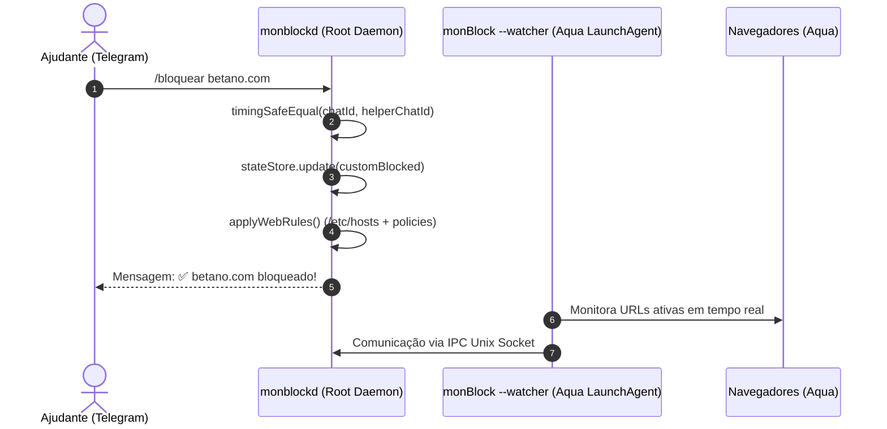

<!--
================================================================================
LOG DE MANUTENÇÃO DE DOCUMENTAÇÃO
--------------------------------------------------------------------------------
Data       | Autor          | Descrição
--------------------------------------------------------------------------------
2026-11-09 | Matheus Diniz  | Criação da ADR 0011 sobre LaunchAgent em sessão Aqua e comandos remotos do Telegram.
================================================================================
-->

# ADR 0011: Resiliência de Monitoramento em Sessão Aqua via LaunchAgent e Comandos Remotos no Telegram

| Metadado | Detalhe |
| :--- | :--- |
| **Status** | **Implementada** (2026-11-09) |
| **Decisores** | Matheus Diniz |
| **Tags** | `[macos]`, `[resiliencia]`, `[telegram]`, `[zero-trust]`, `[desktop]` |
| **Impacto Sistêmico** | Alto (Daemon, Watcher de Sessão de Usuário, App Desktop e Canal de Telegram) |
| **ADRs Relacionadas** | Extends ADR-0002 (3 camadas), ADR-0007 (daemon root) e ADR-0010 (broker do Telegram) |

## Contexto

O monBlock opera um modelo de bloqueio em profundidade (hosts, enterprise policies e watcher de navegadores). O daemon de sistema `monblockd` executa como root (`LaunchDaemon`), fora da sessão gráfica do usuário (`Aqua`/`WindowServer`).
No macOS, permissões de acessibilidade (TCC / `AXUIElement`) e pontes AppleScript de inspeção de abas são estritamente restritas à sessão de login do usuário logado. Caso o aplicativo principal Electron seja fechado pelo usuário, o watcher gráfico de abas deixava de ser executado, dependendo exclusivamente das regras estáticas de hosts e perfil.
Além disso, o fluxo de comunicação com o Ajudante no Telegram processava apenas botões interativos (`callback_query`), descartando mensagens de texto (`message.text`) enviadas proativamente pelo Ajudante para consultar status ou bloquear novos domínios à distância.

### Riscos Identificados e Problemas a Resolver:
1. **Desativação do Watcher de Janelas**: Se a janela do Electron for fechada, a camada de inspeção ativa de URLs em navegadores desprotegidos por policy deixava de operar.
2. **Impossibilidade Técnica do Daemon Root Acessar GUI**: Um `LaunchDaemon` root não pode inspecionar janelas de usuários devido aos limites de segurança de sessão do macOS e TCC.
3. **Falta de Ações Remotas pelo Ajudante**: O Ajudante não conseguia verificar remotamente o estado de proteção ou adicionar novos bloqueios sem ter um pedido pendente na tela.

---

## 1. Fundamentação Jurídica & Fontes Normativas Diretas

| Diploma Legal / Normativo | Artigos / Dispositivos Principais | Aplicação Prática no Sistema |
| :--- | :--- | :--- |
| **Marco Civil da Internet (Lei 12.965/2014)** | Art. 3º, VI (Finalidade e segurança das redes e dados) | Garantia de operação contínua e imune a encerramentos intencionais ou acidentais pelo usuário tutelado. |
| **LGPD (Lei 13.709/2018)** | Art. 46 (Medidas de segurança, técnicas e administrativas) | Isolamento de permissões: credenciais do bot mantidas em cofre isolado e autenticação em tempo constante para comandos remotos. |

---

## 2. Decisão de Arquitetura

1. **Separação de Papéis: Daemon Root vs LaunchAgent de Usuário**:
   - `monblockd` permanece como root `LaunchDaemon` para controle exclusivo de `/etc/hosts`, perfis gerenciados de sistema e broker do Telegram.
   - Provisionamento de um `LaunchAgent` de usuário (`com.ccat.monblock.watcher.plist`) executando com `KeepAlive: true` em espaço Aqua.
   - O binário Electron recebe suporte aos argumentos `--watcher` / `--hidden` para operar de forma invisível/desacoplada da janela principal.

2. **Comandos Remotos Proativos do Telegram com Autenticação Constant-Time**:
   - O broker do Telegram em `monblockd.ts` passa a processar mensagens de texto (`update.message.text`).
   - Todo comando é verificado contra o `chatId` do Ajudante pareado utilizando `crypto.timingSafeEqual`.
   - Suporte aos comandos:
     - `/status`: Retorna se a proteção está ativa, contagem de regras, categorias ativas e tempo restante de liberações temporárias.
     - `/bloquear <dominio ou palavra>`: Adiciona bloqueio customizado persistente e reaplica imediatamente as 3 camadas.
     - `/liberar <dominio> [15m|60m]`: Concede liberação temporária controlada de 15 a 60 minutos.
     - `/revogar <dominio>`: Cancela liberação temporária ativa antes do término do tempo.
     - `/ajuda`: Exibe o guia de comandos operacionais.

3. **Menu de Bandeja (Tray) com Contadores em Tempo Real**:
   - A barra de menu macOS atualiza a cada 10 segundos com o tempo restante real de desbloqueio temporário (`MM:SS`) e cooldown (`HH:MM:SS`).

### Matriz de Avaliação de Alternativas (Trade-off Matrix)

| Critério de Avaliação | Opção A: Root Daemon inspeciona GUI via AXUIElement | Opção B: LaunchAgent Aqua + CLI headless (Eleita) | Opção C: Exigir App Electron aberto 100% do tempo |
| :--- | :--- | :--- | :--- |
| **Viabilidade macOS TCC** | Nula (macOS bloqueia daemons sem sessão) | Total (executa dentro da sessão de usuário) | Limitada (usuário pode fechar janela a qualquer hora) |
| **Resiliência a Fechamento** | Baixa (falha de permissão) | Máxima (`KeepAlive: true` no launchd) | Baixa (vulnerável a Cmd+Q) |
| **Segurança e Menor Privilégio**| Viola separação de sessão | Respeita separação Aqua / Root | Confinado à janela |

---

## 3. Matriz de Implementação Técnica (*IN-CODE*)

- `packaging/macos/com.ccat.monblock.watcher.plist`: Manifesto do LaunchAgent de usuário com `KeepAlive: true` e flags `--watcher`.
- `src/main/main.ts`: Reconhecimento de flags `--watcher` e `--hidden`, evitando exibir janela e inicializando o watcher e tray em background.
- `src/daemon/monblockd.ts`: Implementação de `handleTelegramCommand` com autenticação `crypto.timingSafeEqual`.
- `src/daemon/telegram-client.ts`: Método `sendMessage` genérico com suporte a parse mode MarkdownV2/HTML e targets customizados.

---

## 4. Matriz de Ações de Governança & Operacionais (*OFF-CODE*)

- Na instalação via instalador `.pkg` (`postinstall`), o script copia o arquivo `.plist` para `~/Library/LaunchAgents/` e registra via `launchctl bootstrap gui/$UID`.

---

## 5. Prazos Legais de Guarda e Políticas de Retenção

- Nenhuma URL inspecionada é enviada para fora da máquina local ou persistida em disco. Apenas eventos de comandos remotos do Ajudante são logados localmente no log do daemon para auditoria.

---

## 6. Matriz de Conformidade e Mitigação de Riscos

| Risco | Severidade | Mitigação Implementada |
| :--- | :--- | :--- |
| Injeção de comandos via Telegram | Alta | Validação estrita de formato de domínio, sem uso de shell `exec`, parsing sanitizado e `timingSafeEqual`. |
| Loop infinito de reinicialização do LaunchAgent | Média | Binário checa `app.requestSingleInstanceLock()` antes de inicializar rotinas pesadas. |
| Spam de mensagens pelo bot | Baixa | Respostas concisas e estritamente atreladas a comandos diretos. |

---

## 7. Consequências e Resultados

### Positivas
- A inspeção de navegadores permanece ativa mesmo que o usuário feche a janela do aplicativo.
- O Ajudante ganha autonomia operacional para verificar e ajustar bloqueios sem necessidade de interação física com o dispositivo.
- A Tray exibe contadores regressivos precisos para melhor transparência e cognição do usuário.

### Mitigações e Desafios Gerenciados
- Caso o usuário utilize navegadores sem suporte a AppleScript, o bloqueio estático em nível de `/etc/hosts` e Enterprise Policies continua garantindo a cobertura primária.
