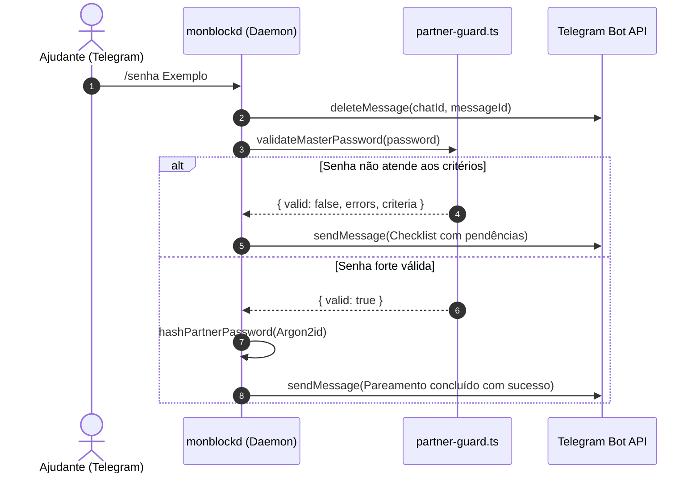

<!--
================================================================================
LOG DE MANUTENÇÃO DE DOCUMENTAÇÃO
--------------------------------------------------------------------------------
Data       | Autor          | Descrição
--------------------------------------------------------------------------------
2026-11-10 | monBlock Core  | Criação da ADR 0012 sobre critérios de senha forte e integridade SHA-256 de updates.
================================================================================
-->

# ADR 0012: Critérios de Senha Forte (NIST SP 800-63B) para o Ajudante e Integridade SHA-256 de Atualizações In-App

| Metadado | Detalhe |
| :--- | :--- |
| **Status** | **Implementada** (2026-11-10) |
| **Decisores** | Arquitetura monBlock, SecOps, Tech Lead |
| **Tags** | `[security]`, `[authentication]`, `[updater]`, `[sha256]`, `[privacy]` |
| **Impacto Sistêmico** | Médio (`partner-guard`, `monblockd`, `updater`, `renderer`) |
| **ADRs Relacionadas** | Complementa ADR-0003, ADR-0005, ADR-0007 |

## Contexto
O monBlock baseia sua catraca de compromisso compartilhado (CCAT) no pressuposto de que o Ajudante possui custódia exclusiva e intransponível de autorizações de liberação e desinstalação. Dois vetores críticos de fragilidade foram identificados:
1. **Senhas Fracas ou Triviais no Pareamento**: Senhas curtas ou óbvias cadastradas por engano ou pressa permitiam ataques de força bruta local ou adivinhação pelo próprio usuário em momentos de vulnerabilidade ou fissura por dopamina. Além disso, o envio da senha em texto claro via Telegram criava risco de vazamento no histórico do chat.
2. **Atualização In-App sem Verificação Criptográfica de Pacote**: O download de instaladores (`.pkg`) a partir de repositórios remotos precisa de proteção contra adulteração em trânsito (MITM), arquivos truncados e substituição maliciosa antes da execução com privilégios de root.

### Riscos Identificados e Problemas a Resolver:
- **Vulnerabilidade de Senha**: Senhas abaixo de 8 caracteres ou sem variedade de caracteres facilitam contorno da catraca.
- **Rastro de Credencial no Telegram**: O comando `/senha <valor>` permanecia visível no histórico do chat do Ajudante.
- **Execução Insegura de Binários**: Instalação de pacotes `.pkg` sem digest criptográfico verificado localmente.

---

## 1. Decisão de Arquitetura

1. **Critérios de Senha Forte Baseados no NIST SP 800-63B**:
   - Mínimo de 8 caracteres e máximo de 128 bytes em UTF-8.
   - Pelo menos 1 letra maiúscula, 1 letra minúscula, 1 número e 1 caractere especial (`!@#$%&*`).
   - Bloqueio estrito de sequências triviais (`12345678`, `password123`, `senha123`, `monblock`) e rejeição de senhas que contenham o nome do ajudante.
   - Higienização imediata no Telegram: tentativa de remoção atômica da mensagem com a senha via `deleteMessage` após o recebimento.
   - Feedback amigável e acessível via Telegram com checklist visual de pendências quando a senha não atender aos requisitos.

2. **Módulo de Atualização In-App com Integridade SHA-256 Obrigatória**:
   - Consulta à API de Releases do GitHub respeitando formato SemVer.
   - Download de arquivo `.pkg` em diretório temporário isolado (`os.tmpdir()`).
   - Cálculo determinístico de hash SHA-256 (`crypto.createHash('sha256')`) sobre os bytes baixados e comparação contra o digest esperado publicado na release.
   - Interrupção e descarte com remoção do arquivo temporário caso haja qualquer discrepância no hash, impedindo a abertura de instaladores adulterados.
   - Disparo de notificações locais acessíveis via Notification API do Electron.

---

## 2. Consequências e Resultados

### Positivas
- Eliminação de senhas frágeis que comprometam a catraca do compromisso assistivo.
- Histórico do Telegram protegido contra exposição acidental de senhas.
- Integridade fim a fim na distribuição de atualizações com proteção contra binários corrompidos ou adulterados.
- Transparência jurídica garantida com inclusão de Termos de Uso e Política de Privacidade acessíveis no aplicativo.
