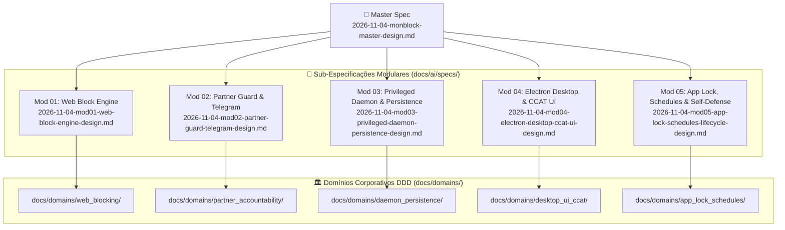

# Especificação Mestra (Master Spec) — `monBlock` Desktop Ecosystem

- **Data:** 2026-11-04
- **Autor:** Matheus Diniz & Arquitetura `monBlock`
- **Status:** **Proposta para Aprovação (Master Spec v1.0)**
- **ADRs Vinculadas:**
  - `docs/adrs/0001-arquitetura-split-privilegiada-daemon-monblockd.md`
  - `docs/adrs/0002-bloqueio-web-em-3-camadas-hosts-policies-watcher.md`
  - `docs/adrs/0003-catraca-unidirecional-append-only-e-aprovacao-ajudante.md`
  - `docs/adrs/0004-pareamento-duravel-tripla-persistencia-e-recuperacao-3-niveis.md`

---

## 1. Objetivo & Escopo Core (Visão Sistêmica do Produto)

O **`monBlock`** é um aplicativo desktop multiplataforma em **Electron + TypeScript + Node.js Nativo** (com **macOS** como plataforma primária do MVP Fase 1 e abstração `PlatformEnforcer` para **Windows** e **Linux**) projetado para o bloqueio resiliente de conteúdo adulto, casas de apostas, distrações digitais e aplicativos, sustentado por um modelo de **Responsabilidade Compartilhada (*Accountability Partner* / "Ajudante")**.

Diferente de bloqueadores convencionais (como o Cisdem AppCrypt mapeado em `_reversa_sdd/`, que armazena estado em plist userland com hash MD5 sem salt e ignora o Firefox), o `monBlock` opera sob a **Invariante da Catraca Unidirecional (`Append-Only`)**:

- O próprio usuário tem **autonomia imediata** para aumentar sua proteção (adicionar sites/domínios em lote, cadastrar palavras-chave simples ou combinadas, ativar qualquer uma das **11 categorias pré-cadastradas** ou travar o **Modo Anônimo**).
- O usuário **jamais consegue remover regras, desativar categorias, adicionar exceções na Allowlist, encerrar o processo ou desinstalar o bloqueio sozinho**. Qualquer redução de proteção exige autorização criptográfica do **Ajudante** (via Bot do Telegram + Token `HMAC-SHA256` ou Senha Mestra derivada com `Argon2id`/`scrypt`).

---

## 2. Mapa de Sub-Especificações Modulares (`docs/ai/specs/`) e Domínios (`docs/domains/`)

Para garantir desenvolvimento incremental, testabilidade isolada (TDD AAA) e governança arquitetural, a especificação do `monBlock` é decomposta em **5 Sub-Especificações Modulares** em `docs/ai/specs/` e **5 Bounded Contexts (Domínios DDD)** em `docs/domains/`:

### 2.1. Matriz de Rastreabilidade: Módulos × Domínios × Status de Implementação

|     Código     | Sub-Spec (`docs/ai/specs/`)                                | Domínio DDD (`docs/domains/`)         | Escopo Técnico & Componentes                                                                                                                                                                                  |     Fase     | Status Atual                                                                                                 |
| :--------------: | :----------------------------------------------------------- | :--------------------------------------- | :------------------------------------------------------------------------------------------------------------------------------------------------------------------------------------------------------------- | :----------: | :----------------------------------------------------------------------------------------------------------- |
| **MOD-01** | `2026-11-04-mod01-web-block-engine-design.md`              | `docs/domains/web_blocking/`           | `RuleEngine`, 11 Categorias, `/etc/hosts` atômico (`chflags uchg`), Browser Policies (Chromium/Safari/Firefox), Watcher Universal (`osascript`/`AXUIElement`) e Servidor `:49152`                 | Fase 1 (MVP) | 🟢 Núcleo TS + Policies + Servidor implementados; falta Watcher macOS em tempo real                         |
| **MOD-02** | `2026-11-04-mod02-partner-guard-telegram-design.md`        | `docs/domains/partner_accountability/` | `PartnerGuard` (`scrypt` + `timingSafeEqual`), Tokens `HMAC-SHA256` anti-replay, Catraca `Append-Only`, Bot Telegram (`api.telegram.org`), Raio-X com Blur + Reveal, Kit 5 Códigos e Cooldown 72h | Fase 1 (MVP) | 🟢 Cripto + Catraca + Kit 5 códigos + Cooldown 72h implementados; falta cliente Telegram Bot                |
| **MOD-03** | `2026-11-04-mod03-privileged-daemon-persistence-design.md` | `docs/domains/daemon_persistence/`     | Daemon Root `monblockd` (`LaunchDaemon`), Socket Unix `/var/run/monblockd.sock` validado com Zod, SQLite `STRICT` (`0600`) + Keychain + `partner.seal` (Self-Healing `2 de 3`)                   | Fase 1 (MVP) | 🟡 Especificado (`ADR-0001`, `ADR-0004`); pendente implementação de `src/storage/` e `src/daemon/` |
| **MOD-04** | `2026-11-04-mod04-electron-desktop-ccat-ui-design.md`      | `docs/domains/desktop_ui_ccat/`        | App Electron (`src/main/`, `src/preload/`, `src/renderer/`), Tray macOS, Onboarding de Pareamento, Dashboard 11 Categorias, Lote de Sites/Keywords, Central do Ajudante e Tela `:49152/blocked`        | Fase 1 (MVP) | 🟡 Tela de bloqueio `:49152/blocked` e `tokens.css` prontos; pendente Shell Electron + Dashboard         |
| **MOD-05** | `2026-11-04-mod05-app-lock-schedules-lifecycle-design.md`  | `docs/domains/app_lock_schedules/`     | Bloqueio de Apps Nativos (`NSWorkspace` + `SIGKILL`), Janelas de Agendamento (`Schedules`), Proteção Anti-Tamper de Relógio (NTP/Monotônico) e Auto-Defesa do Daemon                                 | Fases 2 & 3 | ⏸️ **Congelado / Fora de execução atual** (será revisado com calma antes da Fase 2)                      |

---

## 3. Arquitetura & Limites Modulares (3-Tier Privileged Split)

A arquitetura física e lógica separa estritamente a interface gráfica desprivilegiada do motor de imposição privilegiado:

1. **Camada 1 — Electron Desktop App (`src/main/`, `src/preload/`, `src/renderer/`):**
   - Executa em espaço de usuário comum (`uid >= 501`) com a tríade Zero-Trust (`nodeIntegration: false`, `contextIsolation: true`, `sandbox: true`).
   - Comunica-se com o processo principal via `contextBridge` tipado (`window.monblock`) e com o daemon `monblockd` via Unix Domain Socket (`/var/run/monblockd.sock`).
   - Se o usuário encerrar a janela ou executar `kill -9` no Electron, **o bloqueio permanece 100% ativo** porque toda a fiscalização reside no `monblockd`.
2. **Camada 2 — Daemon Privilegiado (`src/daemon/monblockd.ts`):**
   - Supervisionado pelo `launchd` (`KeepAlive: true`, `/Library/LaunchDaemons/com.ccat.monblockd.plist`).
   - Valida todo comando recebido no socket via schemas estritos e delega mutações sensíveis ao `PartnerGuard` antes de persistir no `StateStore`.
3. **Camada 3 — `PlatformEnforcer` & Persistência Tripla (`src/enforcers/`, `src/storage/`):**
   - Aplica escrita atômica no `/etc/hosts`, políticas corporativas de navegadores, watcher ativo de abas/títulos e reconciliação automática dos 3 cofres de pareamento (`SQLite` + `Keychain` + `partner.seal`).

---

## 4. Restrições Técnicas, Casos de Borda & Invariantes

- **Invariante 1 (`INV-RATCHET-01` — Catraca `Append-Only`):** Toda chamada que reduza o conjunto de domínios bloqueados, desative categorias, remova keywords, adicione domínios na `allowlistDomains` ou altere `lockIncognito` de `true` para `false` é rejeitada com `403 Forbidden` (`RFC 9457 Problem Details`) se `partnerAuthorized !== true`.
- **Invariante 2 (`INV-INFRA-02` — Anti-Lockout Crítico):** Os domínios de `CRITICAL_INFRA_ALLOWLIST` (`localhost`, `127.0.0.1`, `api.telegram.org`, `accounts.google.com`, `appleid.apple.com`, `login.microsoftonline.com`) jamais entram no `/etc/hosts` nem nas `URLBlocklist` de navegadores.
- **Invariante 3 (`INV-PRECEDENCE-03` — Precedência `ALLOWLIST > BLOCKLIST`):** Uma exceção autorizada pelo Ajudante na `allowlistDomains` sempre prevalece sobre categorias ou domínios bloqueados.
- **Invariante 4 (`INV-REPLAY-04` — Single-Use Tokens):** Cada token `UNLOCK-<DURATION>-<MAC>` e cada código do Kit de Emergência (`REC-XXXXXX-XXXXXX`) é consumido de forma atômica e registrado em `usedTokens`, impedindo ataques de replay (`RN-LIM-02`).
- **Invariante 5 (`INV-COOLDOWN-05` — Fail-Closed 72h):** Durante as 72 horas do Cooldown de Emergência (ou em caso de timestamp inválido/clock skew futuro), `unlocked` permanece estritamente `false`.

---

## 5. Resiliência, Concorrência, Timeouts & Degradação Graciosa

1. **Timeouts & Retry com Backoff Exponencial + Jitter:**
   - Chamadas HTTP para `api.telegram.org` possuem timeout estrito de `5000ms` e até 3 retentativas com backoff exponencial (`500ms`, `1500ms`, `3500ms`) + jitter aleatório (`0-250ms`).
   - Execuções de `osascript` no watcher macOS possuem timeout de `1500ms` por ciclo para evitar bloqueio do event loop caso um navegador trave.
2. **Concorrência & Idempotência:**
   - Submissões de pedidos de desbloqueio (`POST /api/unblock-requests`) exigem cabeçalho `Idempotency-Key` e deduplicam requisições concorrentes em janela de 5 minutos.
   - Escritas em arquivos de sistema (`/etc/hosts`, `partner.seal`, estado JSON/SQLite) utilizam arquivo temporário `.tmp` seguido de `fs.renameSync` atômico (POSIX rename).
3. **Circuit Breaker & Modo Offline:**
   - Se a API do Telegram falhar 5 vezes consecutivas, o Circuit Breaker abre por `60s` e a interface orienta automaticamente o usuário a utilizar o **Desafio-Resposta Offline (`HMAC-SHA256`)** com o Ajudante via WhatsApp/SMS/voz.
4. **Limites de Payload:**
   - Lotes de domínios limitados a `MAX_BATCH_DOMAINS = 100` por operação; body HTTP limitado a `16 KB` (`413 Payload Too Large` se excedido).

---

## 6. Segurança Defensiva Zero-Trust & Privacidade

- **Isolamento do Processo Electron:** `nodeIntegration: false`, `contextIsolation: true`, `sandbox: true`, `webSecurity: true`, CSP estrita (`default-src 'self'; style-src 'self' 'unsafe-inline'; img-src 'self' data:; connect-src 'self' http://127.0.0.1:49152`) e bloqueio de navegação externa (`will-navigate` e `setWindowOpenHandler` negados).
- **Criptografia de Senha e Tokens:** Derivação lenta via `crypto.scryptSync` (`N=16384, r=8, p=1`, salt aleatório de 16 bytes) e verificação em tempo constante via `crypto.timingSafeEqual`.
- **Privacidade do Raio-X Enviado ao Ajudante:** O print da janela bloqueada recebe desfoque gaussiano (`blur(24px)`) antes do envio ao Bot do Telegram (`has_spoiler: true`), preservando a dignidade do usuário e evitando exposição acidental de dados bancários/pessoais, enquanto a Tela de Bloqueio local (`:49152/blocked`) exibe apenas uma explicação limpa e respeitosa ao usuário.
- **Zero Segredos Hardcoded:** Bot Tokens e chaves mestras nunca são versionados no código; são injetados via variáveis de ambiente (`op run --`) ou armazenados no Keychain do sistema operacional.

---

## 7. Design System Oficial CCAT, Estados de UI, WCAG 2.2 AAA & Motion

- **Paleta & Temas (`docs/design/tokens.css`):**
  - 4 temas completos: **Capycro Warm Ivory** (padrão diurno `#F6F4EE` + Teal `#005A64` + Terracotta `#C84B31`), **Dark Tech** (noturno automático `#0B0F17`), **Light Fintech** (`#F8FAFC`) e **High Contrast AAA** (`#000000` / `#FFFFFF` / `#FFD60A`).
  - **Banimento Absoluto de Roxo (Purple Ban):** Zero tons violeta/índigo em qualquer superfície.
- **5 Estados Obrigatórios de UI em Todas as Telas (App Electron + Página de Bloqueio):**
  1. `Loading / Skeleton`: Carregamento inicial do estado do daemon e verificação de pareamento.
  2. `Empty State`: Estado inicial quando nenhuma palavra-chave customizada ou exceção foi adicionada.
  3. `Error State (RFC 9457)`: Banner semântico (`role="alert"`) exibindo `title` e `detail` quando a Catraca `Append-Only` veta uma remoção ou quando um token é inválido.
  4. `Partial / Degraded State`: Indicador de modo offline quando o Telegram está inacessível (habilitando o fluxo de código de desafio offline) ou quando o Cooldown de 72h está em contagem regressiva.
  5. `Populated / Active Protection State`: Dashboard com as 11 categorias, contadores `tabular-nums`, status do Ajudante e regras ativas.
- **Acessibilidade (WCAG 2.2 AA/AAA & APCA):**
  - Contraste textual $\ge 7:1$ (`APCA Lc >= 75`), alvos de toque/clique $\ge 44\times44\text{px}$ (`2.75rem`), `:focus-visible` explícito em todos os controles `.ccat-*` e navegação integral por teclado (`Tab`, `Enter`, `Escape`).
- **Animação & Motion (`prefers-reduced-motion` & `deltaTime`):**
  - Transições restritas a propriedades de compositor GPU (`transform`, `opacity`), duração $\le 200\text{ms}$ (`cubic-bezier(0.22, 1, 0.36, 1)`), desativação automática sob `@media (prefers-reduced-motion: reduce)` e cronômetros regressivos (Cooldown 72h / Desbloqueio Temporário) calculados por tempo real decorrido (`Date.now() - startMs`, `deltaTime`), imunes a throttling de aba ou suspensão do SO.

---

## 8. Pre-Mortem & Modos de Falha

| Cenário de Falha Hipotético                                     | Causa Raiz                                                   | Mitigação Arquitetural no `monBlock`                                                                                                                                                                            |
| :---------------------------------------------------------------- | :----------------------------------------------------------- | :------------------------------------------------------------------------------------------------------------------------------------------------------------------------------------------------------------------ |
| **1. Corrupção do `/etc/hosts` após queda de energia** | Escrita direta truncada no arquivo do sistema.               | Escrita em `/etc/hosts.monblock.tmp` + `fs.renameSync` atômico + backup `.monblock.bak` restaurado no boot (`rollbackHostsFromBackup`).                                                                    |
| **2. Usuário apaga o banco local para remover o Ajudante** | Deleção manual em `~/Library/Application Support`.       | Tripla Persistência Self-Healing (`SQLite 0600` + `Keychain` + `/var/db/monblock/partner.seal`). Se 1 ou 2 cofres sumirem, o daemon restaura o vínculo automaticamente e trava em modo `TAMPER_LOCKDOWN`. |
| **3. Perda total da senha do Ajudante e perda do Telegram** | Troca de celular ou esquecimento simultâneo da senha.       | Recuperação em 3 Níveis: (1) `/reset_senha` no Telegram, (2) Kit de Emergência com 5 códigos de uso único gerados no onboarding, (3) Cooldown Time-Lock de 72h com bloqueio ativo durante toda a espera.    |
| **4. Bypass via Firefox ou DNS-over-HTTPS (DoH)**           | Firefox usa rede própria e ignora AppleEvents/Keychain DNS. | `policies.json` do Firefox (`DNSOverHTTPS.Locked = true`, `WebsiteFilter`, `DisablePrivateBrowsing`) + Watcher de títulos de janela via Accessibility API.                                                 |

---

## 9. Matriz de Alternativas Consideradas

| Abordagem                                                                                                 | Prós                                                                                                           | Contras                                                                                       |                   Decisão                   |
| :-------------------------------------------------------------------------------------------------------- | :-------------------------------------------------------------------------------------------------------------- | :-------------------------------------------------------------------------------------------- | :-------------------------------------------: |
| **A. App Electron Monolítico Userland (estilo Cisdem AppCrypt)**                                   | Simples de empacotar sem daemon root.                                                                           | Facilmente derrotado por `kill -9`, edição de `.plist` ou uso do Firefox/modo anônimo. |                 ❌ Rejeitada                 |
| **B. Extensão de Navegador Isolada**                                                               | Acesso direto à DOM da página.                                                                                | Usuário desinstala a extensão em 2 cliques ou abre outro navegador não monitorado.         |                 ❌ Rejeitada                 |
| **C. Arquitetura Split Privilegiada (Electron UI + Daemon `monblockd` + Enforcers em 3 Camadas)** | Imune a `kill -9` na UI, cobre todos os navegadores, `/etc/hosts` imutável e Catraca `Append-Only` real. | Requer separação clara entre UI e serviço de background via IPC.                           | ✅ **Selecionada (`ADR-0001..0004`)** |

---

## 10. Reversibilidade & Plano de Rollback

1. **Rollback Instantâneo de Rede (`/etc/hosts` e DNS):**
   - `rollbackHostsFromBackup('/etc/hosts')` remove o bloco `# >>> MONBLOCK START >>> ... # <<< MONBLOCK END <<<`, restaura `/etc/hosts.monblock.bak` e executa `dscacheutil -flushcache && killall -HUP mDNSResponder`.
2. **Rollback de Políticas de Navegadores:**
   - Remoção dos arquivos gerenciados `.plist` e `policies.json` mediante autorização validada do Ajudante ou conclusão do Cooldown de 72h.
3. **Desinstalação Segura Autorizada:**
   - Script `uninstall-monblock.sh` (exigindo token do Ajudante ou fim do Cooldown de 72h) descarrega o `LaunchDaemon`, remove `chflags nouchg` e restaura as configurações originais do macOS sem deixar resíduos.

---

## 11. Estratégia de Testabilidade & Pirâmide de Testes (AAA)

- **Testes Unitários (`tests/domain/*.test.ts` — Vitest):**
  - `RuleEngine`: sanitização de URLs maliciosas (`javascript:`, `file:`, `data:`), precedência `ALLOWLIST > BLOCKLIST`, lote máximo de 100 domínios e keywords `AND`.
  - `PartnerGuard`: hash `scrypt` + `timingSafeEqual`, tokens `HMAC-SHA256` anti-replay, Kit de 5 códigos, Cooldown 72h fail-closed e Catraca `Append-Only`.
- **Testes de Integração de Enforcers, Persistência & Daemon (`tests/enforcers/*.test.ts`, `tests/storage/*.test.ts`, `tests/server/*.test.ts`):**
  - Escrita atômica e rollback de hosts em diretório temporário, geração de policies Chromium/Firefox, reconciliação `2 de 3` do `StateStore` (Self-Healing) e endpoints HTTP `RFC 9457` com `Idempotency-Key`.
- **Testes End-to-End & Auditoria UI/UX (`Playwright` + `accessibility_checker.py` + `ux_audit.py`):**
  - Validação da Tela de Bloqueio (`docs/design/blocked-page.html`) e do Dashboard Desktop Electron (`src/renderer/index.html`) nos 4 temas CCAT com `0` violações WCAG 2.2 AAA.

---

## 12. Roadmap Planejado de Execução (Próximas Etapas)

1. **Etapa 1 (Concluída ✅):** Núcleo de Domínio (`categories.ts`, `rule-engine.ts`, `partner-guard.ts`), Enforcers (`hosts-enforcer.ts`, `browser-policy-enforcer.ts`), Design System CCAT (`tokens.css`, `blocked-page.html`) e Servidor Local `:49152` (`14/14` testes verdes).
2. **Etapa 2 (MOD-03 — Persistência & Daemon):** Implementar `src/storage/state-store.ts` (Tripla Persistência Self-Healing) e `src/daemon/monblockd.ts` (orquestrador de estado + IPC).
3. **Etapa 3 (MOD-01 & MOD-02 — Watcher macOS & Bot Telegram):** Implementar `src/enforcers/macos-watcher.ts` (`osascript` multi-browser + redirecionamento para `:49152/blocked`) e `src/daemon/telegram-client.ts` (pareamento, pedidos com botões e `/reset_senha`).
4. **Etapa 4 (MOD-04 — Aplicativo Desktop Electron Completo):** Implementar `src/main/main.ts`, `src/preload/preload.ts` e `src/renderer/` (Onboarding do Ajudante, Dashboard de 11 Categorias com Cadeado `Append-Only`, Lote de Sites/Keywords e Central de Recuperação em 3 Níveis).
