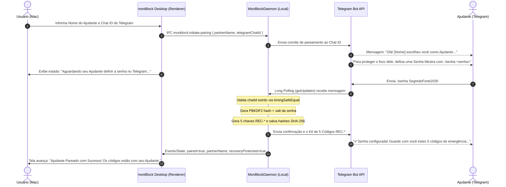

# Design Spec: Pareamento Remoto via Telegram, Definição de Senha Mestra e Entrega Exclusiva de Códigos de Emergência

- **Data:** 2026-11-05
- **Status:** Proposto (Aguardando Aprovação)
- **Autor:** Engenheiro de Software Sênior & Pair Programmer (Antigravity)
- **Alvo:** `docs/ai/specs/2026-11-05-pareamento-telegram-senha-codigos-emergencia-design.md`
- **Padrões Normativos:** `AGENTS.md`, `ADR-0001`, `ADR-0004`, CCAT (Compromisso Compartilhado com Ajudante de Responsabilidade), OWASP Zero-Trust e WCAG 2.2 AAA.

---

## 1. Contexto & Diagnóstico de Segurança Comportamental

### 1.1 O Problema da Auto-Sabotagem Local (Vulnerabilidade Psicológica)
No fluxo anterior do monBlock:
1. O próprio usuário configurava a "Senha Mestra" na interface desktop durante o onboarding.
2. Os 5 Códigos de Emergência (`REC-*`) eram exibidos e disponibilizados para download em arquivo `.txt` local.

**Falha Crítica do Modelo de Compromisso:**
O objetivo central do monBlock é a *Catraca Unidirecional de Foco* (*One-Way Ratchet*): adicionar bloqueios é instantâneo e livre, mas remover exige intervenção de um terceiro de confiança (*Accountability Partner*). Se o usuário tem o arquivo com 5 chaves de emergência no próprio computador ou se ele mesmo criou e memorizou a Senha Mestra, em momentos de impulso ou compulsão (Sistema 1 de Daniel Kahneman) ele burla as próprias defesas sem que o Ajudante tome conhecimento.

### 1.2 A Solução Arquitetural
1. **Definição Remota da Senha pelo Ajudante:** O usuário informa no app apenas o Nome do Ajudante e seu Chat ID do Telegram. O Bot do monBlock notifica o Ajudante no Telegram, solicitando que o **Ajudante** crie a Senha Mestra através do chat privado (`/senha <sua_senha>`).
2. **Guarda Exclusiva dos Códigos de Emergência:** Ao confirmar a senha, o bot entrega o Kit com os 5 Códigos de Emergência (`REC-1-*` até `REC-5-*`) **diretamente no Telegram do Ajudante**. O app desktop **não exibe nem permite o download** desses códigos no computador protegido.
3. **Uso Dual da Senha e de Aprovações:** A Senha Mestra continua existindo como mecanismo de segurança no daemon (armazenada em hash PBKDF2 com salt) e é exigida para ações locais extremas (ex: desinstalação total do app ou liberação manual se a internet estiver inoperante). Como apenas o Ajudante a possui, o usuário precisará contatá-lo.

---

## 2. Restrições Técnicas & Limites Operacionais

1. **Topologia de Rede Local:** O monBlock opera em máquinas locais (macOS) sem IP público, sem NAT forwarding e sem certificados HTTPS de entrada. Portanto, o recebimento de mensagens do Telegram DEVE usar **Long Polling (`getUpdates`)** com `timeout` controlado e não Webhooks externos.
2. **Latência de Pareamento:** O long-polling deve consultar updates a cada 2 segundos durante a fase de pareamento pendente, com timeout máximo de 15 minutos para expiração do convite.
3. **Segurança de PII e Segredos:** A senha enviada no Telegram não é registrada em disco em texto puro. O daemon computa imediatamente o hash PBKDF2 com salt de 16 bytes e solicita a deleção da mensagem no Telegram (`deleteMessage`).
4. **Isolamento Zero-Trust:** O Renderer Electron não recebe a senha nem os códigos `REC-*`. Apenas o booleano `paired: true` e os metadados do Ajudante (`partnerName`, `telegramChatId` mascarado) transitam pelo IPC.

---

## 3. Matriz de Alternativas Arquiteturais

| Dimensão | Alternativa A (Lean / Local) | Alternativa B (Proposta: Telegram Híbrido) | Alternativa C (Cloud Server Central) |
|---|---|---|---|
| **Definição de Senha** | Ajudante digita presencialmente no Mac do usuário | Ajudante define via chat do Telegram (`/senha`) | Ajudante cria em portal Web na nuvem |
| **Códigos de Emergência** | Impressos em papel pelo usuário | Enviados exclusivamente no Telegram do Ajudante | Armazenados em cofre remoto na nuvem |
| **Dependência de Infra** | Zero (totalmente offline) | Zero servidores próprios (usa Telegram Bot API oficial) | Servidor próprio 24/7 (custo + risco de vazamento) |
| **Resistência a Auto-Sabotagem** | Baixa (usuário pode espiar a senha) | **Máxima (o usuário nunca teve acesso aos segredos)** | Alta |
| **Veredito** | Rejeitada (vulnerável a fraude local) | **ESCOLHIDA (Simples, segura e alinhada ao CCAT)** | Rejeitada (fere o princípio local-first sem backend) |

---

## 4. Fluxo de Interação e Estados da Jornada

---

## 5. Especificação Técnica das Camadas

### 5.1 Cliente Telegram (`src/daemon/telegram-client.ts`)
- **Novo Método `sendPairingInvitation`:**
  - Envia texto educativo com instruções claras para o Ajudante no chat privado.
  - Solicita o comando `/senha <senha>` (mínimo de 6 caracteres).
- **Novo Método `sendEmergencyKit`:**
  - Envia os 5 códigos `REC-1-*` a `REC-5-*` com aviso explícito de que devem ser guardados fora do alcance do usuário.
- **Novo Mecanismo `pollUpdates` (Long Polling Resiliente):**
  - Implementa consulta local a `getUpdates` com `timeout=25` e rastreamento de `offset`.
  - Processa apenas mensagens vindas estritamente do `pairedChatId` (comparação com `crypto.timingSafeEqual`).
  - Higieniza e deleta a mensagem de senha no Telegram sempre que a API permitir (`deleteMessage`), reduzindo rastros no histórico do chat.

### 5.2 Daemon de Governança (`src/daemon/monblockd.ts`)
- **Novos Comandos do Daemon:**
  - `INITIATE_PAIRING`: Registra intenção de pareamento com timeout de expiração de 15 minutos.
  - `CHECK_PAIRING_STATUS`: Consulta se o Ajudante já respondeu no Telegram.
- **Transição Atômica de Estado:**
  - Ao receber a senha do Telegram, o daemon calcula `hashPartnerPassword(senha)`, gera o kit de emergência via `generateRecoveryKit()`, salva no `TripleStateStore` e dispara `sendEmergencyKit`.
  - O retorno de `PAIR_PARTNER` para a interface desktop **não** retorna os códigos em texto puro (`kit.plainCodes` nunca transita para o Renderer).

### 5.3 Interface Desktop (`src/renderer/index.html` e `renderer-init.js`)
- **Passo 3 do Onboarding (Ajudante Telegram):**
  - Remove o campo de Senha Mestra da interface do usuário.
  - Mantém campos: Nome do Ajudante e Chat ID do Telegram (com link direto para o bot @monblock_bot).
  - Botão principal: **"Enviar Convite ao Ajudante"**.
  - Estado de espera: card dinâmico com spinner suave e instrução: *"Aguardando seu Ajudante criar a senha no Telegram..."*.
- **Passo 4 do Onboarding (Segurança & Emergência):**
  - Remove os botões "Copiar Códigos" e "Baixar Arquivo TXT".
  - Apresenta card educativo informando: *"Os 5 códigos de emergência foram entregues com segurança diretamente no Telegram do seu Ajudante. Este dispositivo não armazena nenhuma chave."*
  - Checkbox de confirmação: *"Compreendo que desinstalações e desbloqueios de emergência dependem do meu Ajudante."*

---

## 6. Pre-Mortem, Modos de Falha & Reversibilidade (Rollback)

| Modo de Falha | Probabilidade | Impacto | Mitigação Defensiva & Procedimento de Rollback |
|---|:---:|:---:|---|
| **Ajudante não responde ao convite (abandono)** | Média | Médio | O estado de pareamento pendente expira após 15 minutos. Um botão *"Cancelar Convite"* no app permite ao usuário voltar imediatamente ao estado desemparelhado sem bloqueio. |
| **Ajudante digita senha fraca (< 6 chars)** | Baixa | Baixo | O Bot rejeita via mensagem de erro inline: *"A senha precisa ter no mínimo 6 caracteres. Tente novamente com /senha <senha>"*. |
| **Mensagem recebida de terceiro malicioso (ChatID spoofing)** | Baixa | Alto | Rejeição imediata via `timingSafeEqual`: apenas o Chat ID registrado no início do fluxo é aceito. |
| **Falha de rede/queda de internet no envio do Kit** | Baixa | Alto | **Rollback Transacional:** Se o envio do Kit de Emergência falhar com erro irrecuperável, o estado do daemon reverte o pareamento para `paired: false`, limpa a senha e notifica a interface para retentar. |

---

## 7. Critérios de Aceite & Invariantes de Teste (AAA)

1. `INV-PAIR-REMOTE-01`: A interface desktop do monBlock não deve conter input para criação de Senha Mestra nem botões para download local de códigos `REC-*`.
2. `INV-PAIR-REMOTE-02`: A Senha Mestra só é aceita se enviada pelo Telegram a partir do `telegramChatId` exatamente coincidente com o pareamento pendente.
3. `INV-PAIR-REMOTE-03`: O payload retornado para o processo Renderer no final do pareamento não deve conter os códigos de emergência em texto puro.
4. `INV-PAIR-REMOTE-04`: Tentativas de mensagens vindas de outros `chatId` devem ser sumariamente descartadas com log de segurança.
5. `INV-PAIR-REMOTE-05`: Suíte automatizada com 100% dos testes passando (`npm test`) e conformidade estrita com Zero-Roxo e WCAG 2.2 AAA.
