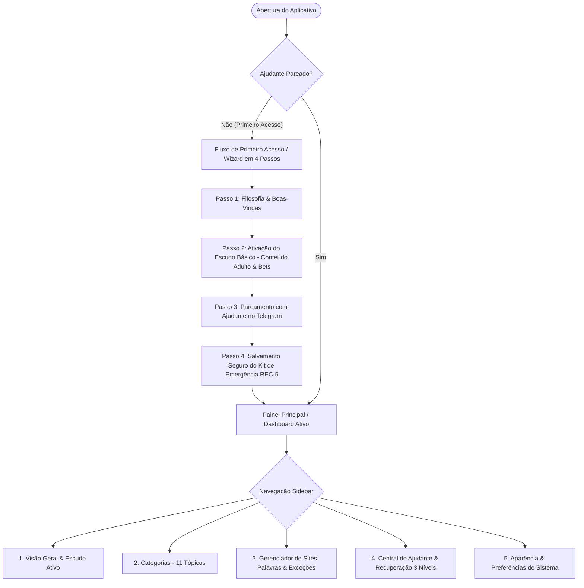

# Spec Técnica de Design e UX/UI — Refatoração Integral do monBlock (CCAT)

> **Data:** 2026-11-05  
> **Status:** 🟡 Proposto para Aprovação  
> **Assinatura Visual:** CCAT Design System — *Organic Elegance, Mindful Security & Anti-Slop Ergonomics*  
> **Padrão de Artefatos:** Em conformidade estrita com `docs/ai/specs/` e governança CPB em `AGENTS.md`.  
> **Metas Principais:** Redesenho completo do fluxo de uso, Onboarding/Primeiro Acesso guiado, Gestão Transparente de Bloqueios (Lista de Sites, Categorias, Palavras-chave, Exceções), Central do Ajudante humanizada, e Eliminação de Anti-patterns visuais.

---

## 1. Visão Geral e Arquitetura de Experiência (UX)

O **monBlock** é um guardião de foco comportamental fundamentado em **Responsabilidade Compartilhada (*Accountability Partner*)** e na **Catraca Unidirecional (*One-Way Ratchet / Append-Only*)**:
- **Adicionar proteção é livre e imediato:** O usuário pode a qualquer momento ativar novas categorias, bloquear sites ou palavras com 1 clique (Sistema 1, zero atrito).
- **Remover proteção exige reflexão deliberada:** Qualquer desativação requer aprovação do Ajudante via Telegram, uso de Código de Emergência (`REC-*`) ou espera pacífica de 72 horas (*Cooldown Time-Lock*).

### 1.1 Princípios de Design Anti-Pânico e Anti-Slop (CCAT)
1. **Linguagem Acolhedora vs. Antivírus Punitivo:**
   - Não usamos tons de sirene vermelha, caveiras ou mensagens de censura moral.
   - Usamos a paleta CCAT autêntica: Bege Pergaminho (`#F6F4EE` / `#faf9f6`), Azul-Petróleo Profundo (`#005A64` / `#5d8a8c`), Terracota Nobre (`#C84B31` / `#d8704c`) e neutros equilibrados. Proibição absoluta de tons roxos (*Zero-Purple Rule* — `RN-UI-01`).
2. **Eliminação de Cards Aninhados (*Flat Surfaces Hierarchy*):**
   - Substituição do card gigante envolvente por layout estruturado em **Sidebar Lateral + Canvas de Conteúdo**, com cards planos específicos apenas onde há agrupamento semântico real.
3. **Visibilidade Total do Sistema (1ª Heurística de Nielsen):**
   - Eliminação do "buraco negro" de regras: exibição em tempo real de todos os domínios bloqueados, palavras-chave ativas e histórico com busca instantânea e paginação/scroll virtual.
4. **Fricção Propositiva e Mindful Friction (CREATE Funnel):**
   - Quando o usuário tenta desbloquear algo, a interface oferece primeiro um **exercício de pausa consciente (respiração guiada 4-7-8 de 10 segundos)** para desarmar o impulso do Sistema 1, antes de formalizar o pedido ao Ajudante.

---

## 2. Jornada do Usuário & Mapeamento de Telas

---

## 3. Especificação Detalhada das Telas

### 3.1 Tela de Primeiro Acesso (Onboarding Wizard)
Atualmente, o usuário cai em uma tela técnica com botões descontextualizados. A nova tela será um **Wizard acolhedor com Stepper visual superior**:

- **Passo 1 — Boas-Vindas e Propósito:**
  - Ilustração sutil e tipografia editorial: *"Bem-vindo ao monBlock. O espaço onde você reassume o controle da sua atenção com apoio de quem você confia."*
  - Explicação visual da Catraca: *"Bloquear é fácil e instantâneo. Desbloquear é um pacto de cuidado com seu Ajudante."*
  - CTA: `[Começar Configuração]`

- **Passo 2 — Escudo Inicial Recomendado:**
  - Seleção rápida das categorias essenciais com toggles visuais enriquecidos:
    - `[x] Conteúdo Adulto & Pornografia` (ativado por padrão)
    - `[x] Apostas & Cassinos (Bets)` (recomendado)
    - `[ ] Redes Sociais no Horário de Trabalho`
    - `[ ] Compras por Impulso`
  - CTA: `[Salvar e Avançar]`

- **Passo 3 — Pareamento do Ajudante de Responsabilidade (*Accountability Partner*):**
  - Passo a passo visual integrado:
    1. *"Peça ao seu Ajudante para abrir o bot `@monBlockBot` no Telegram."*
    2. Campo de Chat ID do Telegram do Ajudante.
    3. Campo de Senha Mestra (guardada pelo Ajudante, com medidor de entropia visual).
    4. Botão de teste: `[Enviar Mensagem de Teste ao Ajudante]` com status em tempo real.

- **Passo 4 — Kit de Códigos de Emergência (`REC-*`):**
  - Geração de 5 códigos únicos de recuperação descartáveis (1 hora de liberação cada).
  - Opções de salvar: `[Copiar Códigos]`, `[Baixar Arquivo TXT Seguro]` ou `[Imprimir / PDF]`.
  - Checkbox obrigatório: *"Confirmo que guardei meus códigos de emergência em local seguro."*
  - CTA Final: `[Entrar no monBlock Protegido]`

---

### 3.2 Painel Principal (Dashboard & Sidebar Dual-Rail)

#### Layout Estrutural:
- **Sidebar Esquerda (240px / 64px recolhida):**
  - Logo CCAT estilizado + status luminoso do daemon (`monblockd: Ativo`).
  - Menu de navegação com ícones SVG nativos:
    - 🛡️ **Visão Geral** (Overview & Métricas de Foco)
    - 🗂️ **Categorias** (11 Coleções com contadores de sites)
    - 🌐 **Sites & Palavras** (Gestão completa com tabela, busca e lote)
    - 🤝 **Ajudante & Resgate** (Telegram, Códigos e Cooldown)
    - ⚙️ **Configurações & Temas** (4 temas, SafeSearch, Modo Anônimo)
  - Card de Ajudante no rodapé da Sidebar: Avatar/iniciais do ajudante, status de conexão e botão rápido de contato.

---

### 3.3 Tela de Gestão de Bloqueios (Sites, Palavras-chave e Exceções)

Dividida em **3 Abas Claras com Data Table Anti-Slop**:

1. **Aba 1: Sites Bloqueados:**
   - **Barra Superior de Ação:**
     - Campo de busca instantânea: `🔍 Filtrar sites bloqueados...`
     - Botão primário: `[+ Adicionar Site ou Lote]` (abre modal limpo com validação instantânea, contador `0/100` e detecção de infraestrutura crítica como `google.com` ou `apple.com`).
     - Contador tabular: `Exibindo 42 domínios protegidos`.
   - **Tabela de Dados (Data Table WCAG 2.2):**
     - Coluna 1: Domínio (ex: `blaze.com`, com favicon ou ícone seguro).
     - Coluna 2: Origem (Tag: `Categoria: Apostas` ou `Adicionado Manualmente`).
     - Coluna 3: Data de inclusão (`04/11/2026`).
     - Coluna 4: Ação: Botão `[Solicitar Desbloqueio]` (com ícone de cadeado que abre o fluxo de reflexão).

2. **Aba 2: Palavras-Chave e Termos Combinados:**
   - Visualização em chips / badges interativos: `cassino,online`, `roleta,aposta`, `slot,bonus`.
   - Explicação semântica: verificação por palavra inteira (*RN-WEB-07*) sem falsos positivos.
   - Formulário ágil para adicionar novas combinações com teste visual imediato.

3. **Aba 3: Exceções & Lista Permitida ("Always Allow"):**
   - Tabela de domínios explicitamente liberados que se sobrepõem a categorias mistas (ex: `stackoverflow.com`, bancos corporativos, intranet).
   - Inclusão rápida com justificativa.

---

### 3.4 Tela de Categorias (11 Coleções)

- Redesenho dos 11 cards com **Hierarquia Visual Rica**:
  - Destaque para categorias de **Alta Sensibilidade** (Adulto, Apostas/Bets, Proxies/Bypass) com bordas reforçadas.
  - Informações de cada categoria:
    - Título em português e subtítulo explicativo.
    - Tag de status: `🟢 Ativa e Trancada` ou `⚪ Inativa`.
    - Lista expansível de exemplos de domínios protegidos (`pornhub.com`, `xvideos.com`...).
    - Toggle acessível: se inativa, ativa em 1 clique; se ativa, exibe o cadeado com atalho para solicitar ao Ajudante.

---

### 3.5 Central do Ajudante & Protocolo de Desbloqueio Consciente

Quando o usuário precisa acessar algo bloqueado:
1. **Modal de Reflexão Consciente (Anti-Impulso):**
   - Pergunta reflexiva: *"O que você busca acessar neste momento apoia o seu objetivo ou é uma distração passageira?"*
   - Mini-timer de 10 segundos de respiração opcional.
2. **Opção A — Pedido Automático via Telegram:**
   - Envio de notificação interativa com botões de liberação rápida (`15m`, `1h`, `Permanente`).
3. **Opção B — Desafio-Resposta Offline (`HMAC-SHA256`):**
   - Exibe o Código de Desafio dinâmico (ex: `MB-8492-X7`).
   - Campo para colar o token retornado pelo Ajudante (`UNLOCK-15M-...`).
4. **Opção C — Código de Emergência (`REC-*`):**
   - Inserção de um dos 5 códigos descartáveis para liberação de 1 hora.
5. **Opção D — Cooldown Time-Lock de 72 Horas:**
   - Acionamento da espera pacífica com barra de progresso serena (`71:59:42 restantes`).

---

## 4. Restrições Técnicas & Limites Operacionais

- **Zero-Trust & Sandbox no Electron (`RN-UI-03`):** Proibido `nodeIntegration: true`. Todas as chamadas continuam restritas a `window.monblock` através de `src/preload/preload.ts` e canais IPC validados no `main.ts`.
- **Performance de Renderização & Latência:** A lista de domínios pode conter até 1.000+ domínios combinados (11 categorias + lote manual). O filtro de busca em memória deve rodar em `<= 16ms` (60fps) usando índice textual em JavaScript sem congelar a thread principal.
- **Limites de Lote (`RN-WEB-04`):** O campo de lote mantém o teto estrito de `MAX_BATCH_DOMAINS = 100` domínios por requisição, ignorando infraestrutura crítica com aviso semafórico (*Problem Details RFC 9457*).
- **Compatibilidade Multi-Plataforma:** Suporte total a macOS (Dark/Light nativo), Windows 11 e Linux, respeitando alvos de toque mínimos de `44px` (`RN-UI-02`).

---

## 5. Pre-Mortem & Análise de Modos de Falha (Blast Radius)

| Modo de Falha | Probabilidade | Impacto | Mitigação Arquitetural |
|---|:---:|:---:|---|
| **1. Estado de Pareamento Inconsistente:** O usuário fecha o app no meio do Onboarding sem salvar o Ajudante. | Média | Médio | O app persiste o progresso do onboarding no `TripleStateStore`; se reiniciado antes de concluir, reabre diretamente no passo pendente. Se abortado, a categoria `adult` permanece protegida (*Fail-Closed*). |
| **2. Falha de Rede ao Testar Bot do Telegram:** API do Telegram fora do ar ou sem internet durante o pareamento. | Baixa | Baixo | Circuit-breaker com feedback imediato e chaveamento automático para o modo offline com Kit de Códigos de Emergência (`REC-*`). |
| **3. Perda dos Códigos de Emergência pelo Usuário:** Usuário avança sem salvar os códigos `REC-*`. | Média | Alto | Ação bloqueante com confirmação explícita de download ou cópia para a área de transferência antes de habilitar o botão final. |
| **4. Sobrecarga de Renderização com Muitos Domínios:** Lentidão ao renderizar centenas de linhas de tabela. | Baixa | Médio | Paginação de 25 em 25 itens com input de busca reativo e contadores tabulares. |

---

## 6. Matriz de Alternativas & Justificativa

| Dimensão | Opção A (Selecionada) | Opção B (Status Quo / Mínima) | Opção C (Framework Pesado / React SPA) |
|---|---|---|---|
| **Arquitetura UI** | HTML5 Semântico + CSS Custom Properties + TS Modular | HTML puro estático sem listagem | Reescrever todo o frontend em React/Vue |
| **Bundle & Performance** | **Zero dependências extras**, inicialização instantânea em `< 50ms` | Rápido, mas com UX defasada e telas cegas | Aumento de 5MB+ no bundle e risco de re-hidratação |
| **Ergonomia & Manutenibilidade** | Alinhado com o Design System CCAT oficial e testes Vitest existentes | Baixa manutenibilidade e alta fricção para o usuário | Desnecessário para uma aplicação desktop local de segurança |

---

## 7. Reversibilidade & Plano de Rollback

- **Estratégia de Branch e Versionamento:** Todas as alterações visuais de layout serão aplicadas em micro-commits com testes locais contínuos (`npm test`).
- **Compatibilidade Retroativa de Contratos IPC:** Nenhuma assinatura de canal IPC (`monblock:get-state`, `monblock:add-batch-domains`, etc.) será removida ou alterada de forma quebrante; apenas novos campos opcionais de consulta serão adicionados.
- **Rollback Imediato:** Caso ocorra qualquer inconsistência no renderer, o commit anterior restaura integralmente `src/renderer/index.html` e `src/renderer/renderer-init.js` com 1 comando `git restore`, mantendo o daemon e os cofres `TripleStateStore` 100% intactos.

---

## 8. Testabilidade & Critérios de Aceite

- **Suíte de Testes Automatizados:** Manutenção de 100% dos testes existentes passando (`npm test` — 66 testes atuais) mais novos testes unitários em `tests/ui/desktop-ui.test.ts` cobrindo o Onboarding Stepper, a filtragem de domínios na tabela e a Catraca Unidirecional.
- **Critérios de Aceite (Gherkin / BDD):**
  - **Cenário 1 (Primeiro Acesso):** Dado que o usuário abre o monBlock pela primeira vez, então é apresentado o Wizard de 4 passos sem ser jogado em configurações avançadas.
  - **Cenário 2 (Transparência de Bloqueios):** Dado que o usuário adicionou domínios à blocklist, quando ele navega para a aba "Sites e Palavras", então ele visualiza a tabela completa com busca, contadores tabulares e tags de origem.
  - **Cenário 3 (Pausa Consciente):** Dado que o usuário tenta desativar uma categoria ativa, então a interface orienta a solicitação ao Ajudante sem becos sem saída ou erros genéricos.

---
