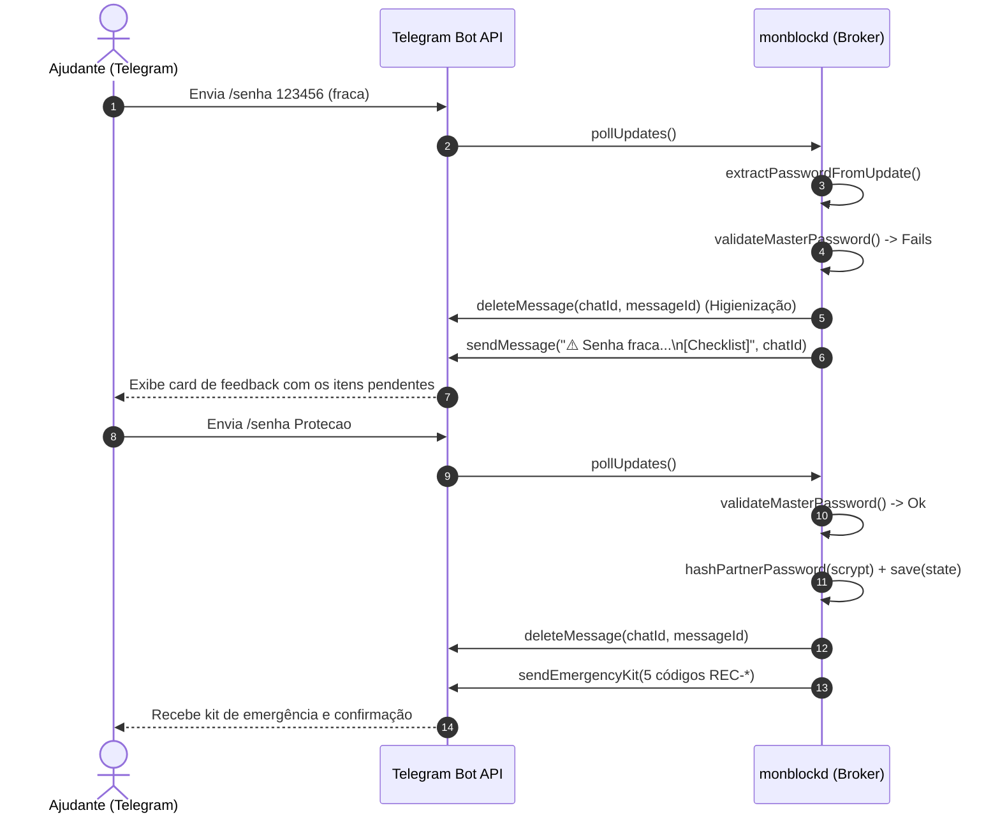

# Design Spec: Critérios de Senha Forte para Ajudante e Feedback Interativo via Telegram

- **Data:** 2026-11-09
- **Status:** Proposto (Aguardando Validação e Aprovação)
- **Autor:** Engenheiro de Software Sênior & Pair Programmer (Antigravity)
- **Alvo:** `docs/ai/specs/2026-11-09-criterios-senha-forte-ajudante-design.md`
- **Padrões Normativos:** `AGENTS.md`, `ADR-0001`, `ADR-0003`, `ADR-0004`, `ADR-0010`, CCAT (Compromisso Compartilhado com Ajudante de Responsabilidade), OWASP MASVS / ASVS e NIST SP 800-63B.

---

## 1. Contexto & Diagnóstico de Segurança

### 1.1 O Papel Crítico da Senha Mestra
A Senha Mestra do Ajudante é a chave de autoridade máxima no monBlock. Ela é exigida para:
1. Operações destrutivas ou de emergência local (ex: desinstalação completa via `uninstall.sh` ou remoção de perfil gerenciado).
2. Substituição de Ajudante pareado (`INV-RATCHET-01`).
3. Autorização de desbloqueio quando canais remotos estiverem offline.

### 1.2 Vulnerabilidades Identificadas
1. **Regra de Complexidade Permissiva:** A validação atual verifica apenas `length >= 6`. Isso permite senhas triviais como `123456`, `senha1`, `aaaaaa`, facilmente adivinháveis pelo usuário tutelado em caso de recaída ou impulso.
2. **Ausência de Feedback no Telegram:** Se o Ajudante envia uma senha inválida ou vazia, o sistema atual descarta silenciosamente o update no long-poll. O Ajudante fica sem retorno no chat do Telegram, gerando incerteza sobre o status do pareamento.
3. **Instruções Incompletas no Convite:** A mensagem inicial de convite enviada pelo bot não detalha claramente os requisitos exigidos.

---

## 2. Requisitos de Senha Forte (*NIST SP 800-63B + CCAT*)

A função validadora `validateMasterPassword(password: string, options?: { partnerName?: string })` deve assegurar os seguintes critérios:

| Critério | Requisito Técnico | Mensagem de Checklist |
| :--- | :--- | :--- |
| **Comprimento** | Mínimo de 8 caracteres e máximo de 128 bytes | `• Mínimo de 8 caracteres` |
| **Letra Maiúscula** | Pelo menos 1 caractere em `[A-Z]` | `• Ao menos 1 letra maiúscula (A-Z)` |
| **Letra Minúscula** | Pelo menos 1 caractere em `[a-z]` | `• Ao menos 1 letra minúscula (a-z)` |
| **Dígito Numérico** | Pelo menos 1 dígito em `[0-9]` | `• Ao menos 1 número (0-9)` |
| **Símbolo / Especial** | Pelo menos 1 símbolo em `[^A-Za-z0-9]` | `• Ao menos 1 caractere especial (!@#$%&*)` |
| **Anti-Trivial / Nome** | Não conter o nome do Ajudante (case-insensitive, se ≥ 3 chars) e não estar na lista de senhas proibidas óbvias (`12345678`, `password`, `senha123`, `admin123`) | `• Não conter sequências óbvias ou seu nome` |

---

## 3. Fluxo de Pareamento e Feedback Interativo via Telegram



### 3.1 Higienização do Chat
Qualquer tentativa de senha (válida ou rejeitada) aciona `deleteMessage` para expurgar a senha em texto puro do histórico do chat do Ajudante.

### 3.2 Mensagem de Convite Atualizada
O texto gerado em `sendPairingInvitation` passa a instruir o formato exigido:
```text
🛡️ monBlock — Convite de Ajudante de Foco (CCAT)

Olá, {Nome}!
Você foi convidado(a) para ser o(a) Ajudante de Foco no computador de quem confia em você.

Para concluir o pareamento e ativar a proteção, defina a Senha Mestra respondendo a esta mensagem com:
👉 /senha <sua_senha>

Critérios da Senha Forte:
• Mínimo de 8 caracteres
• Pelo menos 1 letra maiúscula e 1 minúscula
• Pelo menos 1 número
• Pelo menos 1 caractere especial (!@#$%&*...)
(Exemplo: /senha Foco#2026!)

⚠️ Guarde esta senha com você. O usuário no computador NÃO terá acesso a ela.
```

---

## 4. Matriz de Alternativas

| Dimensão | Alternativa 1: Validação Apenas no App Local | Alternativa 2: Validação Forte com Feedback no Telegram (Eleita) | Alternativa 3: Senha Gerada pelo Sistema |
| :--- | :--- | :--- | :--- |
| **Experiência do Ajudante** | Frustrante (não recebe retorno no Telegram) | **Excelente e Clara (recebe checklist instantâneo do que faltou)** | Complexa (precisa memorizar senha aleatória de 16 caracteres) |
| **Resistência a Advinhação**| Baixa se o usuário puder escolher localmente | **Máxima (regra forte com entropia robusta)** | Máxima |
| **Resiliência a Falhas** | Silenciosa e opaca | **Transparente e orientada a ação imediata** | Risco de perda de chave |

