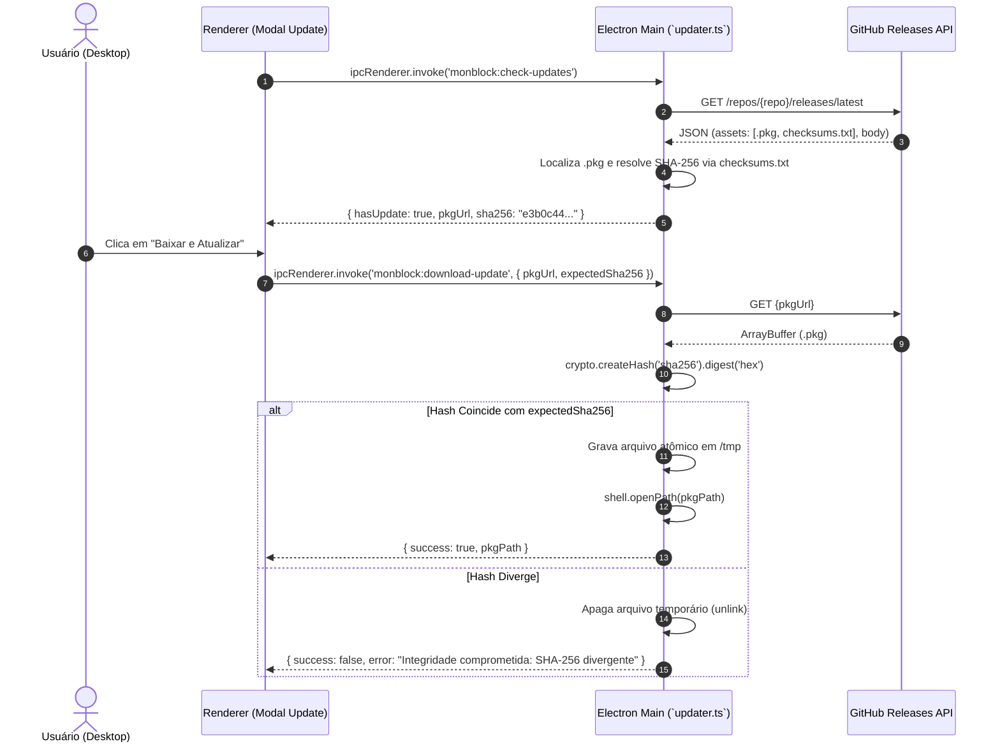

# Design Spec: Garantia de Integridade Criptográfica SHA-256 no Atualizador In-App

- **Data:** 2026-11-09
- **Status:** Proposto (Aguardando Auditoria e Aprovação)
- **Autor:** Engenheiro de Software Sênior & Pair Programmer (Antigravity)
- **Alvo:** `docs/ai/specs/2026-11-09-updater-sha256-integridade-design.md`
- **Padrões Normativos:** `AGENTS.md`, `ADR-0002` (3 Camadas), `ADR-0011` (Resiliência Aqua/Electron), OWASP Software Supply Chain Security, NIST SP 800-218 (Secure Software Development Framework) e Princípio Zero-Trust.

---

## 1. Contexto & Diagnóstico de Vulnerabilidade

### 1.1 O Risco de Supply Chain no Atualizador Desktop
O monBlock possui privilégios de sistema elevados no macOS (`LaunchDaemon` root com `/etc/hosts` e perfis de gerenciamento). Um atualizador in-app que baixa e executa instaladores `.pkg` sem verificação estrita de hash introduz um vetor crítico de adulteração (*Man-in-the-Middle*, comprometimento de DNS ou sequestro de CDN).

### 1.2 Diagnóstico do Fluxo Atual
1. **Omissão na Extração:** `checkForAppUpdates` em `src/main/updater.ts` localiza o binário `.pkg` na API do GitHub Releases, mas não busca arquivos de checksum (`checksums.txt`, `SHA256SUMS`, `.pkg.sha256`) nem faz parse de hashes na descrição da release. O campo `sha256` é retornado como `undefined`.
2. **Bypass Silencioso:** Em `downloadAppUpdatePkg`, a validação reside sob `if (expectedSha256)`. Como o valor recebido pelo IPC é `undefined`, o cálculo de hash é ignorado e o arquivo é entregue ao macOS (`shell.openPath`) sem qualquer garantia de autenticidade.
3. **Divergência Documental:** Documentos de design anteriores descreviam a checagem SHA-256 como ativa, gerando uma falsa sensação de segurança técnica.

---

## 2. Requisitos Arquiteturais & Critérios de Aceite

### 2.1 Resolução Automatizada do Hash SHA-256
A função `checkForAppUpdates` deve resolver o hash esperado através de estratégia em camadas:
1. **Camada 1 — Asset Específico (`<nome>.pkg.sha256`):**
   - Se houver um asset com o mesmo nome do `.pkg` acrescido de `.sha256` (ex: `monblock-0.8.2.pkg.sha256`), efetuar o download via `fetchFn` e extrair o hash de 64 caracteres hexadecimais.
2. **Camada 2 — Arquivo de Checksums Global (`SHA256SUMS` ou `checksums.txt`):**
   - Se houver `SHA256SUMS`, `SHA256SUMS.txt` ou `checksums.txt`, baixar o conteúdo e localizar a linha correspondente ao nome do arquivo `.pkg`.
3. **Camada 3 — Metadados no Corpo da Release (`release.body`):**
   - Caso não haja asset de checksum dedicado, inspecionar o texto do release buscando padrões explícitos como `sha256:\s*([a-fA-F0-9]{64})` ou linhas contendo o nome do `.pkg` seguido/precedido de 64 caracteres hex.

### 2.2 Política de Aplicação (Fail-Closed Zero-Trust)
- **Modo Estrito (Padrão):** Se um hash SHA-256 for resolvido, a validação é **obrigatória**. Qualquer divergência (1 bit diferente) descarta o arquivo imediatamente (`fs.unlinkSync`), retorna erro descritivo e **não abre o instalador**.
- **Tratamento de Release sem Hash:** Se a release remota não fornecer nenhuma assinatura SHA-256, a interface do usuário deve alertar que o pacote não possui verificação criptográfica antes do download, permitindo abrir o link oficial do GitHub no navegador.

---

## 3. Fluxo de Execução Criptográfica

---

## 4. Matriz de Avaliação de Alternativas

| Dimensão | Alternativa 1: Apenas Hash no Release Body | Alternativa 2: Checksum Asset + Body Fallback (Eleita) | Alternativa 3: Assinatura GPG / Sigstore |
| :--- | :--- | :--- | :--- |
| **Automação de CI** | Exige editar notas da release manualmente | **Compatível com `shasum -a 256` em GitHub Actions** | Exige infraestrutura de chaves e biblioteca OpenPGP |
| **Resiliência** | Frágil a erros de formatação de markdown | **Alta (lê arquivos de texto padrão de checksum)** | Máxima |
| **Complexidade** | Baixa | **Ideal (balanceada, sem dependências externas)** | Alta (peso desnecessário para app desktop) |
| **Veredito** | Insuficiente isolada | **ESCOLHIDA (Padrão industrial em empacotadores)** | Desproporcional neste estágio |

