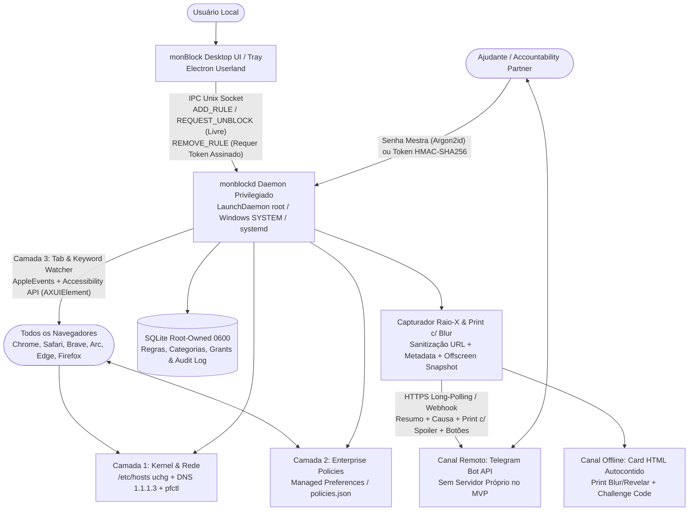
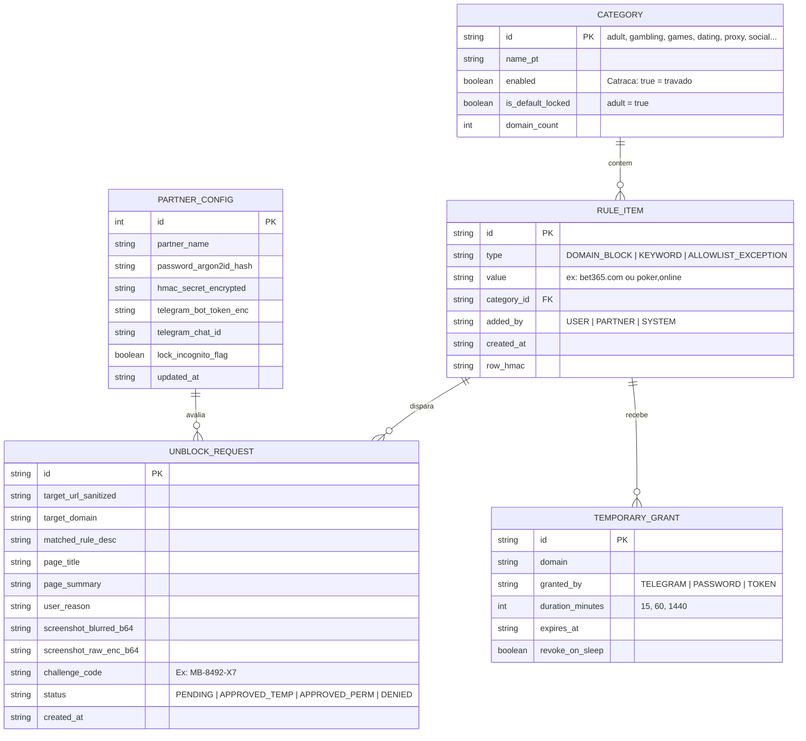

# 🏛️ Especificação Arquitetural do Sistema: monBlock

> [!NOTE]
> **Data de Emissão:** 2026-11-04  
> **Status:** 🟢 Aprovado & Blindado v2 pós `/plan-criticize`, `/security-audit` e `/design-review` (Prontidão: 100%)  
> **Conformidade Normativa:** `ai-guides` (`docs/ai/specs/2026-11-04-monblock-mvp-design.md`, `docs/ai/plans/2026-11-04-monblock-mvp-plan.md`, `docs/ai/reports/`, Clean Architecture, Zero-Trust, RFC 9457 Problem Details, WCAG 2.2 AAA & APCA `Lc >= 75`, Branding CCAT)  
> **Engenharia Reversa de Referência:** `_reversa_sdd/` (Cisdem AppCrypt v7.11.0, build 7110)

---

## 1. Visão Executiva & Requisitos Não-Funcionais (SLOs)

- **Problema de Negócio:** O consumo compulsivo de pornografia, apostas e conteúdos destrutivos causa graves prejuízos pessoais. Bloqueadores tradicionais em espaço de usuário falham porque o próprio usuário consegue desativá-los ou encerrá-los (`kill -9`) em momentos de impulso.
- **Solução (`monBlock`):** Aplicativo desktop multiplataforma (Electron + Daemon Privilegiado de SO) com **Catraca Unidirecional (`Append-Only`)** e **Responsabilidade Compartilhada (*Accountability Partner* / Ajudante)**. O usuário pode adicionar bloqueios e ativar categorias a qualquer momento, mas **jamais** pode desbloquear ou desativar por conta própria — dependendo da aprovação do Ajudante (via Bot Telegram interativo ou Senha/Token assinado offline).
- **Metas de Engenharia (SLOs):**
  - **Persistência do Bloqueio:** **100% ativo** mesmo com a interface Electron fechada, encerrada à força ou após reboot do sistema operacional.
  - **Latência de Bloqueio de Rede (`/etc/hosts` + DNS):** `< 1ms` (resolução local `0.0.0.0` no kernel).
  - **Latência de Interceptação de Aba/Palavra-chave:** `p95 < 400ms` (leitura de URL + redirecionamento para Tela de Bloqueio local).
  - **Tempo de Captura do Raio-X + Print Offscreen (com Blur):** `p95 < 3.000ms`.
  - **Consumo de Recursos em Background (`monblockd`):** `< 1% CPU` média e `< 50MB RAM`.

---

## 2. Diagrama de Arquitetura C4 (Nível 2 — Contêineres)

---

## 3. Arquitetura de Software, Domínio & Bounded Contexts

- **Topologia:** **Arquitetura Split Privilegiada em 3 Camadas** (`Electron UI` desprivilegiado + `monblockd` root daemon + `OS/Browser Enforcers`), estruturada internamente sob **Clean Architecture / Hexagonal (Ports & Adapters)** para suportar **macOS (MVP)**, **Windows** e **Linux** com o mesmo core de domínio.
- **Bounded Contexts:**
  1. **`rule-engine` (Catraca Unidirecional & Categorias):**
     - Gerencia as 11 categorias pré-cadastradas (extraídas do modelo `popularURLs` de `_reversa_sdd/`: *Conteúdo Adulto [ativa por padrão]*, *Apostas e Cassinos*, *Jogos*, *Relacionamento*, *Proxies/VPN*, *Redes Sociais*, *Vídeo*, *Compras*, *Notícias*, *E-mail*, *Buscadores*), lista customizada de domínios (`blackWebsites`), exceções (`whiteWebsites` com precedência máxima — `RN-WEB-01`), palavras-chave simples e combinadas por vírgula com operador `AND` (`RN-WEB-06`), e flag opcional **"Bloquear Modo Anônimo"**.
     - **Invariante de Segurança (Catraca):** Operações de endurecimento (`enableCategory`, `addBlockedDomain`, `addKeyword`, `enableIncognitoLock`) são livres para o usuário; operações de afrouxamento (`disableCategory`, `removeRule`, `addAllowlistException`, `disableIncognitoLock`) exigem `PartnerAuthorizationToken` válido.
  2. **`platform-enforcer` (Adaptadores Multi-OS: `darwin`, `win32`, `linux`):**
     - **`HostsEnforcer`:** Escreve domínios bloqueados em `/etc/hosts` (`0.0.0.0`) e aplica flag imutável `chflags uchg` (macOS), `chattr +i` (Linux) ou ACL `SYSTEM` (Windows) + flush de DNS cache (`dscacheutil -flushcache`).
     - **`DnsAndFirewallEnforcer`:** Configura DNS Familiar (`1.1.1.3` Cloudflare Family / CleanBrowsing Adult Filter) e regra `pfctl` (`/etc/pf.anchors/com.ccat.monblock`) para impedir bypass de DNS.
     - **`BrowserPolicyEnforcer`:** Gera `/Library/Managed Preferences/*.plist` (Chrome, Brave, Edge, Arc, Safari) e `policies.json` (Firefox) aplicando `URLBlocklist`, `URLAllowlist`, desativação de DoH interno (`DnsOverHttpsMode = off`) e, quando a flag estiver ativa, `IncognitoModeAvailability = 1` / `DisablePrivateBrowsing = true`.
     - **`UniversalBrowserWatcher`:** Corrige a falha do Cisdem AppCrypt no Firefox (`_reversa_sdd/web-block-engine/design.md:49`) combinando AppleEvents (`NSAppleScript` para Safari/Chromium/Arc) com a API de Acessibilidade do macOS (`AXUIElement` para Firefox, Zen e navegadores desconhecidos), inspecionando URL completa e `<title>` contra palavras-chave e redirecionando abas violadoras para a **Tela Local de Bloqueio (`http://127.0.0.1:49152/blocked`)**.
  3. **`partner-auth` (Guardião do Ajudante & Criptografia):**
     - Substitui o MD5 inseguro do app de referência (`ADR-003`) por **Argon2id** (para senha presencial do ajudante) e **HMAC-SHA256 / Ed25519** (para códigos de desafio-resposta offline e callbacks do Bot do Telegram).
     - Gerencia **Sessões de Liberação Temporária (`TemporaryGrant`)** com expiração automática (`15 min`, `1h`, `24h`) e revogação imediata quando o Mac entra em `sleep` (`NSWorkspaceWillSleepNotification` — `RN-APP-04`) ou ociosidade (`HIDIdleTime`).
  4. **`unblock-inspector` (Raio-X Seguro & Captura com Blur):**
     - Ao solicitar desbloqueio de uma URL, higieniza query strings sensíveis, extrai metadados (`<title>`, `<meta description>`, `H1/H2`), identifica a regra/palavra-chave exata que causou o bloqueio e captura um snapshot via `BrowserWindow` offscreen (`show: false`, `webPreferences.sandbox: true`), aplicando **Gaussian Blur no cliente** com opção de **"Revelar Imagem"** exclusiva para o Ajudante (no Telegram via `has_spoiler: true` e no Card HTML via toggle interativo).

---

## 4. Persistência, Consistência & Modelo de Dados

- **Banco de Dados Primário:** **SQLite 3** (`better-sqlite3` em modo `WAL` e `STRICT`), armazenado em `/Library/Application Support/monBlock/monblock.db` (propriedade `root:wheel`, permissão `0600`).
- **Integridade Anti-Tampering:** Cada linha de configuração e regra possui um `hmac_signature` calculado com chave secreta mantida no Keychain do `root` / `monblockd`. Edições manuais no arquivo SQLite invalidam a assinatura e restauram o bloqueio máximo (Fail-Closed).

---

## 5. Resiliência Defensiva, Casos de Borda & Padrões Operacionais

- **Fail-Closed por Padrão & Circuit Breaker:** Se o processo Electron UI for fechado pelo usuário, o `monblockd` (`LaunchDaemon`) + `/etc/hosts` (`uchg`) + `pfctl` + Browser Policies mantêm 100% dos bloqueios ativos. Integrações externas (Telegram Bot API) contam com **Circuit Breaker** (abre após 5 falhas consecutivas por 30s) e **Graceful Degradation** para o Card HTML + Token `HMAC-SHA256` offline (`Idempotency-Key` por `request_id` para evitar double-submit de pedidos de desbloqueio).
- **Contrato de Erros HTTP Padronizado (`RFC 9457 Problem Details`):** Todas as rotas do servidor local (`http://127.0.0.1:49152/api/*` e `/blocked`) retornam erros estruturados em `application/problem+json` contendo `type`, `title`, `status`, `detail`, `instance` e `errors[]`, sem jamais vazar stack traces.
- **Escrita Atômica e Rollback Seguro do `/etc/hosts`:**
  - Antes de qualquer mutação, salva backup íntegro em `/etc/hosts.monblock.bak`.
  - Edita apenas o bloco delimitado entre `# >>> MONBLOCK START >>>` e `# <<< MONBLOCK END <<<` em arquivo temporário (`/etc/hosts.monblock.tmp`) e aplica `fs.renameSync` atômico, preservando configurações de `localhost`, Docker e VPNs de trabalho.
- **Allowlist Crítica de Infraestrutura (Prevenção de Auto-Sabotagem):**
  - Domínios vitais (`127.0.0.1`, `localhost`, `api.telegram.org`, `accounts.google.com`, `appleid.apple.com`, `login.microsoftonline.com`) são imunes a bloqueio acidental por palavra-chave para nunca travar SSO de trabalho nem o próprio canal com o Ajudante.
- **Vínculo Durável Usuário ↔ Ajudante (Tripla Persistência Anti-Perda):**
  - O pareamento com o Ajudante (`partner_id`, `telegram_chat_id`, `hmac_secret`, `password_argon2id_hash`) é gravado simultaneamente em:
    1. Banco SQLite primário (`/Library/Application Support/monBlock/monblock.db`, `0600`).
    2. **macOS System Keychain (`/Library/Keychains/System.keychain`)**.
    3. Arquivo selado de recuperação (`/var/db/monblock/partner.seal` com flag imutável `chflags uchg`).
  - Atualizações do aplicativo, reinstalações ou limpezas de cache de usuário jamais quebram o vínculo com o Ajudante.
- **Protocolo de Esquecimento de Senha & Recuperação Anti-Impulso (3 Níveis):**
  1. **Nível 1 (Ajudante esqueceu a Senha Mestra local):** O Ajudante redefine a senha em 5 segundos enviando `/reset_senha` pelo seu celular no **Bot do Telegram pareado** (que assina uma nova senha para o `monblockd`).
  2. **Nível 2 (Ajudante sem Telegram e esqueceu a senha):** No ato do pareamento, é gerado um **Kit de Emergência do Ajudante** contendo **5 Códigos de Recuperação de Uso Único (`One-Time Recovery Codes`)** (evolução segura do `RN-LIM-02` de `_reversa_sdd/`), validados com `crypto.timingSafeEqual`.
  3. **Nível 3 (Perda Total / Ajudante Inacessível — `Cooldown Time-Lock de 72h`):** Para impedir que o computador fique inutilizável para sempre em caso de acidente real, mas **sem permitir recaída por impulso**, o usuário pode acionar o *Desbloqueio de Emergência com Delay Rigoroso de 72 Horas*. Durante as 72h:
     - O bloqueio permanece **100% ativo** (neutralizando qualquer impulso imediato).
     - O Ajudante recebe alertas a cada 6 horas no Telegram/contato configurado e pode **cancelar o timer com 1 clique** caso seja uma tentativa de burla.
- **Timeouts & SSRF Protection no `unblock-inspector`:**
  - Rejeita IPs privados/loopback (`127.0.0.0/8`, `10.0.0.0/8`, `192.168.0.0/16`, `169.254.0.0/16`) ao buscar preview.
  - Timeout rígido de `3.000ms` para renderização offscreen e `3.000ms` com Exponential Backoff + Full Jitter para chamadas à API do Telegram Bot.
- **Prevenção de Loop de Redirecionamento (`RN-WEB-02`):** O watcher ignora abas cujo endereço já aponte para `127.0.0.1:49152/blocked` ou `monblock://blocked`.

---

## 6. Governança de Segurança Zero-Trust

- **Autenticação de Comandos Críticos:** Qualquer comando IPC na rota de desbloqueio (`UNLOCK_TEMP`, `ALLOW_DOMAIN`, `DISABLE_CATEGORY`, `TOGGLE_INCOGNITO_OFF`) exige um destes 3 fatores validados dentro do `monblockd`:
  1. **Senha Mestra do Ajudante** verificada via `Argon2id` (`memoryCost: 64MB, timeCost: 3, parallelism: 4`).
  2. **Token de Desafio-Resposta (`HMAC-SHA256`)** vinculado ao `challenge_code` da solicitação + janela de tempo, com lista de códigos consumidos (`used_tokens` — inspirado em `RN-LIM-02` para impedir replay).
  3. **Callback Assinado do Telegram Bot** vindo exclusivamente do `telegram_chat_id` pareado do Ajudante.
- **Proteção contra Vazamento de Segredos:** O usuário local nunca tem permissão de leitura ao `telegram_bot_token` nem ao `hmac_secret` (guardados em arquivo `0600` de `root`/Keychain do Sistema).

---

## 7. Design UI/UX, Acessibilidade & Branding CCAT

- **Identidade Visual & Design Tokens (`docs/design/tokens.css`):** Segue estritamente o Design System Oficial **CCAT** (`Organic Elegance & Leveza Premium`), utilizando variáveis semânticas `var(--*)` e respeitando a **Proibição Absoluta do Roxo (Purple Ban)**.
- **4 Temas Nativos com Contraste WCAG 2.2 AAA & APCA (`Lc >= 75`):**
  1. **Capycro ("Wellness & Paz" — Padrão Diurno):** `--surface-ground: #faf9f6`, `--primary-color: #5d8a8c`, `--accent-color: #d8704c`, `--success-color: #5a9261`.
  2. **Escuro ("Tech & Imersão Noturna" — Padrão Noturno):** `--surface-ground: #0f172a`, `--surface-card: #1e293b`, `--primary-color: #60a5fa`, `--accent-color: #f97316`.
  3. **Claro ("Azul Fintech Confiável"):** `--surface-ground: #f8fafc`, `--primary-color: #2563eb`, `--accent-color: #0284c7`.
  4. **Alto Contraste ("WCAG AAA"):** `--surface-ground: #000000`, `--surface-card: #121212`, bordas `2px #ffffff`, `--primary-color: #ffff00`, `--accent-color: #00ffff`.
- **Estados Completos de UI (5 Estados Obrigatórios):** Todos os componentes e telas contemplam explicitamente **Idle**, **Loading (Skeleton Shimmer com CLS zero)**, **Empty State** (acionável), **Error State** (formatado via RFC 9457 com botão de Retry) e **Partial/Success State** (toast feedback e progresso).
- **Novos Critérios WCAG 2.2 Garantidos:**
  - **WCAG 2.4.11 (Focus Not Obscured):** `scroll-padding-top: 5rem` em todos os containers com header sticky e `:focus-visible` explícito.
  - **WCAG 2.5.7 (Dragging Movements):** Todos os controles possuem acionamento por clique simples e teclado (`Enter`/`Space`), sem exigir arrasto.
  - **WCAG 3.3.8 (Accessible Authentication):** Campos de Senha Mestra e Token `HMAC` permitem colar (`onPaste` livre) e gerenciadores de senha (1Password).
- **Protocolo Anti-Pânico:** A Tela de Bloqueio adota tom empático, sereno e construtivo (sem sirenes ou vermelho alarmista), apresentando a causa técnica do bloqueio e o fluxo direto de solicitação ao Ajudante.
- **Tipografia & Iconografia:** `Playfair Display` (títulos H1/H2), `Plus Jakarta Sans` / `Inter` (interface e tabelas), `tabular-nums` obrigatório em contadores/cronômetros, e **Lucide Icons** (`1.75px`).

---

## 8. Roadmap Arquitetural em Fases

| Fase | Escopo | Entregáveis Principais |
| :--- | :--- | :--- |
| **Fase 1 (MVP — Atual)** | **Bloqueio de Sites Multi-Browser + Catraca + Ajudante (macOS first)** | App Electron + `monblockd`, `/etc/hosts` imutável + DNS + Browser Policies (Chrome, Safari, Brave, Arc, Edge, Firefox), Watcher Universal (AppleEvents + Accessibility), 11 categorias pré-cadastradas, Flag de Modo Anônimo, Tela de Bloqueio CCAT com Raio-X + Print Blur/Revelar e integração com Bot Telegram + Token/Senha Offline. |
| **Fase 2** | **Bloqueio de Aplicativos, Auto-Defesa & Drivers Windows/Linux** | Portabilidade do `PlatformEnforcer` para Windows (`WFP`/Service) e Linux (`nftables`/`systemd`); bloqueio de apps desktop, proteção de `Terminal`/`Activity Monitor`/`System Settings` e máscara com blur (`RN-APP-01..05`). |
| **Fase 3** | **Inspeção Profunda de Conteúdo In-App & Painel Cloud SaaS** | Extensão MV3 forçada por policy para leitura profunda de DOM em redes sociais + Painel Web Cloud completo para o Ajudante gerenciar múltiplos dispositivos remotamente. |

---

## 9. Matriz de Decisões Arquiteturais (ADRs Vinculadas)

| Decisão Arquitetural | Alternativas Avaliadas | Escolha Selecionada | Justificativa Técnica & Trade-offs | ADR ID |
| :--- | :--- | :--- | :--- | :---: |
| Separação de Privilégios | Electron Monolítico (Userland) vs. Electron UI + Root Daemon (`monblockd`) | **Electron UI + Root Daemon (`monblockd`)** | Impede encerramento via `kill -9` e mantém bloqueio ativo mesmo com o app fechado, superando a limitação do Cisdem AppCrypt (`ADR-001`). | `ADR-0001` |
| Bloqueio Multi-Navegador (incluindo Firefox) | Apenas `/etc/hosts` vs. Apenas AppleScript vs. **Tripla Camada (`/etc/hosts` + Policies + AppleEvents/AXUIElement)** | **Tripla Camada Híbrida** | `/etc/hosts` garante bloqueio instantâneo no kernel; `policies.json`/`.plist` e `AXUIElement` cobrem o Firefox e palavras-chave em URLs. | `ADR-0002` |
| Autenticação do Ajudante no MVP | MD5 Local vs. SaaS Cloud Obrigatório vs. **Argon2id + HMAC Challenge + Telegram Bot** | **Argon2id + HMAC + Telegram Bot** | Zero custo de servidor no MVP, aprovação em 1 clique no celular do ajudante com Spoiler nativo na imagem e fallback 100% offline. | `ADR-0003` |
| Captura de Contexto da URL | Sem contexto vs. Print Cru vs. **Raio-X Textual + Print Offscreen com Blur e Botão Revelar** | **Raio-X + Print c/ Blur e Botão Revelar** | Permite ao ajudante verificar falsos positivos visualmente sem expor conteúdo explícito de imediato. | `ADR-0004` |
