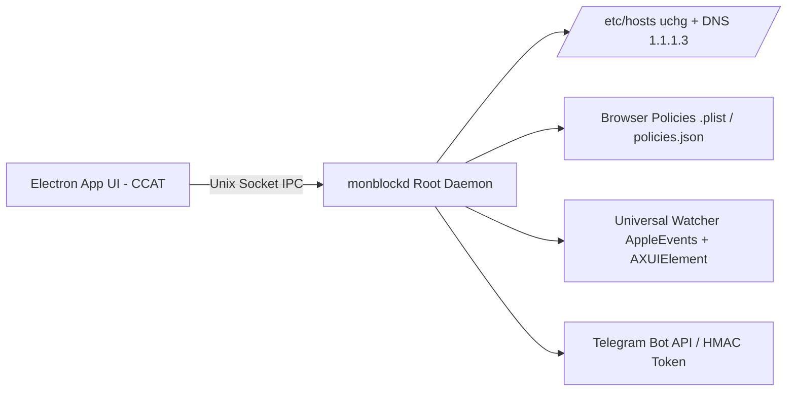

<!--
================================================================================
LOG DE MANUTENÇÃO DE DOCUMENTAÇÃO
--------------------------------------------------------------------------------
Data       | Autor          | Descrição
--------------------------------------------------------------------------------
2026-11-04 | Matheus Diniz  | Registro consolidado de desenvolvimento da sessão.
================================================================================
-->

# Registro de Desenvolvimento — 2026-11-04

| Metadado | Detalhe |
| :--- | :--- |
| **Escopo Principal** | `harness`, `reversa`, `architecture`, `design` |
| **Commits Gerados** | `5` |
| **Arquivos Modificados** | `418` |
| **ADRs Vinculadas / Geradas** | `docs/adrs/0001-arquitetura-split-privilegiada-daemon-monblockd.md`, `docs/adrs/0002-bloqueio-web-em-3-camadas-hosts-policies-watcher.md`, `docs/adrs/0003-catraca-unidirecional-append-only-e-aprovacao-ajudante.md`, `docs/adrs/0004-pareamento-duravel-tripla-persistencia-e-recuperacao-3-niveis.md` |

---

## 1. Visão Geral das Alterações
> Consolidação da engenharia reversa de referência (`_reversa_sdd/`), estruturação do Dual-Harness Nível 3 (`AGENTS.md`, `.agents/`, `.claude/`, `.gemini/`), formalização da Arquitetura Split Privilegiada do `monBlock` (`ARCHITECTURE_SPEC.md` + ADRs `0001` a `0004`), migração de specs e planos para `docs/ai/` (`Risk Score: 0/100`) e implementação do Design System Oficial CCAT com a Tela de Bloqueio limpa (`docs/design/blocked-page.html` e `tokens.css`).

---

## 2. Arquitetura Afetada & Decisões (ADRs)
- **Decisões Registradas:**
  - `docs/adrs/0001-arquitetura-split-privilegiada-daemon-monblockd.md`: Separação entre UI Electron desprivilegiada e Daemon Root `monblockd` via Unix Socket validado por Zod.
  - `docs/adrs/0002-bloqueio-web-em-3-camadas-hosts-policies-watcher.md`: Bloqueio Web em 3 camadas (`/etc/hosts` atômico `chflags uchg` + Policies `.plist`/`policies.json` + Watcher Universal AppleEvents/`AXUIElement`).
  - `docs/adrs/0003-catraca-unidirecional-append-only-e-aprovacao-ajudante.md`: Invariante `Append-Only` para o usuário e aprovação pelo Ajudante via Bot do Telegram / Token HMAC-SHA256 / Senha Argon2id.
  - `docs/adrs/0004-pareamento-duravel-tripla-persistencia-e-recuperacao-3-niveis.md`: Tripla persistência self-healing (SQLite `0600` + Keychain + `partner.seal`) e recuperação de senha em 3 níveis (Telegram, 5 Recovery Codes e Cooldown Time-Lock de 72h).
- **Diagrama de Relações e Fluxos:**

---

## 3. Mapa de Arquivos Modificados

| Arquivo | Camada Técnica | Resumo da Modificação |
| :--- | :--- | :--- |
| `AGENTS.md` / `.agents/` | Governança & Harness | Instruções canônicas, hooks, skills e memórias sincronizadas |
| `_reversa_sdd/*` | Engenharia Reversa | Especificação completa do app de referência (C4, ERD, 5 módulos) |
| `docs/architecture/ARCHITECTURE_SPEC.md` | Arquitetura | Especificação arquitetural completa com C4, SQLite STRICT e Pre-Mortem |
| `docs/adrs/0001..0004-*.md` | Governança Arquitetural | 4 ADRs fundacionais validadas pelo `validate_adrs.py` |
| `docs/ai/specs/2026-11-04-monblock-mvp-design.md` | Spec de IA | Design Spec do MVP Fase 1 (`Risk Score: 0/100`) |
| `docs/ai/plans/2026-11-04-monblock-mvp-plan.md` | Plano de IA | Plano de implementação TDD em 4 tarefas (`Risk Score: 0/100`) |
| `docs/design/tokens.css` & `blocked-page.html` | UI/UX CCAT | Design System 4 temas e Tela de Bloqueio limpa com componentes `.ccat-*` |

---

## 4. Detalhamento por Commit

### `chore(harness): configurar estrutura dual-harness nivel 3 e sincronizar memorias`
- **Razão da alteração:** Garantir paridade entre Claude Code e Gemini CLI com hooks de governança e memória de equipe compartilhada.
- **Comportamento atual:** 15 hooks ativos e memórias espelhadas em `.claude/memory/team/`, `.gemini/memory/team/` e `.agents/memory/`.

### `docs(reversa): adicionar especificacao reversa de referencia em _reversa_sdd`
- **Razão da alteração:** Preservar os artefatos da engenharia reversa que embasaram a superação de falhas de userland/MD5/Firefox.

### `docs(architecture): registrar ARCHITECTURE_SPEC, ADRs 0001-0004 e specs/planos em docs/ai`
- **Razão da alteração:** Consolidar a governança arquitetural e migrar specs/planos para `docs/ai/`.

### `feat(design): implementar design system CCAT, tela de bloqueio clean e servidor local`
- **Razão da alteração:** Entregar a identidade visual CCAT (WCAG 2.2 AAA, zero roxo) e a página local de bloqueio (`127.0.0.1:49152/blocked`).

---

## 5. Dívida Técnica & Próximos Passos

- [x] Executar a implementação das Tasks 1 a 4 do plano (`docs/ai/plans/2026-11-04-monblock-mvp-plan.md`) via `/maestro`.
