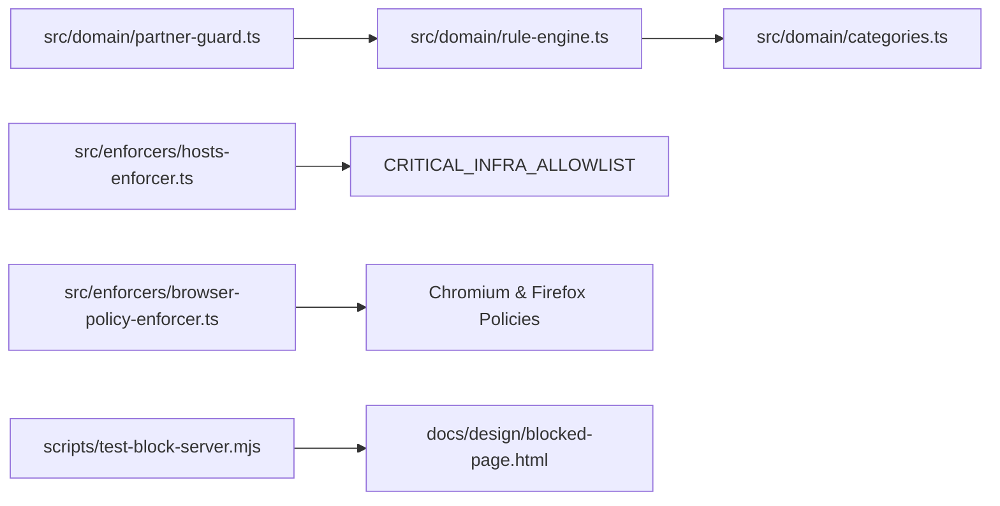

<!--
================================================================================
LOG DE MANUTENÇÃO DE DOCUMENTAÇÃO
--------------------------------------------------------------------------------
Data       | Autor          | Descrição
--------------------------------------------------------------------------------
2026-11-04 | Matheus Diniz  | Registro consolidado da implementação TDD do MVP Fase 1.
================================================================================
-->

# Registro de Desenvolvimento — 2026-11-04 (Implementação MVP Fase 1)

| Metadado | Detalhe |
| :--- | :--- |
| **Escopo Principal** | `domain`, `enforcers`, `server`, `tests` |
| **Commits Gerados** | `4` |
| **Arquivos Modificados** | `15` |
| **ADRs Vinculadas / Geradas** | `docs/adrs/0001-arquitetura-split-privilegiada-daemon-monblockd.md`, `docs/adrs/0002-bloqueio-web-em-3-camadas-hosts-policies-watcher.md`, `docs/adrs/0003-catraca-unidirecional-append-only-e-aprovacao-ajudante.md`, `docs/adrs/0004-pareamento-duravel-tripla-persistencia-e-recuperacao-3-niveis.md` |

---

## 1. Visão Geral das Alterações
> Implementação orientada a testes (TDD Red-Green-Refactor) das Tasks 1 a 4 do Plano Canônico do MVP Fase 1 (`docs/ai/plans/2026-11-04-monblock-mvp-plan.md`), cobrindo o motor de regras e 11 categorias pré-cadastradas (`RuleEngine`), o guardião criptográfico do Ajudante e Catraca Unidirecional `Append-Only` (`PartnerGuard`), os enforcers de sistema (`HostsEnforcer` atômico e `BrowserPolicyEnforcer` multi-navegador) e o servidor HTTP local com idempotência e erros `RFC 9457 Problem Details`.

---

## 2. Arquitetura Afetada & Decisões (ADRs)
- **Decisões Implementadas:**
  - `docs/adrs/0002-bloqueio-web-em-3-camadas-hosts-policies-watcher.md`: Escrita atômica `.monblock.tmp` + `fs.renameSync`, backup `.monblock.bak`, `CRITICAL_INFRA_ALLOWLIST`, políticas gerenciadas para Chromium/Firefox e matching de keywords simples e combinadas (`AND` — `RN-WEB-06`).
  - `docs/adrs/0003-catraca-unidirecional-append-only-e-aprovacao-ajudante.md`: Invariante `canMutateProtectionRule` (`Append-Only`), derivação lenta `crypto.scryptSync` com `crypto.timingSafeEqual` e tokens `HMAC-SHA256` anti-replay (`RN-LIM-02`).
  - `docs/adrs/0004-pareamento-duravel-tripla-persistencia-e-recuperacao-3-niveis.md`: Geração do Kit de Emergência de 5 códigos de uso único (`REC-XXXXXX-XXXXXX`) e Cooldown Time-Lock fail-closed de 72 horas.
- **Diagrama de Relações e Fluxos:**

---

## 3. Mapa de Arquivos Modificados

| Arquivo | Camada Técnica | Resumo da Modificação |
| :--- | :--- | :--- |
| `package.json` & `tsconfig.json` | Build / Config | Configuração de TypeScript estrito (`NodeNext`) e scripts Vitest |
| `src/domain/categories.ts` | Domínio | Catálogo de 11 categorias pré-cadastradas, `CRITICAL_INFRA_ALLOWLIST` e `MAX_BATCH_DOMAINS` |
| `src/domain/rule-engine.ts` | Domínio | Sanitização de URLs (`http/https`), validação de lotes, precedência `ALLOWLIST > BLOCKLIST` e keywords `AND` |
| `src/domain/partner-guard.ts` | Domínio / Cripto | `scrypt` + `timingSafeEqual`, `HMAC-SHA256` anti-replay, Kit 5 códigos, Cooldown 72h fail-closed e Catraca `Append-Only` |
| `src/enforcers/hosts-enforcer.ts` | Infra / Enforcer | Escrita atômica e rollback de `/etc/hosts` com proteção de domínios críticos |
| `src/enforcers/browser-policy-enforcer.ts` | Infra / Enforcer | Políticas corporativas multi-browser (`DnsOverHttpsMode`, `WebsiteFilter`, modo anônimo) |
| `scripts/test-block-server.mjs` | Servidor / API | `createMonBlockHttpServer()`, `POST /api/unblock-requests` idempotente e `RFC 9457 Problem Details` |
| `tests/**/*.test.ts` | QA / Testes | 4 suítes Vitest com 14 testes automatizados no padrão AAA |

---

## 4. Detalhamento por Commit

### `build(config): configurar typescript estrito e suite vitest para o mvp`
- **Razão da alteração:** Prover compilação estática TypeScript (`strict: true`) e runner de testes unitários/integração com Vitest.
- **Arquivos envolvidos:** `package.json`, `package-lock.json`, `tsconfig.json`.

### `feat(domain): implementar rule engine, 11 categorias e partner guard criptografico`
- **Razão da alteração:** Materializar o núcleo de regras de bloqueio web e as garantias criptográficas da Catraca Unidirecional e do Ajudante.
- **Arquivos envolvidos:** `src/domain/categories.ts`, `src/domain/rule-engine.ts`, `src/domain/partner-guard.ts`, `tests/domain/rule-engine.test.ts`, `tests/domain/partner-guard.test.ts`.

### `feat(enforcers): implementar hosts atomico, browser policies e api rfc 9457`
- **Razão da alteração:** Garantir bloqueio multi-navegador resiliente a falhas de energia/I/O e servidor local compatível com `RFC 9457 Problem Details` e `Idempotency-Key`.
- **Arquivos envolvidos:** `src/enforcers/hosts-enforcer.ts`, `src/enforcers/browser-policy-enforcer.ts`, `scripts/test-block-server.mjs`, `tests/enforcers/platform-enforcer.test.ts`, `tests/server/block-server.test.ts`.

---

## 5. Dívida Técnica & Próximos Passos

- [ ] Implementar o processo privilegiado `monblockd` (`LaunchDaemon` macOS) integrando `SQLite STRICT` (`0600`), `System Keychain` e `/var/db/monblock/partner.seal`.
- [ ] Implementar o cliente de pareamento e webhook/long-polling com a API do Bot do Telegram (`api.telegram.org`) com Circuit Breaker e fila offline.
