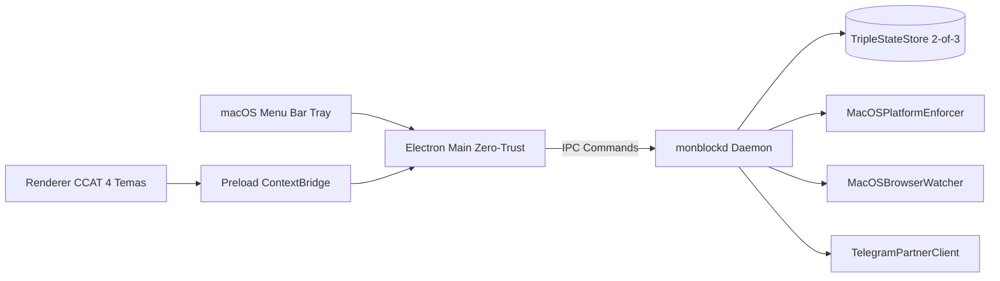

<!--
================================================================================
LOG DE MANUTENÇÃO DE DOCUMENTAÇÃO
--------------------------------------------------------------------------------
Data       | Autor          | Descrição
--------------------------------------------------------------------------------
2026-11-04 | OpenClaude     | Registro consolidado de desenvolvimento de MOD-01 a MOD-04, Master Spec e 5 Domínios DDD.
================================================================================
-->

# Registro de Desenvolvimento — 2026-11-04 (MOD-01 a MOD-04, Master Spec & Domínios DDD)

| Metadado | Detalhe |
| :--- | :--- |
| **Escopo Principal** | `MOD-01..04 (RN-WEB-07, StateStore 2-de-3, monblockd, Watcher macOS, Telegram Bot, Electron + Tray CCAT)` |
| **Commits Gerados** | `7 commits atômicos` |
| **Arquivos Modificados / Criados** | `39 arquivos` |
| **ADRs Vinculadas / Geradas** | `docs/adrs/0001..0004` |

---

## 1. Visão Geral das Alterações
> Consolidação da arquitetura completa do `monBlock` na Master Spec e nas 5 Sub-Especificações Modulares (`MOD-01` a `MOD-05`, mantendo `MOD-05` congelado para revisão futura na Fase 2), documentação dos 5 Bounded Contexts DDD em `docs/domains/` e implementação TDD integral dos módulos `MOD-01`, `MOD-02`, `MOD-03` e `MOD-04` com 48 testes automatizados passando (`9/9` suítes verdes) e verificação adversarial aprovada (`VERDICT: PASS`).

---

## 2. Arquitetura Afetada & Decisões (ADRs)
- **Decisões Aplicadas:**
  - `docs/adrs/0001-arquitetura-split-privilegiada-daemon-monblockd.md`: Isolamento do daemon `monblockd` (`src/daemon/monblockd.ts`) e da UI Electron Zero-Trust (`src/main/main.ts`, `src/preload/preload.ts`) + desinstalação autorizada (`UNINSTALL_AUTHORIZED` — `RN-DAEMON-06`).
  - `docs/adrs/0002-bloqueio-web-em-3-camadas-hosts-policies-watcher.md`: Prevenção geral de falsos positivos por fronteira Unicode (`RN-WEB-07` em `src/domain/rule-engine.ts`) e Watcher Universal macOS (`src/enforcers/macos-watcher.ts`).
  - `docs/adrs/0003-catraca-unidirecional-append-only-e-aprovacao-ajudante.md`: Integração `TelegramPartnerClient` (`src/daemon/telegram-client.ts`) com Raio-X `has_spoiler: true`, Circuit Breaker e fallback para Desafio-Resposta Offline `HMAC-SHA256`.
  - `docs/adrs/0004-pareamento-duravel-tripla-persistencia-e-recuperacao-3-niveis.md`: `TripleStateStore` (`src/storage/state-store.ts`) com reconciliação `Self-Healing (2 de 3)` assinada por `HMAC-SHA256`.

---

## 3. Mapa de Arquivos Modificados

| Arquivo | Camada Técnica | Resumo da Modificação |
| :--- | :--- | :--- |
| `src/domain/rule-engine.ts` | Domínio (`MOD-01`) | Fronteira de palavra inteira Unicode, `safeDecodeUri` e higienização de abreviações (`RN-WEB-07`) |
| `src/storage/state-store.ts` | Persistência (`MOD-03`) | Tripla Persistência Redundante com `HMAC-SHA256`, `Self-Healing (2 de 3)` e modo `Fail-Closed` |
| `src/enforcers/platform-enforcer.ts` | Infraestrutura (`MOD-03`) | `MacOSPlatformEnforcer` integrando `/etc/hosts`, políticas de navegadores e proteção `chflags uchg` |
| `src/daemon/monblockd.ts` | Daemon (`MOD-03`) | Orquestrador IPC com `UNINSTALL_AUTHORIZED`, Catraca `Append-Only` e erros `RFC 9457` |
| `src/enforcers/macos-watcher.ts` | Enforcer (`MOD-01`) | Monitoramento de abas ativas no macOS sem interpolação de shell e com debounce de `150ms` |
| `src/daemon/telegram-client.ts` | Integração (`MOD-02`) | Cliente Telegram com `has_spoiler: true`, retry com jitter e Circuit Breaker com fallback offline |
| `src/main/main.ts` | Desktop (`MOD-04`) | Processo principal Electron Zero-Trust e `buildTrayMenuTemplate` sem opção de saída (`INV-UI-TRAY-03`) |
| `src/preload/preload.ts` | Desktop (`MOD-04`) | Ponte `window.monblock` congelada (`Object.freeze`) sem expor `ipcRenderer` |
| `src/renderer/index.html` & `app.ts` | UI CCAT (`MOD-04`) | 4 temas CCAT Zero-Roxo, 5 estados de UI, Wizard de 4 passos, 11 categorias e Central do Ajudante |
| `docs/ai/specs/*.md` | Especificações | Master Spec e Sub-Specs `MOD-01` a `MOD-05` (`Risk Score: 0/100`) |
| `docs/domains/**` | DDD | 15 documentos canônicos cobrindo os 5 Bounded Contexts do `monBlock` |

---

## 4. Detalhamento por Commit

### `fix(domain): prevenir falsos positivos de palavras-chave por fronteira Unicode (RN-WEB-07)`
- **Razão da alteração:** Impedir que termos curtos bloqueados (`"tit"`, `"sex"`, `"anal"`, `"ass"`, `"cum"`) barrem URLs/títulos legítimos contendo essas sílabas (`"instituição"`, `"sexta-feira"`, `"sex."`, `"tit."`).
- **Comportamento atual:** Decodifica percent-encoding UTF-8, neutraliza abreviações cotidianas e exige casamento de palavra inteira Unicode (`(?<![\p{L}\p{N}])termo(?![\p{L}\p{N}])`).

### `docs(specs): consolidar Master Spec e 5 sub-especificacoes modulares (MOD-01 a MOD-05)`
- **Razão da alteração:** Formalizar todos os contratos de engenharia, segurança anti-tamper e jornada de UX antes da construção dos módulos.

### `docs(domains): documentar os 5 Bounded Contexts DDD do monBlock`
- **Razão da alteração:** Documentar `overview.md`, `business-rules.md` e `tech-design.md` para os 5 domínios do sistema.

### `feat(daemon): implementar TripleStateStore self-healing, PlatformEnforcer e monblockd (MOD-03)`
- **Razão da alteração:** Garantir persistência em 3 cofres com auto-reparo `2 de 3` e exigir prova criptográfica do Ajudante para qualquer redução de regra ou desinstalação (`UNINSTALL_AUTHORIZED`).

### `feat(watcher,telegram): implementar MacOSBrowserWatcher e TelegramPartnerClient resiliente (MOD-01/02)`
- **Razão da alteração:** Interceptar abas em tempo real nos navegadores macOS e enviar pedidos de desbloqueio com Raio-X borrado ao Telegram do Ajudante, com fallback automático para Desafio Offline `HMAC-SHA256`.

### `feat(desktop): implementar aplicativo Electron Zero-Trust, Menu da Tray macOS e UI CCAT (MOD-04)`
- **Razão da alteração:** Entregar a jornada completa do usuário desde o Onboarding em 4 passos até o uso diário pela Tray macOS e Dashboard CCAT Zero-Roxo.

---

## 5. Dívida Técnica & Próximos Passos

- [ ] Revisar em profundidade com o usuário a especificação congelada do `MOD-05` (`AppLockEngine` + `ScheduleEngine` + `ClockGuard`) antes de iniciar a Fase 2.
- [ ] Configurar empacotamento `.dmg` / `.pkg` assinado para instalação automatizada do `/Library/LaunchDaemons/com.ccat.monblockd.plist` em ambiente macOS de produção.
