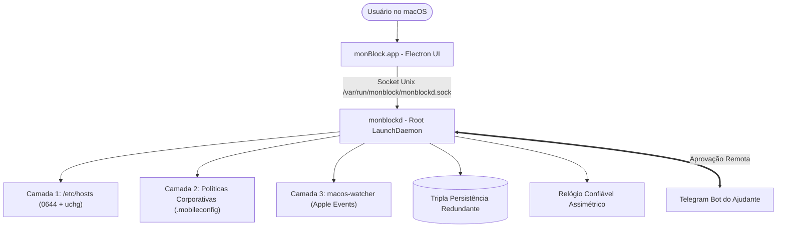

<!--
================================================================================
LOG DE MANUTENÇÃO DE DOCUMENTAÇÃO
--------------------------------------------------------------------------------
Data       | Autor          | Descrição
--------------------------------------------------------------------------------
2026-11-06 | Matheus Diniz  | Registro consolidado de desenvolvimento da sessão.
================================================================================
-->

# Registro de Desenvolvimento — 2026-11-06

| Metadado | Detalhe |
| :--- | :--- |
| **Escopo Principal** | `README Canônico & Governança de Arquitetura (ai-guides v2.13.0 + ADR-0008)` |
| **Commits Gerados** | `2 commits principais + 1 commit de documentação` |
| **Arquivos Modificados** | `39 arquivos` |
| **ADRs Vinculadas / Geradas** | [`docs/adrs/0008-adocao-ddd-pragmatico-use-cases-unit-of-work.md`](../adrs/0008-adocao-ddd-pragmatico-use-cases-unit-of-work.md) |

---

## 1. Visão Geral das Alterações
> Sincronização da branch `main` com `origin/main` incorporando correções de permissões de automação e empacotamento. Criação do `README.md` canônico completo para o repositório com instruções detalhadas de arquitetura, instalação e links de build para download. Atualização do runtime de governança `ai-guides` para `v2.13.0` e resolução da colisão sequencial de ADRs com o registro formal da `ADR-0008`.

---

## 2. Arquitetura Afetada & Decisões (ADRs)
- **Decisões Registradas:**
  - `docs/adrs/0008-adocao-ddd-pragmatico-use-cases-unit-of-work.md`: Padronização de DDD pragmático com estilo backend enxuto, Use Cases por vertical slice e Unit of Work estritamente delimitado ao store relacional local (SQLite).
  - `docs/adrs/0007-daemon-root-pkg-ipc-relogio-confiavel.md`: Sincronizada do remoto, definindo o daemon root compilado via Node SEA, distribuído por `.pkg` e relógio assimétrico.
- **Diagrama de Relações e Fluxos:**

---

## 3. Mapa de Arquivos Modificados

| Arquivo | Camada Técnica | Resumo da Modificação |
| :--- | :--- | :--- |
| `README.md` | Documentação | Criação da documentação oficial com visão geral, badges, downloads de builds e FAQ |
| `docs/adrs/0008-adocao-ddd-pragmatico-use-cases-unit-of-work.md` | Governança | Registro formal da ADR 0008 reordenada para evitar colisão sequencial |
| `docs/adrs/README.md` | Governança | Atualização automática do índice de decisões arquiteturais |
| `.agents/ai-guides/*` | Governança | Atualização de templates, guias e versionamento normativo para v2.13.0 |
| `AGENTS.md` | Governança | Inclusão das diretrizes normativas de DDD pragmático e engenharia de banco de dados |
| `docs/ai/setup-manifest.yaml` | Governança | Atualização do manifesto com status das heurísticas e versão de runtime |

---

## 4. Detalhamento por Commit

### `chore(governance): atualizar ai-guides para v2.13.0 e registrar ADR-0008`
- **Razão da alteração:** Manter os guias de engenharia e governança sincronizados e registrar formalmente a decisão de DDD pragmático sem colidir com a ADR 0007 vinda do upstream.
- **Comportamento atual:** Validador `validate_adrs.py` e gerador `generate_adr_index.py` executados com 100% de conformidade.
- **Decisões técnicas & ADRs:** ADR-0008.

### `docs(readme): criar documentacao canonica do monBlock com guia de instalacao e arquitetura`
- **Razão da alteração:** O repositório não possuía um `README.md` principal na raiz orientando usuários e desenvolvedores.
- **Comportamento atual:** Documentação exaustiva cobrindo arquitetura split, defesa em 3 camadas, catálogo de 11 categorias, passos de instalação no macOS, scripts de compilação e FAQ.
- **Decisões técnicas & ADRs:** Alinhado com ADR-0001, ADR-0002, ADR-0003 e ADR-0007.

---

## 5. Dívida Técnica & Próximos Passos

- [ ] Gerar nova tag e release SemVer no GitHub Releases anexando `monBlock-app.zip` e `monblockd.pkg`.
- [ ] Conduzir testes manuais de instalação do `.pkg` em ambiente macOS limpo com macOS Sequoia.
