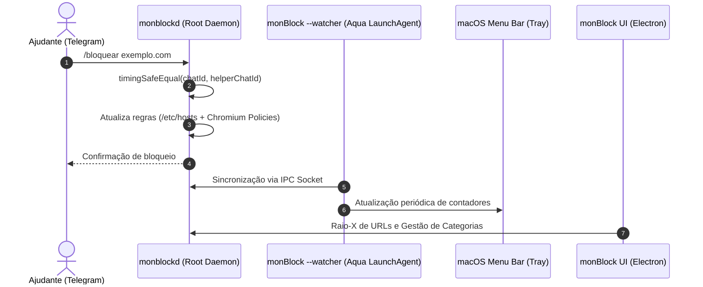

<!--
================================================================================
LOG DE MANUTENÇÃO DE DOCUMENTAÇÃO
--------------------------------------------------------------------------------
Data       | Autor          | Descrição
--------------------------------------------------------------------------------
2026-11-09 | Matheus Diniz  | Registro consolidado de desenvolvimento da sessão.
================================================================================
-->

# Registro de Desenvolvimento — 2026-11-09

| Metadado | Detalhe |
| :--- | :--- |
| **Escopo Principal** | `resiliência contínua, comandos remotos telegram, listas adult e refino ui/ux` |
| **Commits Gerados** | `6 commits atômicos` |
| **Arquivos Modificados** | `22 arquivos` |
| **ADRs Vinculadas / Geradas** | `docs/adrs/0011-resiliencia-sessao-aqua-launchagent-e-comandos-remotos-telegram.md` |

---

## 1. Visão Geral das Alterações
> Esta sessão consolidou melhorias críticas de resiliência e usabilidade no monBlock:
> 1. Resiliência de monitoramento em segundo plano mesmo sem interface gráfica aberta através de suporte a `--watcher` e definição de LaunchAgent para sessão Aqua.
> 2. Empoderamento remoto do Ajudante via bot do Telegram com comandos interativos (`/status`, `/bloquear`, `/liberar`, `/revogar`, `/ajuda`) protegidos por autenticação timing-safe.
> 3. Expansão do catálogo de bloqueio da categoria `adult` com 55 domínios e 32 palavras-chave cobrindo sex shops e artigos eróticos.
> 4. Resolução de falso negativo no Raio-X de Bloqueio para termos puros sem TLD e refino completo da UI/UX com seletor canônico de temas, animação de pulso de proteção e alinhamento de componentes.

---

## 2. Arquitetura Afetada & Decisões (ADRs)
- **Decisões Registradas:**
  - `docs/adrs/0011-resiliencia-sessao-aqua-launchagent-e-comandos-remotos-telegram.md`: Documenta a arquitetura de desacoplamento entre o daemon root (`monblockd`), o LaunchAgent em sessão de login Aqua para inspeção de navegadores (`AXUIElement`/AppleScript) e os comandos remotos do Telegram.

---

## 3. Mapa de Arquivos Modificados

| Arquivo | Camada Técnica | Resumo da Modificação |
| :--- | :--- | :--- |
| `LICENSE` | Governança | Termos de licença proprietária e direitos autorais |
| `docs/adrs/0009-listas-...` | Governança | Normalização de cabeçalho e seção da ADR 0009 |
| `docs/adrs/0010-telegram-...` | Governança | Renomeação e normalização para ADR 0010 |
| `docs/adrs/0011-resiliencia-...` | Governança | Nova ADR 0011 formalizando LaunchAgent e comandos Telegram |
| `docs/adrs/README.md` | Governança | Atualização automática do índice de ADRs |
| `src/domain/lists/adult.*.txt` | Domínio / Dados | Inclusão de sex shops (55 domínios, 32 keywords) |
| `src/domain/lists.generated.ts` | Domínio / Build | Recompilação do catálogo de bloqueio estático |
| `src/domain/rule-engine.ts` | Domínio / Engine | Suporte a termos puros sem TLD no Raio-X de Bloqueio |
| `src/daemon/telegram-client.ts` | Daemon / Infra | Método `sendMessage` genérico com parse mode |
| `src/daemon/monblockd.ts` | Daemon / Broker | Interceptação e execução de comandos remotos do Telegram |
| `packaging/macos/com.ccat.monblock.watcher.plist` | Infra / macOS | Manifesto de LaunchAgent em sessão de usuário |
| `src/main/main.ts` | Desktop / Main | Suporte a `--watcher` / `--hidden` e contadores regressivos na Tray |
| `src/renderer/index.html` | UI / Apresentação | Componente canônico de temas e SVG oficial do CCAT |
| `src/renderer/renderer-init.js` | UI / Lógica | Gestão de estado do tema canônico e pulso visual |
| `src/renderer/renderer.css` | UI / Estilos | Estilos do seletor, animação de pulso e fix de z-index de toasts |
| `tests/domain/lists.test.ts` | Testes | Verificação de bloqueio de sex shops por domínio e keyword |
| `tests/daemon/unblock-flow.test.ts` | Testes | Testes de integração de todos os comandos do Telegram |

---

## 4. Detalhamento por Commit

### `docs(governance): registrar licenca proprietaria, adrs 0009-0011 e relatorios de auditoria`
- Inclusão do arquivo de licença proprietária `LICENSE`.
- Normalização de formato das ADRs 0009 e 0010.
- Criação da ADR 0011 e atualização do índice README.md de ADRs.
- Arquivamento de relatórios técnicos de auditoria em `docs/ai/`.

### `feat(domain): adicionar sex shops e artigos eroticos na categoria adult`
- Adicionados 55 domínios e 32 keywords na categoria `adult`.
- Compilação para 6.452 domínios e 290 palavras-chave.
- Testes unitários comprovando bloqueio determinístico.

### `fix(engine): corrigir deteccao de termos puros sem tld no verificador raio-x`
- Normalização de termos de busca sem TLD ou protocolo.
- Comparação contra categorias ativas, bloqueios customizados e palavras-chave compostas.

### `feat(telegram): adicionar comandos remotos /status, /bloquear, /liberar e /ajuda para o ajudante`
- Interceptação de `message.text` no broker com autenticação timing-safe.
- Suporte aos comandos operacionais remotos `/status`, `/bloquear`, `/liberar`, `/revogar` e `/ajuda`.
- Testes cobrindo autorização e fluxos de comando.

### `feat(desktop): adicionar modo watcher em background e launchagent para sessao aqua`
- Argumentos `--watcher` e `--hidden` no main process.
- Criação de `com.ccat.monblock.watcher.plist` para persistência em login.
- Atualização dinâmica da Tray a cada 10s com regressão de timers.

### `refactor(ui): componente canonico de tema, logo oficial ccat e pulso de protecao ativa`
- Seletor canônico com acessibilidade por teclado e contraste APCA.
- Animação de pulso no indicador de proteção ativa.
- Ajuste de z-index do toast evitando colisões de layout com header fixo.
