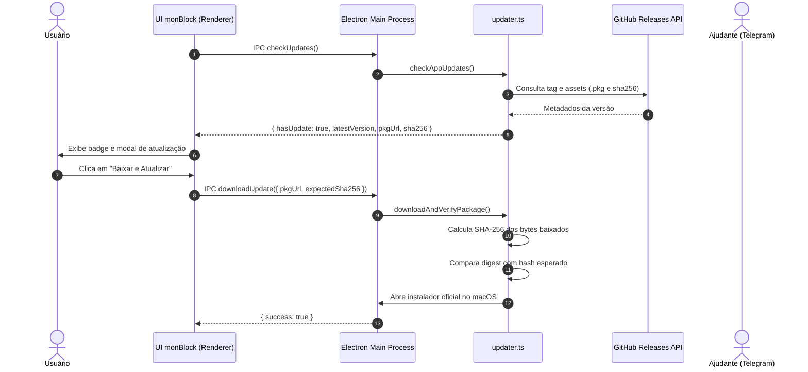

<!--
================================================================================
LOG DE MANUTENÇÃO DE DOCUMENTAÇÃO
--------------------------------------------------------------------------------
Data       | Autor          | Descrição
--------------------------------------------------------------------------------
2026-11-10 | Matheus Diniz  | Registro consolidado de desenvolvimento da sessão.
================================================================================
-->

# Registro de Desenvolvimento — 2026-11-10

| Metadado | Detalhe |
| :--- | :--- |
| **Escopo Principal** | `Critérios de Senha Forte NIST SP 800-63B, Auto-Update com Integridade SHA-256, Documentação Legal e Geração de Instaladores` |
| **Commits Gerados** | `4 commits atômicos` |
| **Arquivos Modificados** | `30 arquivos` |
| **ADRs Vinculadas / Geradas** | `docs/adrs/0012-criterios-senha-forte-e-integridade-sha256-atualizacoes.md` |

---

## 1. Visão Geral das Alterações
> Esta sessão implementou pilares fundamentais de segurança, conformidade legal e atualização contínua no monBlock:
> 1. **Segurança de Autenticação do Ajudante:** Critérios estritos de senha forte conforme NIST SP 800-63B com feedback amigável no Telegram via checklist visual e higienização imediata de mensagens com a credencial.
> 2. **Sistema de Atualizações In-App e Notificações:** Motor de auto-update integrado ao GitHub Releases com download seguro em diretório temporário, validação obrigatória de hash SHA-256 para evitar adulterações e notificações desktop nativas.
> 3. **Conformidade Legal & Acessibilidade:** Formalização de Política de Privacidade e Termos de Uso em `docs/legal/`, integrados a um modal acessível no renderer (WCAG 2.2), além de modal de progresso de download e badge de versão.
> 4. **Geração e Validação de Instaladores:** Compilação do executável universal SEA `monblockd`, geração do `.pkg` com LaunchDaemons e montagem do `build/monBlock.app` com códigos assinados e 293 testes automatizados verdes.

---

## 2. Arquitetura Afetada & Decisões (ADRs)
- **Decisões Registradas:**
  - `docs/adrs/0012-criterios-senha-forte-e-integridade-sha256-atualizacoes.md`: Formaliza os critérios de entropia para senhas do Ajudante, higienização no chat do Telegram e modelo de integridade criptográfica SHA-256 antes da execução de pacotes de instalação `.pkg`.

---

## 3. Mapa de Arquivos Modificados e Criados

| Arquivo | Camada Técnica | Resumo da Modificação |
| :--- | :--- | :--- |
| `src/domain/partner-guard.ts` | Domínio | Validador de senha forte NIST SP 800-63B e formatador de checklist visual |
| `src/daemon/monblockd.ts` | Daemon / Core | Validação de senha forte em `PAIR_PARTNER` e fluxo `/senha` do Telegram |
| `src/daemon/telegram-client.ts` | Daemon / Integração | Suporte a `deleteMessage` para higienização de senhas no chat |
| `src/main/updater.ts` | Desktop / Main | Consulta de releases, download seguro em pasta temporária e verificação SHA-256 |
| `src/main/notifications.ts` | Desktop / Main | Módulo de notificações desktop nativas do macOS via Notification API |
| `src/main/main.ts` | Desktop / Main | Registro de handlers IPC para `check-updates`, `download-update` e `show-notification` |
| `src/preload/preload.ts` & `.cjs` | Desktop / Preload | Exposição tipada e segura dos métodos de updater e notificações no bridge |
| `src/renderer/index.html` | Apresentação | Indicador de versão na sidebar, modal de update in-app e modal de termos/privacidade |
| `src/renderer/renderer-init.js` | Apresentação | Controle dos modais de atualização e termos legais, checagem em background |
| `src/renderer/renderer.css` | Apresentação | Estilos dos novos diálogos, barra de progresso e links legais acessíveis |
| `docs/legal/privacy-policy.md` | Governança / Legal | Política de Privacidade oficial detalhando processamento 100% local |
| `docs/legal/terms-of-use.md` | Governança / Legal | Termos de Uso explicando o compromisso compartilhado e regras da catraca |
| `docs/adrs/0012-...` | Arquitetura | ADR 0012 sobre senhas fortes e integridade SHA-256 de updates |
| `docs/adrs/README.md` | Arquitetura | Catálogo de ADRs atualizado com a decisão 0012 |
| `tests/main/updater.test.ts` | Testes | Suíte de testes unitários do updater com mock de rede e validação SHA-256 |
| `tests/main/notifications.test.ts` | Testes | Testes unitários do despachador de notificações |
| `tests/daemon/*` | Testes | Ajustes na suíte de testes para conformidade com a nova política de senhas |

---

## 4. Histórico dos Commits Atômicos

1. `feat(auth): critérios de senha forte NIST SP 800-63B e higienização no Telegram` (`fa59e0d`)
2. `feat(updater): auto-update in-app com integridade sha256 e notificacoes de sistema` (`148c699`)
3. `feat(ui): interface de atualizacao in-app e modal legal acessivel de privacidade e termos` (`19d9f09`)
4. `docs(adr): formalizar adr 0012 sobre senhas fortes nist e integridade sha256 de updates` (`2811b39`)

---

## 5. Verificação da Qualidade e Segurança
- **Testes Automatizados:** 23 arquivos de teste executados com 293 testes aprovados (100% verde).
- **TypeScript Typecheck:** `tsc --noEmit` executado sem erros.
- **CSP & Higiene de Código:** Zero estilos inline não permitidos (`style=""`), CSP estrito respeitado.
- **Artefatos de Instalação:** `build/monBlock.app` assinado e `build/monblockd.pkg` montados e conferidos.
