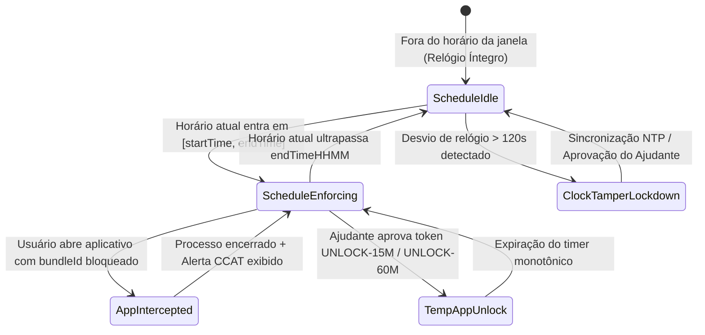

# Domínio de Bloqueio de Aplicativos Nativos, Agendamentos e Autodefesa (`app_lock_schedules`): Regras de Negócio (Business Rules)

---

## 1. Regras de Validação e Formatação

*   **RN-SCHED-01 (Catraca Unidirecional para Aplicativos e Horários — `ADR-0003`):**
    *   Adicionar um novo `bundleId` à lista de aplicativos bloqueados, adicionar dias da semana (`daysOfWeek`) ou **ampliar** a duração de uma janela de bloqueio (`ScheduleWindow`) é permitido autonomamente ao usuário.
    *   Remover um `bundleId`, excluir um dia da semana ou **reduzir** o intervalo de minutos bloqueados em uma `ScheduleWindow` exige `partnerAuthorized: true` (senha ou token `HMAC-SHA256` do Ajudante).
*   **RN-SCHED-02 (Suporte a Janelas Noturnas Cruzando a Meia-Noite):** Quando `startTimeHHMM > endTimeHHMM` (ex.: `22:00` até `06:00`), a avaliação considera o agendamento ativo tanto no trecho `[startTime, 23:59]` do dia $D$ quanto no trecho `[00:00, endTime]` da madrugada de $D+1$.
*   **RN-SCHED-03 (Allowlist Anti-Lockout de Processos Críticos do SO):** Processos essenciais do sistema operacional (`com.apple.finder`, `com.apple.loginwindow`, `com.ccat.monblock`) jamais podem ser incluídos na lista de aplicativos bloqueados para evitar inutilização da sessão gráfica do macOS.
*   **RN-SCHED-04 (Detecção de Adulteração de Relógio *Fail-Closed*):** Se a diferença entre o delta de tempo de parede (`Date.now() - lastWallClockMs`) e o delta monotônico de kernel (`Number(process.hrtime.bigint() - lastTickNs) / 1e6`) exceder `120.000ms` (2 minutos), o estado `clockSkewDetected` torna-se `true`. Enquanto `clockSkewDetected === true`, todas as `ScheduleWindow` cadastradas são tratadas como **ativas (bloqueadas)** e o progresso do Cooldown de 72h (`evaluateEmergencyCooldown`) congela.

### 1.1. Tabela de Validações

| Campo / Parâmetro | Formato / Regra | Obrigatório | Mensagem de Erro / Comportamento |
| :--- | :--- | :--- | :--- |
| `bundleId` | Reverse-DNS válido (`^[a-zA-Z0-9.-]+\.[a-zA-Z0-9_-]+$`) fora da allowlist do SO | Sim | `"Bundle ID inválido ou pertencente à lista crítica do sistema operacional."` |
| `daysOfWeek` | Array não vazio de inteiros `0..6` sem duplicatas | Sim | `"Selecione ao menos um dia da semana (0=Domingo a 6=Sábado)."` |
| `startTimeHHMM` / `endTimeHHMM` | String `^([01]\d|2[0-3]):[0-5]\d$` (`start !== end`) | Sim | `"Horário deve estar no formato 24h HH:MM e início não pode ser igual ao fim."` |
| `clockSkewMs` | Desvio máximo tolerado de `120000` ms (`2m`) | Automático | Aciona `CLOCK_TAMPER_LOCKDOWN` (*Fail-Closed*) |

---

## 2. Máquina de Estados e Ciclo de Vida

---

## 3. Matriz de Permissões e Acessos

| Papel / Perfil | Operação / Ação no Domínio `app_lock_schedules` | Permissão | Regra de Escopo / Observação |
| :--- | :--- | :--- | :--- |
| **Usuário Protegido** | Adicionar aplicativo nativo (`bundleId`) ou criar/expandir `ScheduleWindow` | Permitido (Autônomo) | Aumento unidirecional de proteção |
| **Usuário Protegido** | Encurtar janela de horário, desativar agendamento ou remover app bloqueado | **Negado (`403`)** | Exige autorização criptográfica do Ajudante |
| **Usuário Protegido** | Alterar hora do sistema operacional para contornar agendamento | **Neutralizado** | Detectado pelo `MonotonicClockGuard` $\rightarrow$ trava em *Fail-Closed* |
| **Ajudante (Partner)** | Conceder liberação temporária (`15m`/`60m`) ou editar grade horária | Exclusivo | Via Bot do Telegram ou token `UNLOCK-<DURATION>-<MAC10>` |

---

## 4. Auditoria, Rastreabilidade e Privacidade

*   **Identificação por Metadados de Pacote (Zero Keylogging):** O monitor de aplicativos inspeciona apenas o `bundleId` e o caminho do executável em execução (`NSRunningApplication`), sem capturar digitação de teclado (*keystrokes*) nem ler arquivos pessoais abertos dentro de aplicativos produtivos.
*   **Registro de Tentativas de Manipulação Temporal:** Qualquer acionamento de `clockSkewDetected` registra um evento de auditoria contendo `wall_clock_iso`, `monotonic_delta_ms` e `skew_ms`, informando o Ajudante sobre a tentativa de manipulação do relógio do sistema.
