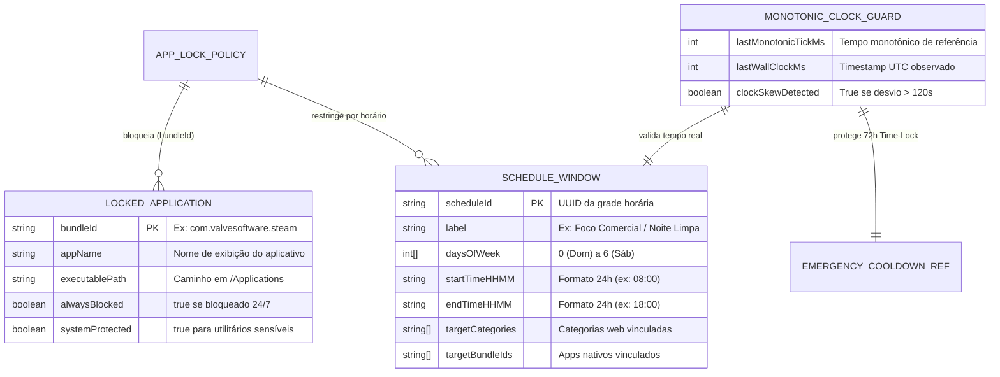

# Domínio de Bloqueio de Aplicativos Nativos, Agendamentos e Autodefesa (`app_lock_schedules`): Visão Geral (Overview)

---

## 1. Propósito e Contexto de Negócio

O domínio **`app_lock_schedules`** estende a proteção do `monBlock` para além dos navegadores web, abrangendo o **Bloqueio de Aplicativos Desktop Nativos**, as **Janelas de Agendamento (`Schedules` regidas pela Catraca `Append-Only`)** e os mecanismos de **Proteção Contra Adulteração de Relógio e Autodefesa de Ciclo de Vida** (mapeado na sub-especificação `MOD-05` para evolução nas Fases 2 e 3 da arquitetura).

No ecossistema desktop, bloquear apenas sites não é suficiente quando o usuário pode abrir clientes nativos de jogos (Steam, Roblox Desktop, Epic Games), aplicativos de mensagens paralelos ou utilitários de sistema (Terminal, Monitor de Atividade, Ajustes do Sistema) para tentar burlar as restrições ou alterar o relógio do sistema operacional a fim de vencer janelas de horário bloqueadas.

Este *Bounded Context* resolve três problemas críticos:
1. **Interceptação de Aplicativos Nativos (`AppLockManager`):** Monitora a abertura e ativação de processos (`NSWorkspace` / `runningApplications` no macOS) identificados por `bundleId` e hash binário, ocultando ou encerrando aplicativos bloqueados antes da interação e apresentando o modal de solicitação ao Ajudante.
2. **Janelas de Agendamento com Catraca Unidirecional (`ScheduleRule`):** Permite definir grades horárias por dia da semana (ex.: bloquear redes sociais e jogos das `08:00` às `18:00` em dias úteis ou impor toque de recolher digital após as `22:00`), onde expandir o horário bloqueado é livre, mas encurtá-lo exige autorização do Ajudante.
3. **Imunidade a Adulteração de Relógio (`MonotonicClockGuard`):** Impede que o usuário adiante ou atrase o relógio local do macOS para escapar de um agendamento ativo ou acelerar artificialmente o Cooldown de 72 horas (`evaluateEmergencyCooldown`).

---

## 2. Entidades Principais e Relacionamentos

### 2.1. `LockedApplication` & `ScheduleWindow`
*   **Papel:** Entidades que definem quais aplicativos nativos (`bundleId`) e categorias web ficam bloqueados permanentemente ou dentro de intervalos horários recorrentes (`daysOfWeek`, `startTimeHHMM`, `endTimeHHMM`).
*   **Atributos de Destaque:**
    *   `bundleId`: Identificador canônico do pacote macOS (ex.: `com.roblox.RobloxPlayer`, `com.valvesoftware.steam`), imune à simples renomeação do arquivo `.app` no Finder.
    *   `startTimeHHMM` / `endTimeHHMM`: Intervalo em formato 24h (`00:00` a `23:59`), suportando janelas que cruzam a meia-noite (ex.: `22:00` às `06:00`).

### 2.2. `MonotonicClockGuard` & `SelfDefensePolicy`
*   **Papel:** Serviços de domínio e infraestrutura responsáveis por detectar saltos retroativos ou avanços artificiais no relógio de parede (`Wall Clock` vs. `process.hrtime.bigint()`) e proteger binários/configurações do próprio `monBlock`.
*   **Atributos de Destaque:**
    *   `clockSkewDetected`: Quando `true`, trava todas as janelas de agendamento em modo *Fail-Closed* (bloqueado) até que o relógio sincronize ou o Ajudante aprove.

---

## 3. Fluxo de Trabalho Geral (Workflow)

1. **Cadastro de App ou Grade Horária (`Append-Only`):** O usuário seleciona aplicativos instalados em `/Applications` ou cria uma janela `ScheduleWindow`. Por representar aumento de proteção, a adição entra em vigor imediatamente.
2. **Monitoramento de Processos e Relógio:**
   * A cada ciclo de eventos de ativação de janela (`NSWorkspaceDidActivateApplicationNotification`), o motor verifica se o `bundleId` do aplicativo em foco está bloqueado (24/7 ou pela `ScheduleWindow` ativa no horário atual).
   * Simultaneamente, o `MonotonicClockGuard` compara a evolução de `Date.now()` com o contador monotônico de hardware (`hrtime`).
3. **Ação de Contenção e Autodefesa:**
   * Se o aplicativo estiver bloqueado, o processo recebe sinal de ocultação/encerramento (`SIGTERM`/`SIGKILL`) e a UI apresenta o card CCAT explicando qual regra/horário atuou.
   * Se o usuário tentar encerrar o agente ou alterar a hora do sistema para burlar a janela, o modo `CLOCK_TAMPER_LOCKDOWN` ativa o bloqueio integral de todas as regras agendadas e notifica o Ajudante via Telegram.
