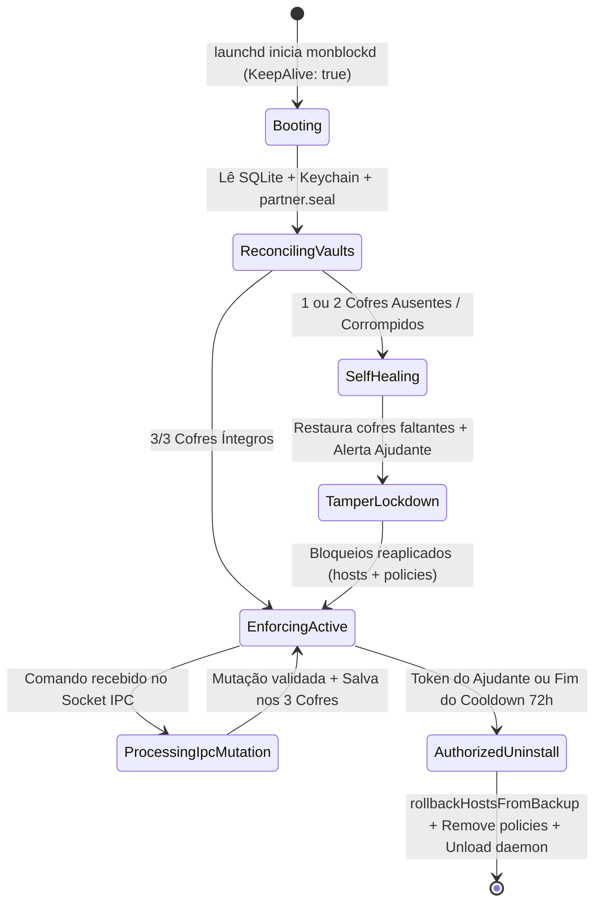

# Domínio do Daemon Privilegiado e Tripla Persistência (`daemon_persistence`): Regras de Negócio (Business Rules)

---

## 1. Regras de Validação e Formatação

*   **RN-DAEMON-01 (Isolamento de Privilégios `ADR-0001`):** A interface gráfica Electron (`uid >= 501`) jamais escreve diretamente em `/etc/hosts`, `/Library/Managed Preferences` ou nos cofres de estado. Toda mutação passa obrigatoriamente pelo socket `/var/run/monblockd.sock` ou API loopback autenticada do `monblockd` (`uid 0`).
*   **RN-DAEMON-02 (Reconciliação e Self-Healing `1 de 3` / `2 de 3` — `ADR-0004`):**
    *   Se pelo menos **1 dos 3 cofres** (`SQLite`, `Keychain` ou `partner.seal`) contiver um selo criptográfico válido de Ajudante pareado, o sistema considera o Ajudante **ATIVO**.
    *   É proibido retornar ao estado `Unpaired` (sem Ajudante) por mera ausência do arquivo SQLite se `Keychain` ou `partner.seal` indicarem que havia um pareamento ativo.
*   **RN-DAEMON-03 (Monotonicidade de Versão de Estado):** Cada mutação válida incrementa `schemaVersion` (inteiro monotônico crescente) e recalcula `stateChecksumSha256 = HMAC-SHA256(hmacSecret, canonicalStateJson)`, impedindo ataques de *rollback* (substituição do arquivo `state.db` por um backup antigo com menos regras).
*   **RN-DAEMON-04 (Validação Estrita de Payload IPC):** Mensagens recebidas no socket Unix devem ser JSON válido com tamanho máximo de `16 KB` (`16384` bytes), contendo `command`, `requestId` e `payload`.
*   **RN-DAEMON-05 (Blindagem de Arquivos em 4 Níveis Contra Remoção Manual):** Todos os artefatos do daemon (`/Library/LaunchDaemons/com.ccat.monblockd.plist`, `/Library/PrivilegedHelperTools/com.ccat.monblockd`, `/var/db/monblock/partner.seal`, `/var/db/monblock/state.db` e `/etc/hosts`) operam sob propriedade `root:wheel`, permissão `0600` nos cofres e flag imutável de kernel (`chflags uchg`). Se o usuário apagar `/Applications/monBlock.app` no Finder, o daemon mantém o bloqueio ativo e restaura o `.app` a partir do backup protegido em `/var/db/monblock/`.
*   **RN-DAEMON-06 (Desinstalação e Desregistro Exclusivos via Prova Criptográfica Interna):** Não há script externo desprotegido capaz de desativar o `monblockd`. O comando `UNINSTALL_AUTHORIZED` é processado exclusivamente dentro do próprio daemon `monblockd` e exige prova criptográfica válida no `PartnerGuard` (Token `UNLOCK-PERMANENT-<MAC>` assinado pelo Ajudante, Senha Mestra `scrypt` do Ajudante ou término verificado das 72h de Cooldown) antes de remover `chflags nouchg`, executar `rollbackHostsFromBackup`, limpar os 3 cofres e descarregar o `LaunchDaemon` via `launchctl bootout system`.

### 1.1. Tabela de Validações

| Campo / Recurso | Formato / Regra | Obrigatório | Mensagem de Erro / Comportamento |
| :--- | :--- | :--- | :--- |
| `payload` (IPC / HTTP) | JSON válido $\le 16\text{ KB}$ | Sim | `400 Bad Request` (`"Payload JSON inválido"`) ou `413 Payload Too Large` |
| `schemaVersion` | Inteiro positivo monotônico ($\ge \text{versão atual}$) | Sim | Rejeita tentativa de *downgrade* de arquivo de estado (`TAMPER_ROLLBACK_DETECTED`) |
| `stateChecksumSha256` | Hexadecimal de 64 caracteres (`HMAC-SHA256`) | Sim | Cofre com checksum divergente é descartado e sobrescrito pelo cofre íntegro |
| `hostsFilePath` | Caminho absoluto com backup `.monblock.bak` | Sim | Cria `.monblock.bak` na primeira escrita e preserva linhas fora dos marcadores |

---

## 2. Máquina de Estados e Ciclo de Vida

---

## 3. Matriz de Permissões e Acessos

| Papel / Processo | Recurso / Ação no Domínio `daemon_persistence` | Permissão | Regra de Escopo / Observação |
| :--- | :--- | :--- | :--- |
| **Processo UI Electron (`uid >= 501`)** | Ler status (`GET_STATE`) e enviar adições `Append-Only` via IPC | Leitura / Adição | Sem acesso direto aos arquivos `0600` do daemon |
| **Processo UI Electron (`uid >= 501`)** | Solicitar redução de regra via IPC sem token do Ajudante | **Negado (`403`)** | Barrado pelo `monblockd` via `canMutateProtectionRule()` |
| **Daemon `monblockd` (`uid 0`)** | Ler/Escrever `state.db`, `Keychain`, `partner.seal` e `/etc/hosts` | Escrita Total | Único processo detentor de privilégio root |
| **Script `uninstall-monblock.sh`** | Descarregar `LaunchDaemon` e executar `rollbackHostsFromBackup` | Condicional | Exige verificação criptográfica prévia de token do Ajudante ou Cooldown 72h concluído |

---

## 4. Auditoria, Rastreabilidade e Privacidade

*   **Trilha de Auditoria de Reconciliação (`audit_events`):** Toda execução de *Self-Healing* (quando um cofre deletado é reconstruído) grava um registro imutável com `event_type: "VAULT_SELF_HEALED"`, `missing_vaults`, `restored_from` e `timestamp_utc`, enviando alerta imediato ao Bot do Telegram do Ajudante.
*   **Permissões Restritivas de Arquivo (`0600`):** Os arquivos `state.db` e `partner.seal` são criados com modo `0600` (`rw-------` pertencente a `root:wheel`), impedindo que processos de terceiros ou o próprio usuário sem privilégio leiam hashes ou metadados internos.
*   **Desinstalação Limpa e Reversível:** Quando autorizada pelo Ajudante, a rotina de rollback remove integralmente os blocos gerenciados no `/etc/hosts` (`rollbackHostsFromBackup`), apaga os manifestos de políticas de navegadores e não deixa arquivos órfãos no sistema.
