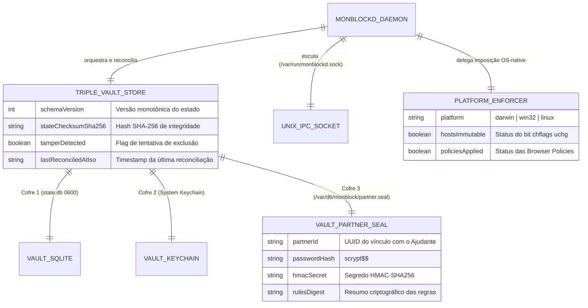

# Domínio do Daemon Privilegiado e Tripla Persistência (`daemon_persistence`): Visão Geral (Overview)

---

## 1. Propósito e Contexto de Negócio

O domínio **`daemon_persistence`** constitui a espinha dorsal de segurança e resiliência em nível de sistema operacional do `monBlock` (mapeado na sub-especificação `MOD-03` e regido pelas `ADR-0001` e `ADR-0004`). Seu propósito é garantir que o bloqueio e o vínculo com o Ajudante sobrevivam a qualquer tentativa de sabotagem local pelo próprio usuário em momentos de impulsividade — incluindo fechar a interface gráfica Electron, executar `kill -9`, deletar pastas em `~/Library/Application Support` ou reiniciar o computador.

Na engenharia reversa do aplicativo de referência (`_reversa_sdd/` — Cisdem AppCrypt v7.11.0), identificou-se que rodar o motor de bloqueio dentro do próprio processo da UI *userland* e salvar a configuração em um único arquivo `.plist` permitia desativar todo o aplicativo em segundos pelo Monitor de Atividade ou apagando o arquivo de preferências. O `monBlock` resolve esse problema estrutural através de dois pilares:
1. **Arquitetura Split Privilegiada (`monblockd` — `ADR-0001`):** O daemon `monblockd` roda em background sob supervisão do `launchd` (`KeepAlive: true`, `/Library/LaunchDaemons/com.ccat.monblockd.plist` no macOS) e expõe um canal IPC local via Unix Domain Socket (`/var/run/monblockd.sock`) com validação estrita de payload.
2. **Tripla Persistência Self-Healing (`ADR-0004`):** O estado de pareamento e as regras ativas são replicados em **3 cofres independentes** (`SQLite STRICT 0600` em `/Library/Application Support/monBlock/state.db`, **macOS System Keychain** e o selo imutável `/var/db/monblock/partner.seal`). Se o usuário conseguir apagar 1 ou 2 cofres, o daemon reconstrói automaticamente os cofres ausentes (*Self-Healing*) a partir do cofre sobrevivente e aciona o modo `TAMPER_LOCKDOWN`.

---

## 2. Entidades Principais e Relacionamentos

### 2.1. `TripleVaultStore` (`SQLite` + `Keychain` + `partner.seal`)
*   **Papel:** Agregado responsável pela persistência durável e autorregenerativa (*Self-Healing*) do vínculo com o Ajudante e do `RuleEngineState`.
*   **Atributos de Destaque:**
    *   `VAULT_SQLITE`: Banco relacional `/Library/Application Support/monBlock/state.db` com tabelas `STRICT`, `PRAGMA journal_mode = WAL` e permissão `0600` (`root:wheel`).
    *   `VAULT_KEYCHAIN`: Entrada criptografada no `System.keychain` (`service: "com.ccat.monblock.partner"`).
    *   `VAULT_PARTNER_SEAL`: Arquivo binário/JSON assinado em `/var/db/monblock/partner.seal` protegido com `chflags uchg`.

### 2.2. `PlatformEnforcer` (`src/enforcers/`)
*   **Papel:** Contrato polimórfico que isola as primitivas específicas de sistema operacional (`MacOSPlatformEnforcer` na Fase 1 MVP, preparado para `WindowsPlatformEnforcer` e `LinuxPlatformEnforcer`).
*   **Atributos de Destaque:**
    *   Encapsula `applyAtomicHostsBlock`, `rollbackHostsFromBackup`, `buildBrowserPolicies`, invalidação de cache DNS (`dscacheutil -flushcache`) e o Watcher de janelas/abas.

---

## 3. Fluxo de Trabalho Geral (Workflow)

1. **Boot e Reconciliação Self-Healing:** Ao iniciar sob o `launchd`, o `monblockd` lê os 3 cofres (`SQLite`, `Keychain`, `partner.seal`):
   * Se todos os 3 coincidirem, carrega o `RuleEngineState` em memória.
   * Se 1 ou 2 cofres tiverem sido deletados ou corrompidos, o `TripleVaultStore` restaura imediatamente os cofres faltantes a partir do cofre íntegro de maior versão monotônica, registra evento `TAMPER_HEALED` e notifica o Ajudante.
2. **Imposição Inicial de Camadas:** O daemon aciona o `PlatformEnforcer` para garantir que `/etc/hosts` e as políticas corporativas de Chromium/Firefox estejam sincronizados com o estado recuperado.
3. **Escuta IPC Zero-Trust (`/var/run/monblockd.sock`):** O daemon recebe comandos JSON da UI Electron, valida o schema de entrada, consulta `canMutateProtectionRule()` no `PartnerGuard` e, se aprovado, persiste nos 3 cofres e reaplica os *enforcers*.
4. **Supervisão Contínua (`KeepAlive`):** Caso o processo `monblockd` receba um sinal de término inesperado, o `launchd` do macOS o reinicia automaticamente em menos de `1s`.
