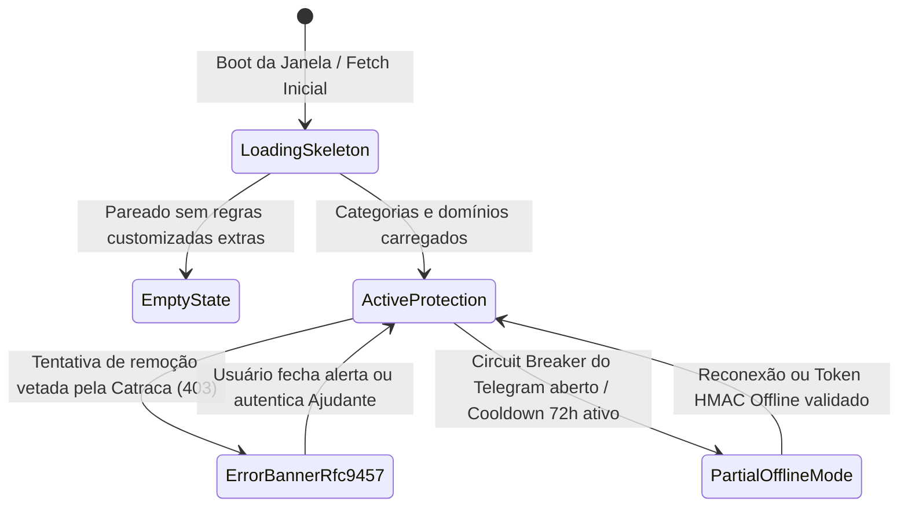

# Domínio da Interface Desktop Electron e Design System CCAT (`desktop_ui_ccat`): Regras de Negócio (Business Rules)

---

## 1. Regras de Validação e Formatação

*   **RN-UI-01 (Banimento Absoluto de Roxo — *Zero Purple Policy*):** Nenhum arquivo CSS, SVG ou HTML do domínio `desktop_ui_ccat` pode conter códigos hexadecimais, `rgb()` ou `hsl()` na faixa violeta/roxa/índigo. A identidade visual utiliza exclusivamente a paleta editorial CCAT (`#005A64` Deep Teal, `#C84B31` Terracotta, `#F6F4EE` Warm Ivory e neutros de alto contraste).
*   **RN-UI-02 (Acessibilidade WCAG 2.2 AAA e Alvos Táteis):**
    *   Contraste mínimo de `7:1` (`APCA Lc >= 75`) para texto de corpo e `4.5:1` para elementos gráficos.
    *   Todo elemento interativo (`.ccat-btn`,switches de categoria, botões de tema, inputs) deve possuir dimensões mínimas de `44x44px` (`min-height: 2.75rem`) e anel de foco explícito `:focus-visible`.
*   **RN-UI-03 (Tríade de Isolamento Zero-Trust no Electron):** É estritamente proibido habilitar `nodeIntegration: true` ou desativar `contextIsolation` / `sandbox` em qualquer `BrowserWindow`. O `preload.ts` deve expor apenas funções de alto nível estritamente tipadas via `contextBridge.exposeInMainWorld('monblock', ...)`, jamais expondo o objeto `ipcRenderer` bruto.
*   **RN-UI-04 (Precisão Numérica e Cronômetros `deltaTime`):** Todos os contadores, códigos de desafio (`MB-8492-X7`), tokens (`UNLOCK-*`) e cronômetros regressivos (Cooldown de 72h / Desbloqueio de 15m ou 60m) devem utilizar `font-variant-numeric: tabular-nums` e calcular o tempo restante por diferença de relógio real (`Date.now() - startMs`), nunca confiando em incrementos cegos de `setInterval`.

### 1.1. Tabela de Validações

| Elemento / Propriedade | Formato / Regra | Obrigatório | Comportamento / Tratamento |
| :--- | :--- | :--- | :--- |
| `data-theme` (`<html>`) | `'capycro-ivory' \| 'dark-tech' \| 'light-fintech' \| 'high-contrast-aaa'` | Sim | Padrão inicial `'capycro-ivory'`; alternável sem reload |
| Lote de Domínios (Textarea) | Até 100 linhas/domínios (`MAX_BATCH_DOMAINS`) | Sim | Exibe erro inline `role="alert"` se ultrapassar 100 itens |
| Campo de Token (`input`) | `UNLOCK-(15M\|60M\|PERMANENT)-[0-9A-F]{10}` | Sim | Normalizado em maiúsculas (`trim().toUpperCase()`) |
| Navegação Externa (`will-navigate`) | Bloqueada para origens fora de `self` / `127.0.0.1:49152` | Sim | Interceptada e negada no processo `main` do Electron |

---

## 2. Máquina de Estados e Ciclo de Vida

---

## 3. Matriz de Permissões e Acessos

| Contexto de Execução | Capacidade / API | Permissão | Regra de Escopo / Observação |
| :--- | :--- | :--- | :--- |
| **`renderer` (DOM / HTML / CSS)** | Acesso a `fs`, `child_process`, `os` ou `ipcRenderer` bruto | **Proibido** | Isolado por `sandbox: true` e `contextIsolation: true` |
| **`preload` (`window.monblock`)** | Invocar canais IPC nomeados na *allowlist* (`monblock:get-state`, `monblock:add-rules`, `monblock:request-unblock`) | Restrito | Valida tipos dos argumentos antes de encaminhar ao `main` |
| **`main` (Processo Electron)** | Gerenciar `BrowserWindow`, `Tray` macOS e cliente do socket `/var/run/monblockd.sock` | Usuário (`uid >= 501`) | Se encerrado via `Cmd+Q`, minimiza para a bandeja (`Tray`); se morto via `kill -9`, o daemon mantém o bloqueio |
| **Página `:49152/blocked`** | Chamar `GET /api/health` e `POST /api/unblock-requests` | Loopback (`127.0.0.1`) | Protegida por `X-Frame-Options: DENY` e `X-Content-Type-Options: nosniff` |

---

## 4. Auditoria, Rastreabilidade e Privacidade

*   **Exibição Respeitosa e Livre de Exposição na Tela de Bloqueio:** A página `http://127.0.0.1:49152/blocked` exibe apenas o domínio limpo (sem caminho/query string sensível) e o rótulo da categoria/regra (`ruleLabel`), sem renderizar capturas de tela na própria tela do usuário.
*   **Sanitização Contra XSS no Renderer:** Qualquer domínio ou motivo exibido na interface é inserido exclusivamente via `textContent` (nunca via `innerHTML` não sanitizado), neutralizando vetores de *DOM-based XSS* caso o título de uma aba contenha tags `<script>` ou ``.
*   **Respeito a Preferências Vestibulares e Visuais do SO:** A folha de estilos `docs/design/tokens.css` desativa transições e animações automaticamente quando `@media (prefers-reduced-motion: reduce)` está ativo no macOS/Windows/Linux.
