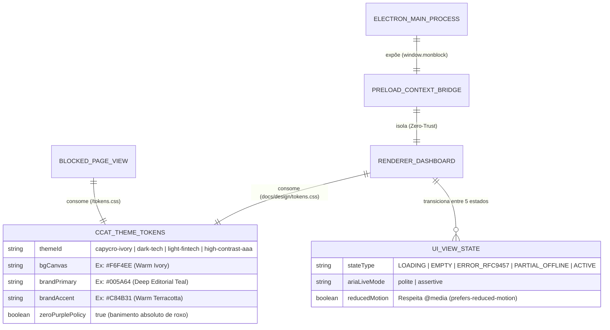

# Domínio da Interface Desktop Electron e Design System CCAT (`desktop_ui_ccat`): Visão Geral (Overview)

---

## 1. Propósito e Contexto de Negócio

O domínio **`desktop_ui_ccat`** abrange toda a experiência visual, ergonômica e de interação do usuário e do Ajudante no aplicativo desktop `monBlock` (`src/main/`, `src/preload/`, `src/renderer/`) e nas páginas servidas localmente em `http://127.0.0.1:49152/blocked` e `/showcase` (`docs/design/tokens.css`, `docs/design/blocked-page.html` e `docs/design/tokens-showcase.html`, mapeados na sub-especificação `MOD-04`).

Seu objetivo de negócio é transformar uma ferramenta de controle comportamental e proteção digital em uma experiência **calma, transparente, digna e livre de *dark patterns***. Quando um usuário é interceptado ao tentar acessar um site bloqueado, a interface não deve gerar pânico nem humilhação: a paleta **Capycro Warm Ivory (`#F6F4EE`)** combinada ao **Deep Editorial Teal (`#005A64`)** e **Warm Terracotta (`#C84B31`)** reduz a carga cognitiva, explica com transparência qual regra atuou e oferece caminhos claros (retornar ao foco, solicitar liberação pontual ao Ajudante via Telegram ou inserir um token `UNLOCK-*`).

Do ponto de vista de engenharia de segurança desktop, este *Bounded Context* opera sob a **Tríade Zero-Trust do Electron** (`nodeIntegration: false`, `contextIsolation: true`, `sandbox: true`), de modo que a janela renderizadora funcione exclusivamente como um painel de controle desprivilegiado conectado ao daemon `monblockd`.

---

## 2. Entidades Principais e Relacionamentos

### 2.1. `CCATThemeTokens` (`docs/design/tokens.css`)
*   **Papel:** Sistema centralizado de Design Tokens do Design System Oficial CCAT que governa cores, tipografia (`Plus Jakarta Sans`, `Inter`, `JetBrains Mono`), espaçamento, elevação e estados de foco em todas as superfícies do `monBlock`.
*   **Atributos de Destaque:**
    *   Suporte nativo a **4 temas**: `capycro-ivory` (padrão diurno editorial), `dark-tech` (noturno `#0B0F17`), `light-fintech` (`#F8FAFC`) e `high-contrast-aaa` (`#000000` / `#FFFFFF` / `#FFD60A`).
    *   **Política Estrita Zero-Roxo (*Purple Ban*):** Nenhuma variável CSS ou componente utiliza matizes roxos, violetas ou índigos.

### 2.2. `BlockedPageView` (`docs/design/blocked-page.html`) & `RendererDashboard`
*   **Papel:** Superfícies interativas apresentadas no navegador interceptado (`:49152/blocked`) e na janela principal do aplicativo Electron.
*   **Atributos de Destaque:**
    *   Implementam obrigatoriamente os **5 Estados de UI** (`Loading`, `Empty`, `Error RFC 9457`, `Partial/Offline` e `Populated/Active`) e conformidade **WCAG 2.2 AAA** (`APCA Lc >= 75`, alvos $\ge 44\times44\text{px}$).

---

## 3. Fluxo de Trabalho Geral (Workflow)

1. **Inicialização Segura da Janela (`main` $\rightarrow$ `preload` $\rightarrow$ `renderer`):**
   * O processo `main` adquire `app.requestSingleInstanceLock()`, cria a `BrowserWindow` oculta (`show: false`, `backgroundColor: '#F6F4EE'`) com `nodeIntegration: false`, `contextIsolation: true` e `sandbox: true`, e só exibe a janela no evento `ready-to-show` (eliminando *white flash*).
2. **Onboarding Guiado em 4 Passos ou Carregamento de Dashboard:**
   * Se o daemon reportar estado `Unpaired`, o `renderer` apresenta o Wizard de Primeiro Acesso em 4 passos: (1) Boas-vindas e explicação da Catraca Unidirecional, (2) Permissões do macOS e instalação do `monblockd`, (3) Pareamento com o Ajudante via Telegram Bot + Senha Mestra `scrypt`, e (4) Confirmação do Kit de 5 Códigos de Emergência (`REC-*`) + seleção inicial das 11 categorias.
   * Se reportar `ActivePaired`, renderiza o Dashboard com as 11 categorias de `PREDEFINED_CATEGORIES`, lote de domínios (`MAX_BATCH_DOMAINS = 100`), palavras-chave (com dica anti-falso-positivo para termos curtos) e status dos 3 cofres.
3. **Uso Contínuo no Dia a Dia via Menu da Tray (Barra de Menu do macOS):**
   * O ícone na Menu Bar permanece sempre ativo (sem opção de `"Sair / Desativar"`) e oferece ações rápidas em 1 clique: **Adicionar site/keyword rápido**, **Bloquear site da aba atual do navegador**, **Solicitar desbloqueio temporário ao Ajudante**, **Inserir Token `UNLOCK-*`** e **Abrir a Janela Principal**.
4. **Adição Instantânea (`Append-Only`) vs. Bloqueio com Cadeado:**
   * Ao ativar uma categoria desligada ou adicionar novos domínios em lote, a UI aplica a mutação imediatamente.
   * Categorias e regras já ativas exibem badge de cadeado (`Trancado pelo Ajudante`): clicar nelas abre o modal de solicitação ao Ajudante ou inserção de token `UNLOCK-*`.
5. **Interceptação na Tela `:49152/blocked`:**
   * Quando redirecionado para `http://127.0.0.1:49152/blocked`, o usuário visualiza a regra acionada, pode alternar entre os 4 temas CCAT, submeter um pedido idempotente (`POST /api/unblock-requests`) ou validar um código de desafio offline.
