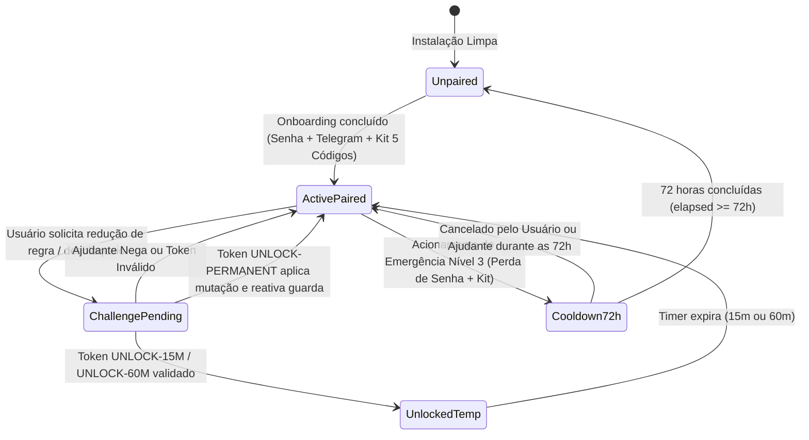

# Domínio de Responsabilidade Compartilhada e Ajudante (`partner_accountability`): Regras de Negócio (Business Rules)

---

## 1. Regras de Validação e Formatação

O módulo `src/domain/partner-guard.ts` implementa regras formais e criptográficas para impedir bypasses por força bruta, ataques de *timing*, reutilização de tokens (*replay*) ou adulteração de relógio:

*   **RN-PARTNER-01 (Catraca Unidirecional `Append-Only` — `ADR-0003`):** A função `canMutateProtectionRule({ current, next, partnerAuthorized })` permite livremente qualquer transição que apenas expanda `enabledCategories`, `blockedDomains`, `keywords` ou ative `lockIncognito`. Qualquer uma das 5 reduções abaixo sem `partnerAuthorized: true` é bloqueada com mensagem explicativa:
    1. Desativar categoria ativa (`current.enabledCategories` ausente em `next.enabledCategories`).
    2. Remover domínio bloqueado (`current.blockedDomains` ausente em `next.blockedDomains`).
    3. Remover palavra-chave (`current.keywords` ausente em `next.keywords`).
    4. Adicionar domínio na `allowlistDomains` (`next.allowlistDomains` não presente em `current.allowlistDomains`).
    5. Desativar `lockIncognito` (`current.lockIncognito === true` e `next.lockIncognito === false`).
*   **RN-PARTNER-02 (Derivação Lenta `scrypt` + Comparação em Tempo Constante):** `hashPartnerPassword()` gera salt aleatório de 16 bytes (`crypto.randomBytes(16)`) e deriva chave de 64 bytes com `N: 16384, r: 8, p: 1`. `verifyPartnerPassword()` valida o prefixo `scrypt$`, o comprimento de 64 bytes do buffer hexadecimal e executa `crypto.timingSafeEqual(derived, expected)`.
*   **RN-LIM-02 (Tokens `HMAC-SHA256` Anti-Replay com Escopo de Duração):** `generateChallengeToken(secret, challengeCode, duration)` calcula `HMAC-SHA256(secret, "${challengeCode}:${duration}")`, extrai os 10 primeiros caracteres hexadecimais em maiúsculas e formata `UNLOCK-<DURATION>-<MAC10>`. `verifyChallengeToken()` rejeita imediatamente qualquer token já presente em `usedTokens` e, ao validar com sucesso via `crypto.timingSafeEqual`, insere o token em `usedTokens` no mesmo ciclo síncrono.
*   **RN-PARTNER-03 (Kit de Emergência de 5 Códigos de Uso Único):** `generateRecoveryKit()` produz exatamente 5 códigos no padrão `REC-<6_HEX>-<6_HEX>` (24 bits de entropia em cada metade) e retorna `{ plainCodes, hashedCodes }`, onde cada item de `hashedCodes` recebe hash `scrypt` individual.
*   **RN-PARTNER-04 (Cooldown Time-Lock de 72h *Fail-Closed*):** `evaluateEmergencyCooldown(startedAtIso, nowMs)` exige o transcurso integral de `72 * 3600 * 1000` ms (`259.200.000` ms). Se `startedAtIso` for inválido (`NaN`), `nowMs` for inválido ou o relógio for atrasado (`nowMs < startMs`), a função opera em modo *fail-closed* retornando `{ unlocked: false, remainingHours: 72 }`.

### 1.1. Tabela de Validações

| Campo / Parâmetro | Formato / Regra | Obrigatório | Mensagem de Erro / Comportamento |
| :--- | :--- | :--- | :--- |
| `storedHash` | `scrypt$<32_hex_salt>$<128_hex_derived>` | Sim | Retorna `false` em `verifyPartnerPassword()` se malformado |
| `duration` (`UnlockDuration`) | `'15m' \| '60m' \| 'permanent'` | Sim | Codificado no prefixo `UNLOCK-15M-`, `UNLOCK-60M-` ou `UNLOCK-PERMANENT-` |
| `token` (Desafio-Resposta) | `UNLOCK-(15M\|60M\|PERMANENT)-[0-9A-F]{10}` | Sim | `{ valid: false }` se MAC divergir ou se constar em `usedTokens` |
| `recoveryCode` | `REC-[0-9A-F]{6}-[0-9A-F]{6}` | Sim | Validado via `verifyPartnerPassword(code, hashedCode)` e removido após uso |
| `startedAtIso` | Timestamp ISO-8601 válido | Sim | Em caso de `NaN`, retorna `{ unlocked: false, remainingHours: 72 }` |

---

## 2. Máquina de Estados e Ciclo de Vida

---

## 3. Matriz de Permissões e Acessos

| Papel / Perfil | Operação / Ação no Domínio `partner_accountability` | Permissão | Regra de Escopo / Observação |
| :--- | :--- | :--- | :--- |
| **Usuário Protegido** | Solicitar desbloqueio ou gerar `challengeCode` | Permitido | Sujeito a deduplicação por `Idempotency-Key` e rate limit |
| **Usuário Protegido** | Iniciar Cooldown de Emergência de 72h (Nível 3) | Permitido | Mantém bloqueio 100% ativo por 72h e notifica o Ajudante |
| **Usuário Protegido** | Reduzir proteção sem token/senha do Ajudante | **Negado (`403`)** | Bloqueado por `canMutateProtectionRule()` |
| **Ajudante (Telegram / Senha)** | Emitir `UNLOCK-15M`, `UNLOCK-60M`, `UNLOCK-PERMANENT` ou `/reset_senha` | Exclusivo | Autenticado via `telegramChatId` pareado ou `hmacSecret` |
| **Portador do Kit Nível 2** | Consumir código `REC-XXXXXX-XXXXXX` | Uso Único | Invalida o código consumido imediatamente após sucesso |

---

## 4. Auditoria, Rastreabilidade e Privacidade

*   **Privacidade e Dignidade no Raio-X (Blur + Spoiler):** Quando um bloqueio gera alerta para o Ajudante no Telegram, o *screenshot* opcional da janela recebe desfoque gaussiano (`blur(24px)`) antes do envio e utiliza `has_spoiler: true` na API do Telegram, impedindo exposição acidental de dados bancários, mensagens privadas ou conteúdo sensível, enquanto registra o evento de auditoria com timestamp UTC e regra acionada.
*   **Zero Armazenamento de Senhas ou Códigos em Texto Plano:** Nem a senha do Ajudante nem os 5 códigos `REC-*` são salvos em texto claro em disco, logs ou memória persistente; apenas os hashes `scrypt` com salt individual são armazenados.
*   **Comparação Criptográfica em Tempo Constante:** Todas as verificações de senha (`verifyPartnerPassword`) e de tokens (`verifyChallengeToken`) utilizam `crypto.timingSafeEqual`, eliminando canais laterais de tempo (*timing side-channels*).
