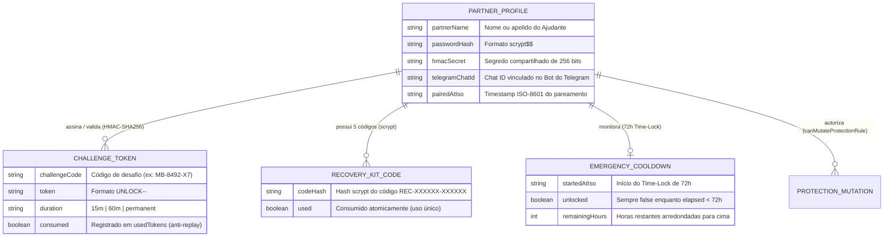

# Domínio de Responsabilidade Compartilhada e Ajudante (`partner_accountability`): Visão Geral (Overview)

---

## 1. Propósito e Contexto de Negócio

O domínio **`partner_accountability`** materializa o diferencial central de produto do `monBlock`: a **Responsabilidade Compartilhada (*Accountability Partner* / "Ajudante")** governada pela **Invariante da Catraca Unidirecional (`Append-Only` — `ADR-0003`)** e pelo sistema de **Recuperação Resiliente em 3 Níveis (`ADR-0004`)**.

Em bloqueadores convencionais (como o Cisdem AppCrypt v7.11.0 analisado em `_reversa_sdd/`), a mesma pessoa que deseja se proteger detém a senha local (frequentemente armazenada em hash fraco `MD5` sem *salt*), o que torna a proteção ineficaz em momentos de impulsividade ou vulnerabilidade. No `monBlock`, o **Ajudante** (cônjuge, terapeuta, mentor ou amigo de confiança) detém a chave de redução de regras e interage com o sistema remotamente pelo **Bot do Telegram** ou via códigos de desafio-resposta assinados com `HMAC-SHA256`.

Para evitar que a perda da senha ou do acesso ao Telegram transforme o computador em um *brick* permanente, sem jamais abrir uma brecha de desbloqueio impulsivo instantâneo, este domínio implementa:
1. **Catraca Unidirecional (`canMutateProtectionRule`):** Aumentar a proteção é 100% autônomo; diminuir qualquer regra exige `partnerAuthorized: true`.
2. **Aprovação Assíncrona e Raio-X com Privacidade:** Notificações enviadas ao Telegram do Ajudante incluem o contexto do pedido e uma captura borrada (`blur(24px)`, `has_spoiler: true`), com botões inline de decisão (`Liberar 15m`, `Liberar 1h`, `Liberar Permanente`, `Negar`) e opção de desafio-resposta offline (`UNLOCK-<DURATION>-<MAC10>`).
3. **Recuperação em 3 Níveis:** (Nível 1) Comando `/reset_senha` no Telegram do Ajudante; (Nível 2) **Kit de Emergência** com 5 códigos de uso único (`REC-XXXXXX-XXXXXX`); (Nível 3) **Cooldown Time-Lock de 72 horas** (`evaluateEmergencyCooldown`) durante o qual o bloqueio permanece 100% ativo.

---

## 2. Entidades Principais e Relacionamentos

### 2.1. `PartnerProfile` & Credenciais Criptográficas (`src/domain/partner-guard.ts`)
*   **Papel:** Agregado que representa o vínculo criptográfico com o Ajudante.
*   **Atributos de Destaque:**
    *   `passwordHash`: Gerado por `hashPartnerPassword()` usando `crypto.scryptSync(password, salt, 64, { N: 16384, r: 8, p: 1 })` com salt aleatório de 16 bytes (`scrypt$<salt_hex>$<derived_hex>`) e verificado em tempo constante por `verifyPartnerPassword()` via `crypto.timingSafeEqual`.
    *   `hmacSecret`: Segredo simétrico usado em `generateChallengeToken()` e `verifyChallengeToken()`.

### 2.2. `ChallengeToken`, `RecoveryKit` e `EmergencyCooldown`
*   **Papel:** Entidades e Value Objects que governam o desbloqueio pontual e a recuperação em 3 níveis.
*   **Atributos de Destaque:**
    *   `UnlockDuration`: Tipo estrito `'15m' | '60m' | 'permanent'`.
    *   `usedTokens`: Conjunto (`Set<string>`) de tokens `UNLOCK-*` já utilizados, garantindo semântica *single-use* anti-replay (`RN-LIM-02`).
    *   `plainCodes` / `hashedCodes`: Par retornado por `generateRecoveryKit()` no onboarding (5 códigos no formato `REC-XXXXXX-XXXXXX`).

---

## 3. Fluxo de Trabalho Geral (Workflow)

1. **Onboarding e Pareamento Inicial:** O usuário pareia o aplicativo com o Ajudante definindo a Senha Mestra (`hashPartnerPassword`), vinculando o Bot do Telegram e gerando o Kit de Emergência de 5 códigos (`generateRecoveryKit`), cujos `plainCodes` são entregues ao Ajudante e apenas os `hashedCodes` são persistidos.
2. **Avaliação da Catraca (`canMutateProtectionRule`):**
   * Se o usuário tentar adicionar domínios, ativar categorias, adicionar keywords ou ligar `lockIncognito: true`, `canMutateProtectionRule` retorna `{ allowed: true }` imediatamente sem exigir o Ajudante.
   * Se o usuário tentar desativar categoria, remover domínio/keyword, adicionar exceção em `allowlistDomains` ou desligar `lockIncognito`, `canMutateProtectionRule` retorna `{ allowed: false, reason: "... exige autorização do Ajudante." }`.
3. **Solicitação de Desbloqueio (Online via Telegram ou Offline via HMAC):**
   * O sistema gera um `challengeCode` (ex.: `MB-8492-X7`) e envia a notificação com Raio-X borrado ao Telegram do Ajudante.
   * O Ajudante aprova diretamente no botão do Telegram ou informa ao usuário o token `UNLOCK-15M-<MAC10>` / `UNLOCK-60M-<MAC10>` / `UNLOCK-PERMANENT-<MAC10>`, validado por `verifyChallengeToken()` e gravado em `usedTokens`.
4. **Fluxo de Recuperação de Emergência (3 Níveis):**
   * **Nível 1:** Ajudante dispara `/reset_senha` no Telegram.
   * **Nível 2:** Inserção de 1 dos 5 códigos `REC-XXXXXX-XXXXXX` do Kit de Emergência.
   * **Nível 3:** Abertura do Cooldown Time-Lock de 72 horas (`evaluateEmergencyCooldown(startedAtIso, nowMs)`), mantendo `unlocked: false` até que `elapsed >= 72 * 3600 * 1000`.
