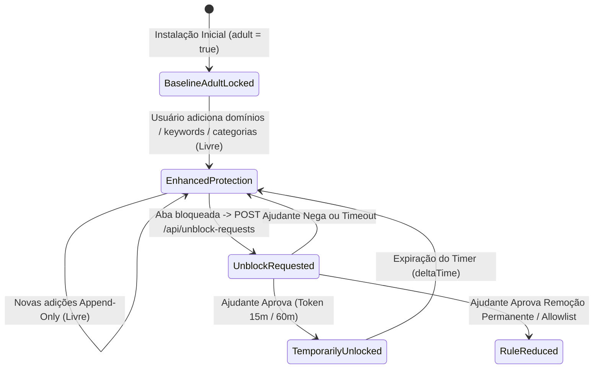

# Domínio de Bloqueio Web em 3 Camadas (`web_blocking`): Regras de Negócio (Business Rules)

---

## 1. Regras de Validação e Formatação

O motor `RuleEngine` (`src/domain/rule-engine.ts`) e os *enforcers* (`src/enforcers/hosts-enforcer.ts`, `src/enforcers/browser-policy-enforcer.ts`) aplicam validações determinísticas antes de persistir ou avaliar qualquer regra:

*   **RN-WEB-01 (Precedência Estrita de Avaliação):** A avaliação em `evaluateUrlAndTitle()` obedece rigorosamente à ordem:
    1. `CRITICAL_INFRA_ALLOWLIST` e rota local `http://127.0.0.1:49152/blocked` $\rightarrow$ sempre permitido (`{ blocked: false }`).
    2. `allowlistDomains` (exceções autorizadas pelo Ajudante) $\rightarrow$ sempre permitido (`{ blocked: false }`), mesmo que o domínio pertença a uma categoria ativa ou `blockedDomains`.
    3. Domínios das categorias ativas (`enabledCategories` em `PREDEFINED_CATEGORIES`) $\rightarrow$ bloqueado com `reason: 'CATEGORY'`.
    4. Domínios customizados (`blockedDomains`) $\rightarrow$ bloqueado com `reason: 'CUSTOM_DOMAIN'`.
    5. Palavras-chave (`keywords` das categorias ativas + customizadas) inspecionadas sobre `${cleanUrl} ${title}` em minúsculas $\rightarrow$ bloqueado com `reason: 'KEYWORD'`.
*   **RN-WEB-02 (Casamento Exato e de Subdomínios):** A função `matchesDomain(host, ruleDomain)` remove o prefixo `www.` e retorna `true` se e somente se `host === cleanRule` ou `host.endsWith('.' + cleanRule)`. Isso impede falsos positivos parciais (ex.: bloquear `bet.com` bloqueia `sub.bet.com`, mas não bloqueia `alphabet.com`).
*   **RN-WEB-03 (Higienização Zero-PII de URLs):** `sanitizeAndNormalizeUrl(rawInput)` aceita entradas com ou sem protocolo (`https://` assumido por padrão), rejeita esquemas não-HTTP ou hostnames sem ponto (exceto `localhost` e `127.0.0.1`) e descarta integralmente `search` (query strings), `hash` e credenciais de usuário, retornando apenas `{ domain, cleanUrl }`.
*   **RN-WEB-04 (Limite de Lote de Domínios):** `validateBatchDomains(rawDomains)` impõe o teto `MAX_BATCH_DOMAINS = 100`. Qualquer lote com `rawDomains.length > 100` é rejeitado imediatamente sem processamento parcial.
*   **RN-WEB-05 (Proteção Anti-Lockout de Infraestrutura):** Os domínios `localhost`, `127.0.0.1`, `api.telegram.org`, `accounts.google.com`, `appleid.apple.com` e `login.microsoftonline.com` (`CRITICAL_INFRA_ALLOWLIST`) são filtrados silenciosamente tanto em `validateBatchDomains()` quanto em `applyAtomicHostsBlock()`.
*   **RN-WEB-06 (Palavras-Chave Simples e Combinadas `AND`):** Uma regra de palavra-chave separada por vírgulas (ex.: `"cassino,online"` ou `"roleta,aposta"`) opera com lógica booleana **E (`AND`)**: todos os termos separados por vírgula devem estar presentes simultaneamente na combinação `cleanUrl + title` para disparar o bloqueio.
*   **RN-WEB-07 (Prevenção Geral do *Scunthorpe Problem*, Fronteira de Palavra Unicode e Abreviações):** O motor decodifica a URL (`safeDecodeUri` para recompor palavras acentuadas como `institui%C3%A7%C3%A3o` $\rightarrow$ `instituição`), aplica casamento estrito por fronteira de palavra inteira Unicode (`(?<![\p{L}\p{N}])termo(?![\p{L}\p{N}])`) e neutraliza abreviações cotidianas (`sanitizeBenignTitleContexts`: `"sex."`, `"tit."`, `"seg a sex"`, `"sex, sáb"`, `"sexo: masculino/feminino"`), garantindo que termos curtos como `"tit"`, `"sex"`, `"anal"`, `"ass"` ou `"cum"` jamais bloqueiem rotas ou textos legítimos contendo `"instituição"`, `"título"`, `"constituição"`, `"sexta-feira"`, `"sex. 14/11"`, `"unissex"`, `"análise"`, `"canal"`, `"assunto"` ou `"documento"`.
*   **RN-WEB-08 (Listas em Dados e Prioridade):** as listas vivem em `src/domain/lists/*.txt` e viram `lists.generated.ts` por `scripts/gen-lists.mjs`; a ordem do arquivo é a prioridade. O gerador falha o build em domínio inválido, duplicado ou excluído.
*   **RN-WEB-09 (Tetos por Camada):** perfil dos navegadores = 900 primeiros domínios do `adult` (`POLICY_DOMAIN_LIMIT`, URLBlocklist documenta 1000); `/etc/hosts` = no máximo 25 000 domínios (`HOSTS_MAX_DOMAINS`), com domínios do usuário antes dos das categorias; o vigia usa a lista completa por índice de sufixo.
*   **RN-WEB-10 (Exclusões):** `src/domain/lists/exclusions.txt` (infra crítica, CDNs, genéricos, saúde/educação) nunca entra em lista; vale para o domínio e subdomínios e é testado.

### 1.1. Tabela de Validações

| Campo / Parâmetro | Formato / Regra | Obrigatório | Mensagem de Erro / Comportamento |
| :--- | :--- | :--- | :--- |
| `rawInput` (URL/Domínio) | Hostname válido com TLD (ou `localhost`/`127.0.0.1`) | Sim | Retorna `null` em `sanitizeAndNormalizeUrl()` |
| `rawDomains` (Lote) | Array de strings com `length <= 100` (`MAX_BATCH_DOMAINS`) | Sim | `"Limite máximo de 100 domínios por lote excedido (RN-WEB-04)."` |
| `enabledCategories` | Subconjunto dos 11 IDs de `PREDEFINED_CATEGORIES` | Sim | IDs desconhecidos são ignorados na avaliação; `adult` é ativo por padrão |
| `keywords` | Strings simples ou separadas por `,` (operador `AND`) | Não | Termos vazios após `.split(',').map(trim)` são ignorados |
| `Idempotency-Key` | Header HTTP em `POST /api/unblock-requests` | Recomendado | Deduplica submissões repetidas retornando `202 Accepted` com `deduplicated: true` |

---

## 2. Máquina de Estados e Ciclo de Vida

---

## 3. Matriz de Permissões e Acessos

| Papel / Perfil | Operação / Ação no Domínio `web_blocking` | Permissão | Regra de Escopo / Observação |
| :--- | :--- | :--- | :--- |
| **Usuário Protegido** | Ativar categoria (`enabledCategories.push`) | Permitido (Autônomo) | Ação unidirecional de aumento de proteção (`ADR-0003`) |
| **Usuário Protegido** | Adicionar domínios (`blockedDomains`) ou `keywords` | Permitido (Autônomo) | Até `MAX_BATCH_DOMAINS = 100` por lote |
| **Usuário Protegido** | Ativar trava de modo anônimo (`lockIncognito: true`) | Permitido (Autônomo) | Aplica `IncognitoModeAvailability = 1` e `DisablePrivateBrowsing = true` |
| **Usuário Protegido** | Remover domínio/keyword, desativar categoria ou incluir em `allowlistDomains` | **Bloqueado (`403`)** | Vetado por `canMutateProtectionRule()` sem `partnerAuthorized: true` |
| **Ajudante (Partner)** | Aprovar inclusão em `allowlistDomains` ou remoção de regra | Permitido (Autenticado) | Requer validação de senha `scrypt` ou token `HMAC-SHA256` single-use |
| **Daemon `monblockd` (Root)** | Escrever `/etc/hosts` e manifestos de políticas de navegadores | Escrita Privilegiada | Único processo com permissão `uid 0` sobre `/etc/hosts` e `/Library/Managed Preferences` |

---

## 4. Auditoria, Rastreabilidade e Privacidade

*   **Higienização Estrita de Query Strings (LGPD / Zero-PII):** `sanitizeAndNormalizeUrl()` garante que parâmetros de URL (`?token=...`, `?session_id=...`, `?cpf=...`) nunca sejam persistidos em logs, no histórico de bloqueio ou enviados ao Ajudante.
*   **Preservação Integral e Rollback de Arquivos do Sistema:** `applyAtomicHostsBlock()` cria uma cópia fiel do `/etc/hosts` original em `/etc/hosts.monblock.bak` antes da primeira escrita e atua exclusivamente dentro dos delimitadores `# >>> MONBLOCK START >>>` e `# <<< MONBLOCK END <<<`.
*   **Headers Defensivos na Página Local de Bloqueio:** O servidor local `:49152` injeta `X-Content-Type-Options: nosniff` e `X-Frame-Options: DENY` em todas as respostas HTML e erros `application/problem+json` (`RFC 9457`).
