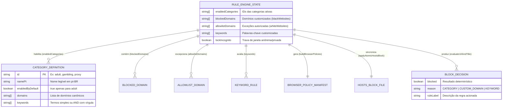

# Domínio de Bloqueio Web em 3 Camadas (`web_blocking`): Visão Geral (Overview)

---

## 1. Propósito e Contexto de Negócio

O domínio **`web_blocking`** constitui o motor central de fiscalização e interceptação de navegação web do `monBlock` (mapeado na sub-especificação `MOD-01` e regido pela `ADR-0002`). Seu propósito de negócio é impedir o acesso impulsivo a conteúdo adulto, casas de apostas (*bets*), jogos online, proxies de evasão e distrações digitais em qualquer navegador instalado no sistema operacional, superando as limitações de bloqueadores baseados apenas em extensões ou scripts *userland*.

Para eliminar pontos únicos de falha (como o uso do Mozilla Firefox ou DNS-over-HTTPS que derrotavam o aplicativo de referência Cisdem AppCrypt), este *Bounded Context* opera em **3 Camadas Complementares de Defesa em Profundidade**:
1. **Camada 1 — Resolução de Rede (`/etc/hosts` Atômico + Imutabilidade):** Redireciona domínios bloqueados (`0.0.0.0 <dominio>` e `0.0.0.0 www.<dominio>`) com escrita atômica via arquivo temporário `.monblock.tmp` + `fs.renameSync` e proteção contra edição manual (`chflags uchg` no macOS).
2. **Camada 2 — Políticas Corporativas de Navegadores (`BrowserPolicyEnforcer`):** Aplica manifestos gerenciados para motores Chromium (`URLBlocklist`, `URLAllowlist`, `DnsOverHttpsMode: 'off'`, `IncognitoModeAvailability`) e Firefox (`WebsiteFilter.Block`, `WebsiteFilter.Exceptions`, `DNSOverHTTPS.Locked: true`, `DisablePrivateBrowsing`).
3. **Camada 3 — Inspeção Ativa de Abas e Palavras-Chave (`RuleEngine` + Watcher Universal + Servidor Local `:49152`):** Avalia URLs higienizadas e títulos de janela contra as **11 categorias pré-cadastradas**, domínios customizados e palavras-chave simples ou combinadas (`AND` por vírgula), redirecionando abas infratoras para a página pedagógica local `http://127.0.0.1:49152/blocked`.

Os principais atores impactados são o **Usuário Protegido** (que possui autonomia para adicionar bloqueios em lote ou ativar categorias instantaneamente) e o **Ajudante (*Accountability Partner*)**, cuja autorização é exigida para qualquer redução de escopo ou inclusão de exceções na `allowlistDomains`.

---

## 2. Entidades Principais e Relacionamentos

### 2.1. `CategoryDefinition` (`src/domain/categories.ts`)
*   **Papel:** Representa cada uma das **11 categorias pré-cadastradas** no catálogo imutável `PREDEFINED_CATEGORIES` (`adult`, `gambling`, `games`, `proxy`, `dating`, `social`, `video`, `forums`, `shopping`, `news`, `search_unsafe`).
*   **Atributos de Destaque:**
    *   `id`: Identificador único em *snake_case* (`adult` vem habilitado por padrão com `enabledByDefault: true`).
    *   `namePt`: Rótulo de exibição na UI CCAT (ex.: `"Conteúdo Adulto & Pornografia"`, `"Apostas & Cassinos (Bets)"`).
    *   `domains`: Lista base de domínios representativos da categoria.
    *   `keywords`: Lista de palavras-chave simples ou combinadas por vírgula (`AND`).

### 2.2. `RuleEngineState` & `BlockDecision` (`src/domain/rule-engine.ts`)
*   **Papel:** Agregado que consolida o estado ativo das regras de bloqueio web e o Value Object resultante da inspeção de cada aba (`evaluateUrlAndTitle`).
*   **Atributos de Destaque:**
    *   `allowlistDomains`: Lista de domínios liberados pelo Ajudante com precedência máxima sobre categorias e blocklist (`RN-WEB-01`).
    *   `CRITICAL_INFRA_ALLOWLIST`: Conjunto estático imutável (`localhost`, `127.0.0.1`, `api.telegram.org`, `accounts.google.com`, `appleid.apple.com`, `login.microsoftonline.com`) que jamais pode ser bloqueado (proteção anti-lockout).
    *   `reason` e `ruleLabel`: Metadados retornados em `BlockDecision` para alimentar a tela local `:49152/blocked` sem expor query strings sensíveis.

---

## 3. Fluxo de Trabalho Geral (Workflow)

1. **Entrada / Mutação de Regras:** O usuário ativa uma das 11 categorias ou submete um lote de até 100 domínios (`validateBatchDomains`, `MAX_BATCH_DOMAINS = 100`).
2. **Higienização e Anti-Lockout:** `sanitizeAndNormalizeUrl()` remove credenciais, fragmentos, portas e query strings (protegendo tokens OAuth e PII), normaliza o hostname em minúsculas sem `www.` e descarta qualquer domínio presente na `CRITICAL_INFRA_ALLOWLIST`.
3. **Sincronização das Camadas 1 e 2:**
   * `applyAtomicHostsBlock()` preserva o backup `.monblock.bak`, injeta o bloco delimitado `# >>> MONBLOCK START >>> ... # <<< MONBLOCK END <<<` em arquivo temporário `.monblock.tmp` e executa `fs.renameSync` atômico.
   * `buildBrowserPolicies()` gera os objetos `chromiumPolicy` e `firefoxPolicy`, desativando DoH (`DnsOverHttpsMode: 'off'` e `DNSOverHTTPS.Locked: true`) e aplicando `IncognitoModeAvailability` / `DisablePrivateBrowsing`.
4. **Inspeção Contínua (Camada 3):** Quando o usuário navega em uma aba, o Watcher coleta `{ url, title }` e invoca `evaluateUrlAndTitle()`.
5. **Redirecionamento Pedagógico:** Se `BlockDecision.blocked === true`, a aba do navegador é redirecionada imediatamente para `http://127.0.0.1:49152/blocked`, onde o servidor local exibe o motivo (`ruleLabel`) e permite solicitar desbloqueio idempotente ao Ajudante (`POST /api/unblock-requests`).
